# 370Z ProECU RaceROM Supplement

> Source: [https://ecutek.atlassian.net/wiki/spaces/SUPPORT/pages/6881638](https://ecutek.atlassian.net/wiki/spaces/SUPPORT/pages/6881638)
> EcuTek Support Confluence, space SUPPORT, version 25 (2025-11-14), retrieved 2026-07-16. Images are in `images/` next to this file.

Table of contents

- [370Z ProECU Tuning Guide: RaceROM Supplement](#370z-proecu-tuning-guide-racerom-supplement)
- [Introduction](#introduction)
- [Recently Added Features and Improvements](#recently-added-features-and-improvements)
  - [RaceROM features currently available for the 370Z](#racerom-features-currently-available-for-the-370z)
    - [Additional Guides](#additional-guides)
  - [Map Switching Feature](#map-switching-feature)
    - [Map List](#map-list)
  - [Launch Control](#launch-control)
    - [Map List](#map-list-1)
  - [Special Features](#special-features)
  - [Boost Control](#boost-control)
  - [Flat Foot Shifting Feature](#flat-foot-shifting-feature)
    - [Map List](#map-list-2)
  - [Per Gear Rev Limits Feature](#per-gear-rev-limits-feature)
    - [Map List](#map-list-3)
  - [RaceROM Flex Fuel](#racerom-flex-fuel)
  - [CAN Inputs / Outputs Devices and Wiring](#can-inputs--outputs-devices-and-wiring)
  - [370 CAN Wiring](#370-can-wiring)
  - [370Z CAN Inputs Specifics](#370z-can-inputs-specifics)
  - [CAN Outputs](#can-outputs)
  - [Custom Sensor](#custom-sensor)
  - [Speed Density](#speed-density)
    - [Method of Operation](#method-of-operation-2)
    - [Removal of MAF sensor](#removal-of-maf-sensor)
    - [Using Speed Density and MAF sensor together](#using-speed-density-and-maf-sensor-together)
    - [Map List](#map-list-4)
    - [Speed Density Enable](#speed-density-enable)
    - [Speed Density Volumetric Efficiency](#speed-density-volumetric-efficiency)
    - [Speed Density VVEL Compensation](#speed-density-vvel-compensation)
    - [Speed Density AIT Compensation](#speed-density-ait-compensation)
    - [Speed Density Activation MAF](#speed-density-activation-maf)
    - [Speed Density Activation RPM](#speed-density-activation-rpm)
    - [Speed Density Activation MAP](#speed-density-activation-map)
  - [RaceROM Failsafe](#racerom-failsafe)
    - [Operation](#operation)
  - [RaceROM Sensor Scaling](#racerom-sensor-scaling)
    - [Wheel Speed](#wheel-speed)
    - [Manifold Absolute Pressure](#manifold-absolute-pressure)
    - [Mass Air Flow (MAF) Multiplier](#mass-air-flow-maf-multiplier)
  - [RaceROM Controller (RRC)](#racerom-controller-rrc)
    - [Map List](#map-list-5)
  - [Custom Maps](#custom-maps)
    - [Map List](#map-list-6)
  - [RaceROM Oil Temp Gauge](#racerom-oil-temp-gauge)
    - [Map List](#map-list-7)
  - [RaceROM Valet Mode](#racerom-valet-mode)
    - [Map List](#map-list-8)
    - [Valet Mode Torque Limiter and Valet Mode Speed Limiter](#valet-mode-torque-limiter-and-valet-mode-speed-limiter)
    - [Valet Mode Enable](#valet-mode-enable)
  - [Forced Induction Tuning – Speed Density](#forced-induction-tuning--speed-density)
    - [Fitting a MAP sensor with Charge Air Temp](#fitting-a-map-sensor-with-charge-air-temp)
  - [Custom Maps Example ROMs](#custom-maps-example-roms)
  - [Closed Loop Fuelling](#closed-loop-fuelling)
  - [Closed Loop Boost Control - Using Custom Maps](#closed-loop-boost-control---using-custom-maps)
  - [Gauge Hi-Jack](#gauge-hi-jack)
  - [Fail Safe - using custom maps](#fail-safe---using-custom-maps)
    - [Contact Us:](#contact-us)

# 370Z ProECU Tuning Guide: RaceROM Supplement

# Introduction

EcuTek RaceROM is a package of special software features that can be installed into the ECU of the supported vehicles. You simply open your ECU ROM file using EcuTek software, apply the RaceROM Feature File (Patch) to it, adjust the RaceROM maps as necessary, and then program the ROM file into the vehicle.   
  
Please read [How to: Add/Remove EcuTek Race Rom to your Vehicle.](https://ecutek.atlassian.net/wiki/spaces/SUPPORT/pages/327688/How+to+Add+Remove+EcuTek+Race+Rom+to+your+Vehicle.) Feature File Guide for info on how RaceROM works, how to install and uninstall RaceROM feature files, and further hints and tips.

**RaceROM** utilizes a different security for the tuner from read, write, copy by other EcuTek dealers competitors' products. This security feature also prevents the Nissan dealer tool from rewriting the ECU during service (therefore losing any performance tuned ROM that a customer has purchased from an EcuTek tuner.

# Recently Added Features and Improvements

- CAN Inputs (via VVEL bus)
- CAN Outputs (via VVEL bus)
- Flex fuel Ignition IAT comp map
- Custom map inputs and outputs added
- MS mode specific RR ignition enable
- RaceROM Fuel Trim per Cylinder
- New Custom map outputs
  - Ethanol content
  - Fuel enrichment for B1 / B2
  - Rad Fan duty
- New Custom map Inputs
  - CAN channels
  - Ethanol content
  - Brake pedal
  - Time since activation
  - Boost target
  - Boost Error
  - WG duty %
- Fixed minor bugs

## RaceROM features currently available for the 370Z

- RaceROM Custom Ignition Timing
- Map Switching
- Launch Control
- Flat Foot Shifting
- Per-gear Rev Limits
- RaceROM Gauge Hijack
- Speed Density
- Knock Warning
- RaceROM Custom Maps
- RaceROM Controller
- Valet Mode
- Custom Parameter Data Logging
- Hardcoded Boost Control
- Hardcoded Flex Fuel
- Hardcoded Failsafe Maps
- Hardcoded Custom Sensors
  - Preset tables allow you to easily set the source and operational values of added custom sensors
- 2D Map Sensor Scaling
- MAF Multiplier
- RaceROM Custom Map Improvements
  - Increased input and output options for greater control
- Sensor Hijack Improvements
- Space Reduction (allows you to fit more features onto smaller ROM files.

### Additional Guides

[RaceROM Custom Maps Tuning Guide](https://ecutek.atlassian.net/wiki/spaces/SUPPORT/pages/13598721/RaceROM+Custom+Maps+Tuning+Guide)

## Map Switching Feature

The Map Switching feature allows you to up to define four different calibrations in the ECU ROM. The driver can switch between the calibrations at the press of a button. This allows a tuner to provide a comfortable calibration for everyday road use and a hard-core maximum performance calibration for use at the track. Alternatively you could use this feature to provide four calibrations optimised for different grades of fuel.

Four separate maps have been provided for Fuel, Ignition Timing and Knock Control, one for each mode. You can also set different rev limits and injector sizes for each mode. The Launch Control and Flat Foot Shift features can be enabled on a per-mode basis.

To select a mode:

1. Ensure that the cruise control is OFF.
2. Hold the CANCEL button for 1 second.
3. The Rev Counter will move to indicate the current mode (eg. 2000rpm = mode 2).
4. Use the cruise up and down buttons to select the desired mode.
5. Press CANCEL to enable the selected mode.

### **Map List**

**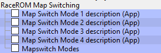**

> [!WARNING]
> **Map Switching and the 370Z Ignition System**
>
> The 370Z Ignition system is very complicated and difficult to tune due to the adjustments from the VVEL system. RaceROM implements a less complicated ignition strategy which still works with the factory knock control and dynamic advance.
>
> Instead of the standard Ignition MBT Adjustment and Ignition Mode B maps, each of the four Map Switch modes has a single high resolution Ignition Advance map with real Ignition Advance values for easier understanding and more simplistic tuning.

#### Drive Mode Integration

Some vehicles have a "Drive Mode" switch allowing the driver to select different throttle responses for "Normal, Eco, Sport and Snow". This can be used to control Map Switching by selecting the "Drive Mode Integration" option as shown below.

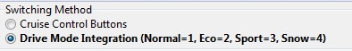

## Launch Control

The adjustable Launch Control feature allows you to adjust the launch control RPM live. This can be used to provide a higher or lower power/torque output during launch to suit the driver's requirements. Due to vehicle limitations, this feature can only be implemented on vehicles equipped with SyncroRev.

#### Method of Operation

1. Ensure the 'Launch Control Enable' checkbox is ON for the current Map Switch Mode
2. Engine must be running and Vehicle must be stationary
3. Press clutch pedal and move the gear stick to 1st position
4. Quickly press the accelerator all the way to the floor
5. Adjust launch RPM using the cruise control stalk
6. Release the clutch to commence launch

When Launch Control is active, the rev limit will be set to the 'Launch Control Rev Limit'. This limit defaults to the 'Launch Control Rev Limit Base" value and can be adjusted up and down using the cruise control stalk. Select "Res/Acc" to increase the launch RPM and "Set/Cst" to decrease it. An alternative method of adjustment is available for vehicles without cruise control. Note: Launch Control is not available on vehicles fitted with Automatic Transmissions.

During the launch, the rev limit increases according to the 'Launch Control Rev Limit Delta, This 2D map, indexed by elapsed time, has multiple columns to allow you to set up a multi-stage system for best results.

There are minimum and maximum coolant temperature limits. Launch control will only operate when the temperature is between these limits.

Adjustments are provided that allow you to enrich the AFR and retard the timing when the vehicle is stationary in order to create pops and bangs. This adjustment is removed as soon as the vehicle starts to move.

The Launch Control feature is **deactivated** when one of the following conditions occurs:

- The vehicle speed exceeds the last column on the 'Launch Control Rev Limit Delta Map'
- The driver lifts off the accelerator
- The driver performs a flatfoot shift

#### Integration with Map Switching Feature

The Launch Control Feature can be enabled in any of the four calibration modes by selecting the appropriate checkboxes in the

"Enable Special Features" map.

### **Map List**

**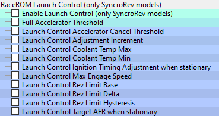**

## Special Features

You can now enable RaceROM ignition timing in individual map switch modes allowing true stock Running in select modes

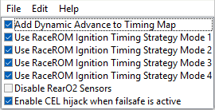

a RaceROM map for fuel correction per cylinder has also been added to give better tunability of banks and cylinders

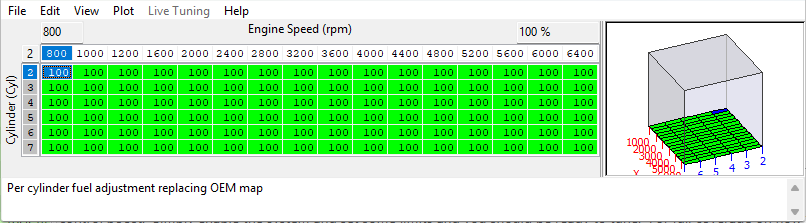

## Boost Control

With fully featured hard-coded boost control you no longer need to set up an array of complex custom maps to control boost. Simply enable the system and set some limits and you should be ready to tune. For full coverage on how the system works check out our guide here: [/wiki/spaces/SUPPORT/pages/443678725](https://ecutek.atlassian.net/wiki/spaces/SUPPORT/pages/443678725/RaceROM+Boost+Control)

Boost control can now be directly output to the can output function instead of the CPC hijack

## Flat Foot Shifting Feature

The Flat Foot Shifting feature allows the driver to up-shift without lifting their foot from the accelerator pedal. At the moment when the Flat Foot Shifting feature activates, a temporary rev limit is set that is slightly higher than the current RPM. The ignition timing is retarded by a specified amount that reduces engine torque while preventing the RPM from rising too rapidly. When the driver completes the gear change, the temporary rev limit and timing adjustment are removed.

#### Method of Operation

The Flat Foot Shifting Feature (FFS) is activated when all of the following conditions are met:

1. 'The Flat Foot Shift Enable' checkbox is ON for the current Map Switch Mode
2. The vehicle is travelling faster than the 'Flat Foot Shift Minimum Speed'
3. The accelerator amount is greater than the value in the 'Full Accelerator Threshold Map' - The driver is pressing the Clutch pedal

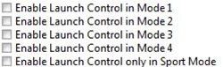

The Flat Foot Shifting Feature is cancelled when one of the following conditions occurs:

- The driver releases the Clutch pedal
- The driver lifts off the accelerator
- The vehicle speed falls below the value in the 'Flat Foot Shift Minimum Speed Map'

An AFR adjustment is provided that allows you to enrich the mixture during the shift. The richer AFR cannot be measured from the exhaust gas due to the operation of the rev limiter.

A deactivation delay can be configured to prolong the feature after the clutch-switch has disengaged. This may be required for smooth operation if the switch point and the bite point of the clutch are substantially different.

#### Integration with Map Switching Feature

The Flat Foot Shift Feature can be enabled each of the four modes by selecting the appropriate checkboxes in the "Enable Special Features" map.

### **Map List**

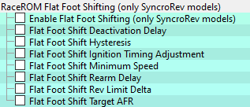

> [!WARNING]
> Flat Foot Shifting is not available on automatic transmission vehicles

## Per Gear Rev Limits Feature

The Per Gear Rev Limits feature allows you to define different rev limits for each gear. By setting a higher rev limit in lower gears you may be able to reduce the number of gearshifts required in attaining a given speed. E.g. 0-60mph (0-100km/h) tests.

A separate per-gear rev limit map is provided for each map switch mode. Enter the fuel cut RPM in the first column and the fuel resume rpm in the second column

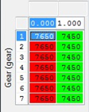

### **Map List**

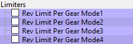

## RaceROM Flex Fuel

FlexFuel support was added as an integral part of the Phase 4 RaceROM upgrade. It uses a strategy of ignition and AFR target modifier maps for 100% E85 and 2d maps to determine how much of that modification is applied. The difference in base fuel requirement is taken care by the **FlexFuel Quantity Multiplier** map and a 2d blend map. Typically, 40% extra fuel will be required for 100% E85 to maintain the same Lambda (therefore the same reported petrol AFR), and the transition will be quite linear. The change in ignition advance will probably more readily be applied with most, if not all of the additional advance added by 50% E85. For 100% E85 there is a second boost target defined by **FlexFuel Boost Target by Gear** and a corresponding blend map to set how the boost target is determined from the two maps.

Currently the patch is supplied with typical values used in the **FlexFuel Quantity Multiplier** map so that any car with a FlexFuel sensor added should start and run reasonably well when E85 fuel is added. Remaining correction maps for ignition and AFR target are blank, and the **FlexFuel Target Boost** map has default values identical to those found in the **Target Boost** map.

For more information on how this system works, check out our RaceROM Guide [RaceROM Flex Fuel](https://ecutek.atlassian.net/wiki/spaces/SUPPORT/pages/14123023/RaceROM+Flex+Fuel)

The basic flow chart for the flex fuel feature is below.

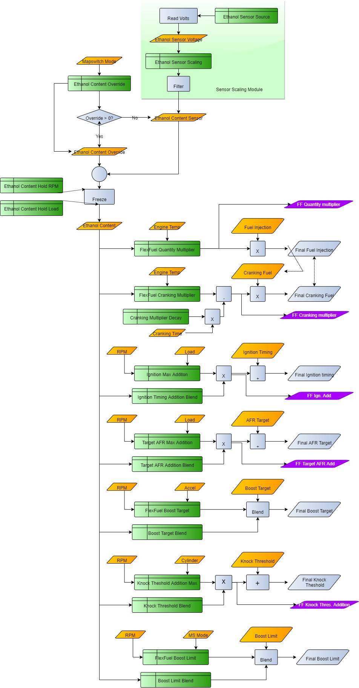

there Flex fuel Ignition timing IAT comp map is also available to allow a different amount of correction for various ethanol content amounts, it uses the ignition blend map to determine the final value of AIT correction with ethanol.

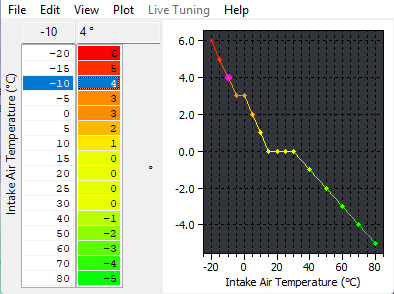

**Map List**

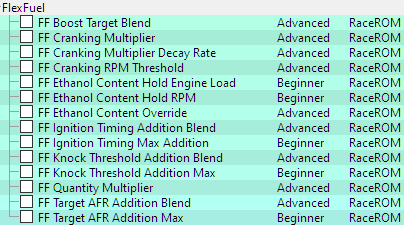

**Monitors**

- **FlexFuel Cranking Multiplier** – Injector opening time multiplier only used during cranking
- **FlexFuel Ethanol Content** – Filtered and conditioned Ethanol content % used in all FF calculations
- **FlexFuel Ethanol Sensor Output** – The output directly from the ethanol content sensor
- **FlexFuel Ignition Advance** – Additional ignition advance after all FF compensations
- **FlexFuel Quantity Multiplier** – Current fuel multiplier based on ethanol content and engine temp
- **FlexFuel AFR Adjustment** – Offset to normal target AFR by FlexFuel Strategy
- **FlexFuel knock addition** – offset to knock threshold values

## CAN Inputs / Outputs Devices and Wiring

There is information on setup requirements for RaceROM can inputs and outputs here

[RaceROM CAN Sensor Input / Output](https://ecutek.atlassian.net/wiki/x/OAB8Gg)

370Z has enough spare mailboxes to use an independent channel of 8 byte messages for inputs and a second independent channels for outputs. this should allow separate input and output channels i.e. 1 device that does input and output combined or 2 devices one input and 1 output. Any CAN equipped module that has defined outputs should be able to be used. some devices such as

- Motiv Reflex ([ReFlex+ Control Unit - Nissan](https://www.motivmotorsport.com/products/reflex-control-unit-nissan?_pos=1&_sid=d4acb0c63&_ss=r) )
- Total Racing Products CAN bus flex kits ( [CAN bus version](https://totalracingproducts.com/product/total-racing-products-flex-fuel-kit-can-bus-version-electronics-only-r35-gtr/) )
- Syvecs OEX / tiny Dash ([Syvecs TinyDash V2 - TouchScreen](https://www.syvecs.com/product/syvecs-tinydash-v2-touchscreen/) [Syvecs OEX | (Oem Ecu eXpander)](https://www.syvecs.com/product/syvecs-oex/) )
- AMS CAN bus flex fuel kit [AMS Performance INFINITI Q50/Q60 CAN Bus Flex Fuel Kit - AMS Performance](https://www.amsperformance.com/product/ams-performance-infiniti-q50-q60-can-bus-flex-fuel-kit/?srsltid=AfmBOooQ7cUXvf_p3y0uofHy0lF-GB630anm173bJkvgitZNB98kLnSS)
- MaxxECU mini / PWM driver ([MaxxECU MINI](https://www.maxxecu.com/products/mini) [MaxxECU PWM module (kit)](https://www.maxxecu.com/products/accessories/maxxecu_can_pwmmodule) )
- Visconti CANbox Pro ([Visconti Tuning](https://www.viscontituning.com/) )

## 370 CAN Wiring

The 370z main can bus is fully populated (Unlike the GTR / VR30) so the VVEL CAN bus needs to be used Wiring looms and breaking points for the 370z/G37 are made by some aftermarket suppliers, to wire the device in it can be done anywhere on the VVEL bus, this may include such points as

- at the VVEL pins,
- the two connectors (F5 or E10)
- or at the ECU pins or header

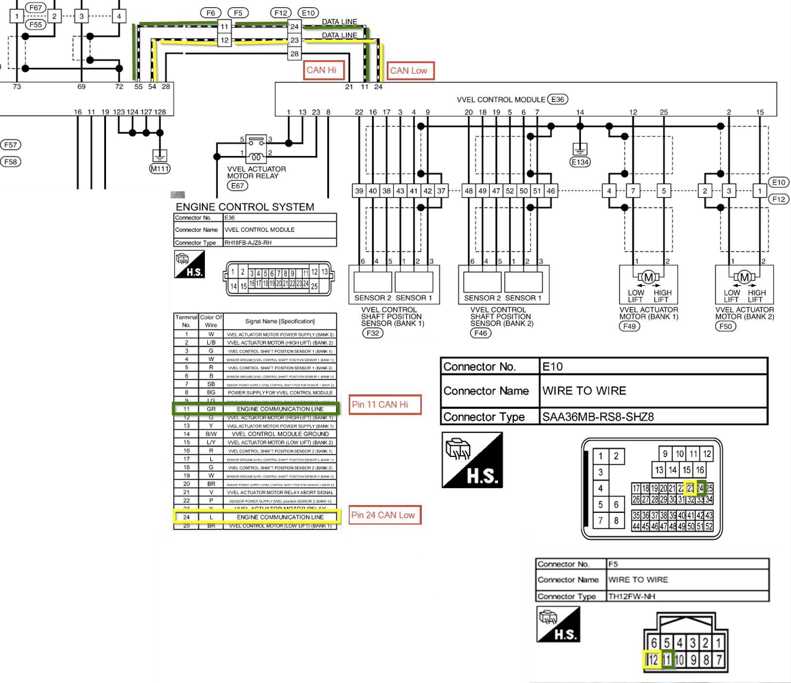

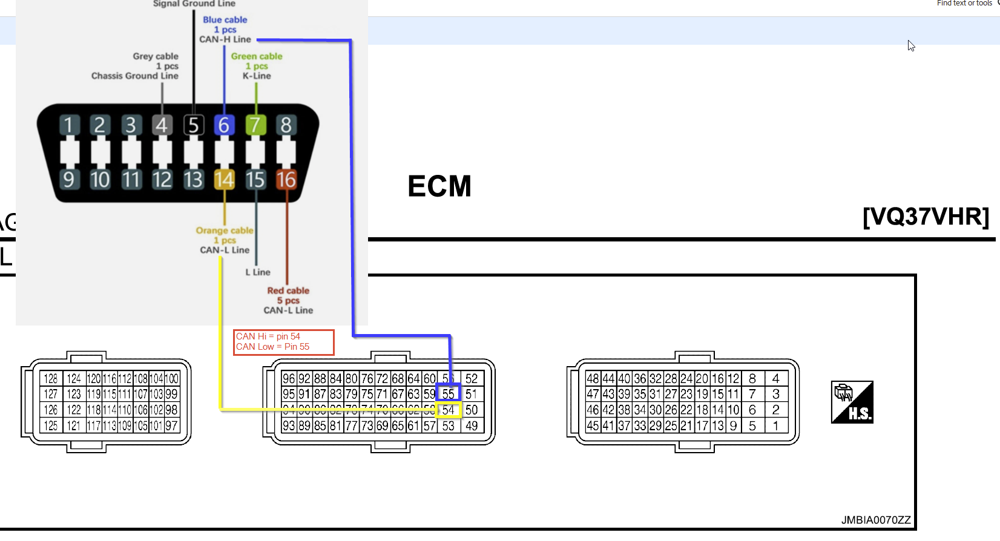

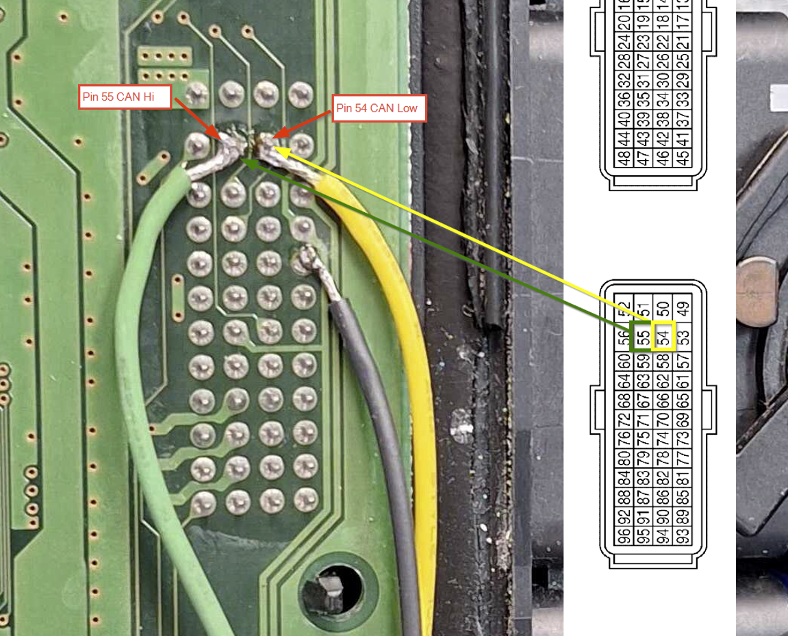

## 370Z CAN Inputs Specifics

1. Configure a CAN Sensor Type to the sensor type in use, there are two CAN IDs available and you can select one of the Pre-set sensor types or a custom device. 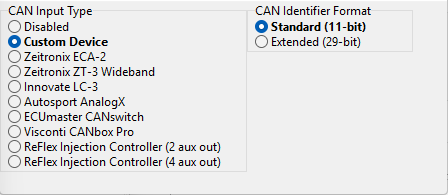
2. You need to select the closest Expected Channel Frequency to the CAN devices send rate (which should be available from the kit manufacturer).
3. If using the standard CAN address you won't need to do any further configuration. If using a non-standard (User configured on the unit) CAN ID you'll need to change the values found under "CAN ID for ___" and add it in Hex format. 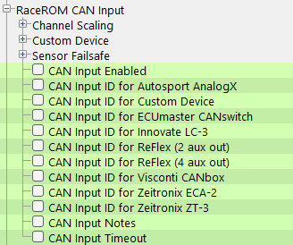
4. You will then need to set the sensor you are using up as an input. this is done by choosing the sensor and setting it as a CAN Input, If you are choosing a 0-5V input it may be used instead Sensors -> Flex Fuel Sensor Source as CAN input 
5. For Information on Custom CAN Sensors or other Preselected Units please see the RaceROM CAN Sensor Manual
  1. [RaceROM CAN Sensor Input / Output](https://ecutek.atlassian.net/wiki/spaces/SUPPORT/pages/444334136)
6. If you are using 2 sensors at once, e.g. Ethanol Content and Fuel pressure you will have to manually set up a custom CAN device as per the link above. and then assign the CAN sensor output to a Channel Usage. 

## CAN Outputs

RaceROM now offers output of Custom maps or Boost control via CAN outputs, There are some Prefab selections or you can set up custom devices. Due to the reduced amount of ROM space in 370Z ROM preselected options are limited.

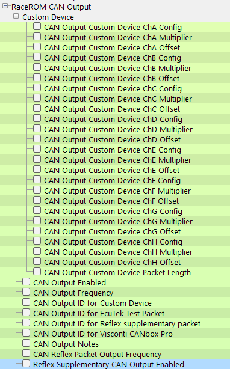

To set up a custom device, enable can outputs and select the identifier format

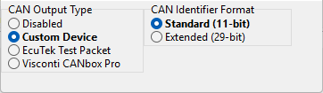

and assign an output ID and output frequency to match the CAN box you are using in the CAN Output ID maps

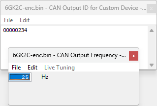

a packet length may be required for certain devices

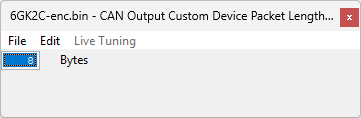

Configure the desired channels, with the data type, the start position, scaling and parameter you wish to output,

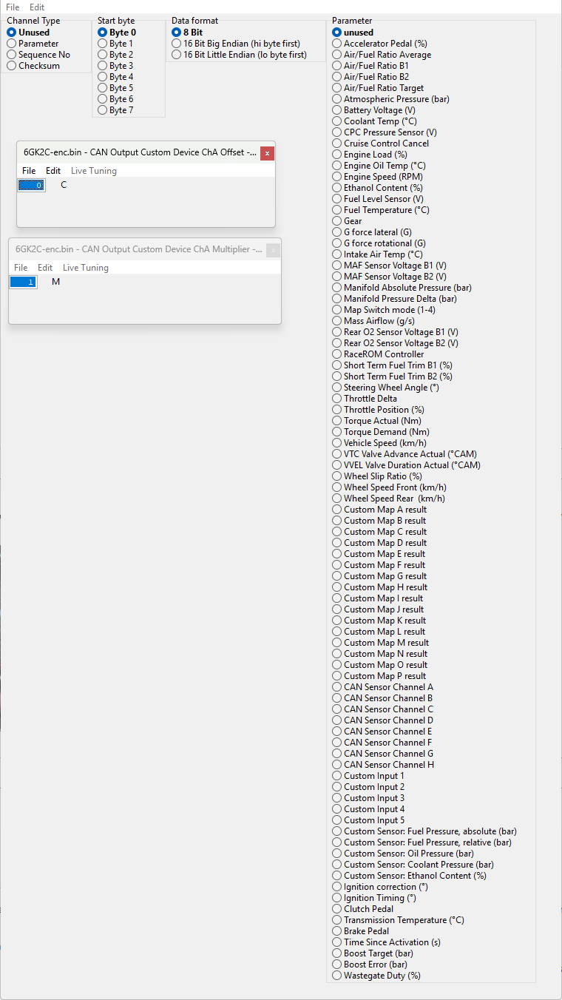

Once this is configured you can add notes. If using a reflex box enable the Reflex supplementary CAN output option. this send extra data required for the reflex box to operate.

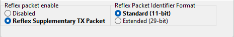

to enable WG duty parameters the Boost control Enable checkbox must be checked as well

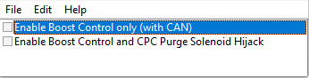

## Custom Sensor

RaceROM now offers the ability to add custom sensor inputs hard coded in the RaceROM files. This means no more time-intensive work to make custom maps to re-write the way your ECU utilises an input. For information on these input/outputs and how to set them out, check out our guide [370z Sensor Input / Output Hijack](https://ecutek.atlassian.net/wiki/spaces/SUPPORT/pages/60031081/370z+Sensor+Input+Output+Hijack)

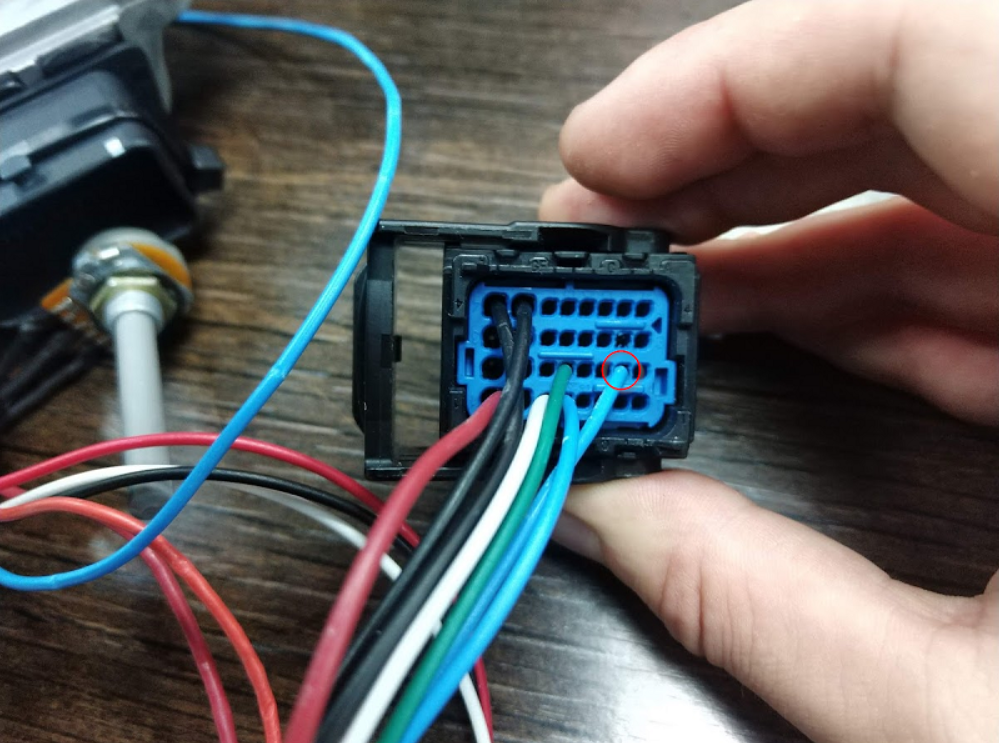

## Speed Density

Create tuning based on the Manifold Pressure Sensor, this is ideal for forced induction models.

### Method of Operation

The Speed Density feature changes the way that Mass Airflow is calculated. When SD mode is activated, the ECU will disregard the MAF sensor reading and calculate Mass Airflow based on Engine Speed, Manifold Pressure and Air Temperature instead.

The Speed Density feature is enabled by selecting the **Enable Speed Density** checkbox in the **Speed Density Enable** section. Speed Density can be selected for each of the four map switch modes. When this feature is active, the ECU will ignore the reading from the Mass Airflow sensors and will calculate Mass Airflow as follows:

A value is read from the 3D **Speed Density Volumetric Efficiency** maps, indexed by RPM and Manifold Absolute Pressure. This value is then combined with charge temperature, manifold pressure and engine speed to calculate the Mass Airflow.

In the default configuration, we assume a fixed charge temperature of 20°C then adjust the final result according to Air Intake Temperature using the Speed Density AIT Compensation map. However, RaceROM also supports measuring Charge Air Temperature directly using the AIT sensor or Fuel Temperature Sensor inputs.

The **Speed Density VVEL compensation** map provides SD-VE adjustment for a given VVEL angle ensuring the correct load for any given set of conditions.

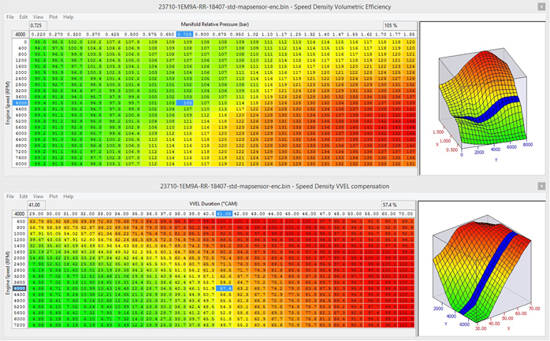

### Removal of MAF sensor

As the 370z uses VVEL to control cylinder fill at light load in certain conditions, this means that for the same RPM and power output the MAP can be very different which makes SD based calibration impossible **but** the SD VVEL compensation map shown above solves this problem enabling the 370z to run full time SD if required.

### Using Speed Density and MAF sensor together

The hybrid Speed Density feature can also be useful in applications where the MAF sensors are present, by configuring the **Speed Density activation** maps. In this scenario, the ECU can be programmed to use the MAF sensors at lower Mass Airflow values and switch to Speed Density for the higher values.

You can specify threshold values of MAF, RPM and MAP that are required for Speed Density activation. **The ECU will activate the Speed Density feature only when all three of these values are above their respective thresholds.**

The threshold values are implemented using hysteresis. The 1st value (top value) should be higher than the 2nd value (lower value). The feature will activate when the parameter rises above the 1st value, and will deactivate when it falls below the 2nd value.

You can also use the Speed Density feature in applications where the amount of airflow is lower than the MAF sensor can accurately measure. In this situation, enable the **Speed Density - Activate BELOW thresholds instead of ABOVE** checkbox. The ECU will activate the Speed Density feature when MAF, RPM and MAP are all **below** their respective thresholds.

The default value for the thresholds is zero. If you use the **Speed Density - Activate BELOW thresholds instead of ABOVE** checkbox, then the feature will only be activated when all three parameters are below their respective thresholds. Therefore you need to set a high value into any thresholds that you are not using, otherwise the feature will not activate.

### **Map List**

**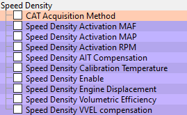**

### **Speed Density Enable**

This map contains the checkbox to enable the Speed Density feature.

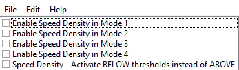

### **Speed Density Volumetric Efficiency**

This 3D map specifies volumetric efficiency based on RPM and Manifold Absolute Pressure.

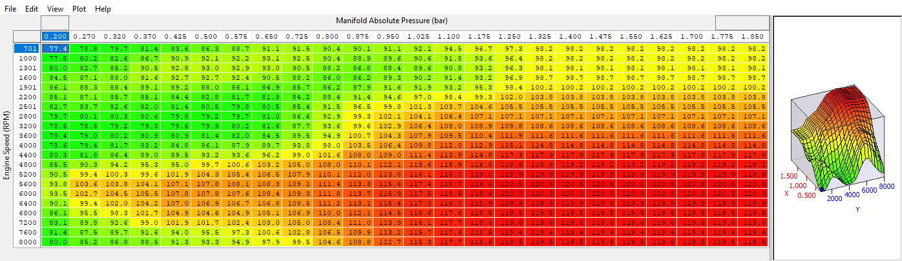

### **Speed Density VVEL Compensation**

This 3D map corrects the SD calculation for a given VVEL angle.

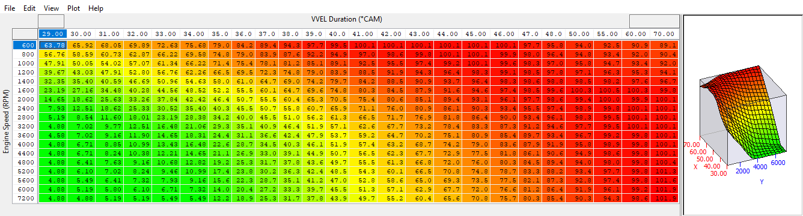

### **Speed Density AIT Compensation**

This 2D map specifies a multiplication factor that is applied to the calculated Mass Airflow.

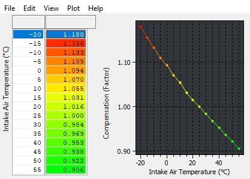

### **Speed Density Activation MAF**

This 1D map specifies that Speed Density mode should only be used above the given Mass Airflow reading. The ECU will switch from MAF sensors to Speed Density when the Mass Airflow rises above the first value. It will switch back to MAF sensors when the (actual) Mass Airflow falls below the second value. This map works in combination with the Activation RPM and MAP maps. Note that each bank is treated independently therefore one bank may switch from MAF to SD mode before the other.

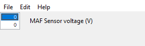

### **Speed Density Activation RPM**

This 1D map specifies that Speed Density mode should only be used above the given RPM. The ECU will switch from MAF sensors to Speed Density when the RPM rises above the first value. It will switch back to MAF sensors when the RPM falls below the second value. This map works in combination with the Activation MAF and MAP maps.

### **Speed Density Activation MAP**

This 1D map specifies that Speed Density mode should only be used above the given Manifold Pressure. The ECU will switch from MAF sensors to Speed Density when the MAP rises above the first value. It will switch back to MAF sensors when the MAP falls below the second value. This map works in combination with the Activation MAF and RPM maps.

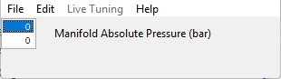

---

## RaceROM Failsafe

Adding an element of safety to tuning, a range of thresholds for important engine variables that if not in a desired range will trigger a torque limit to cut power. To clear the limp mode torque limit, the ignition will be turned off for a few seconds and then the engine restarted.

### Operation

In each case a safe threshold (high or low) and a timeout is defined. Once the *Engine Load* is greater than **Failsafe Min Load** and the *Engine Speed* is greater than **Failsafe Min RPM** the various thresholds are compared for each of the channels, if the measured value crosses the threshold for time greater than the timeout, then a failsafe condition will be set for that channel.

The torque limiting action is performed when *G Force Lateral* falls below the **Failsafe Max LatG** threshold. The lateral G lockout means a tuner has the option of not allowing a sudden loss of power when cornering hard.

The failsafe strategy is outlined in the diagram below.

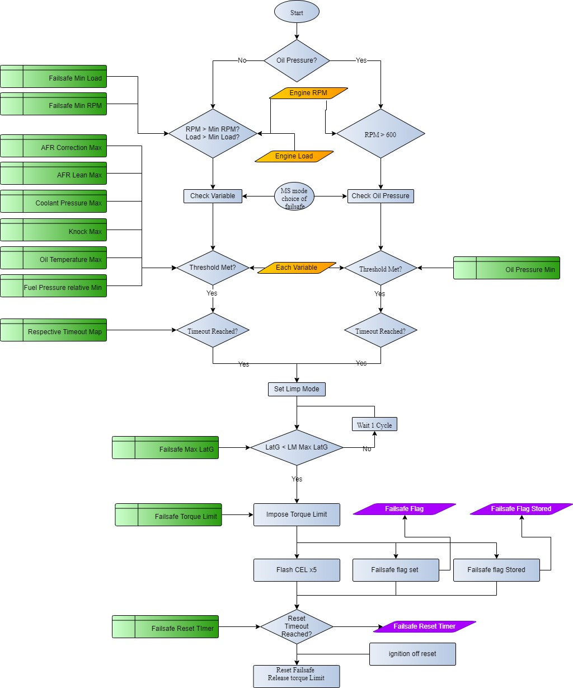

#### Failsafe Flag Decoding

The failsafe flags show a single integer value that corresponds to the reason the vehicle went into limp mode. Those values are as shown below.

|   |   |
| --- | --- |
| 1 | Knock Retard |
| 2 | Low Oil Pressure |
| 4 | High Oil Temperature |
| 8 | High Short Term Fuel Trim |
| 16 | Low Relative Fuel Pressure |
| 32 | Lean AFR |
| 64 | High Coolant Pressure |
| 128 | Custom Maps Limp Mode Flag |

Note: The logged values are displayed as a sum e.g. 3 = 1 + 2 = Knock Retard Active & Low Oil Pressure Active

#### Failsafe Reset

Sets the amount of time required for the failsafe time to clear a limp mode condition after a flag is tripped.

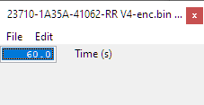

#### AFR Correction Max

This sets the maximum allowable *Fuel Trim Short Term Bank #1/#2* values, that if reached for **AFR Correction Timeout** while over the **LM Min Load** and **LM Min RPM** will trigger the limp mode limit. Note the default value for this is less than the maximum possible fuel trim of 120% so if enabled, poor tuning or inadequate hardware will be quickly found.

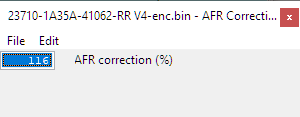

#### AFR Correction Timeout

*Fuel Trim Short Term Bank #1/#2* will need to exceed the **AFR Correction Max** thresholds for longer than this delay for the limp mode torque limit to be applied.

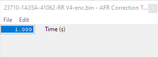

#### AFR Lean Max

This sets the maximum allowable *AFR Bank1/2* values, that if reached for **AFR Lean Timeout** while over the **LM Min Load** and **LM Min RPM** will trigger the limp mode limit. After ignition-on, *AFR Bank1/2* is monitored and ignored until both sensors are observed outside of the range 14.6 to 14.8 to mitigate AFR limp mode trips on sensor warmup.

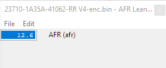

#### AFR Lean Timeout

Delay timer in seconds for the **AFR Lean** Max safety trip.

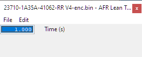

#### Coolant Pressure Max

High coolant pressure can be encountered on high power maximum effort engines as an early sign of head gasket failure due to combustion gases compromising the gasket seal. This limp mode trigger allows an additional sensor configured using coolant pressure options to be used to trigger the torque limit, typically a 0-10bar sensor similar to those used for fuel pressure measurement plumbed into the top radiator hose is suitable. Due to the losses around the coolant system the pressure will vary greatly at different locations, you should first familiarise yourself with normal pressure levels before relying on this.

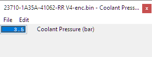

#### Coolant Pressure Timeout

Delay timer in seconds for the **Coolant Pressure** Max safety trip, this is set to 0 Seconds by default to ensure immediate drop in pressure if dangerously high coolant pressure is encountered.

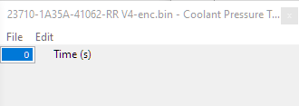

#### Failsafe Enable (mode 1 to 4)

Check the boxes enable the failsafe for each Map switch mode.

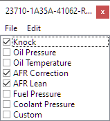

#### Failsafe Max LatG

The Failsafe torque limit will not be imposed until the lateral G has dropped below this absolute threshold. However even while the Lateral G exceeds this limit, the all limp mode tests will continue and if triggered will latch on, only the torque limit itself will be delayed. The default value of 1 will impose the torque limit once the lateral G is within the range of -1 to +1.

Requires TCM RaceROM to receive Lateral G data.

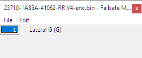

#### Failsafe Min Load

All the tests will only be carried out while engine load is greater than this value.

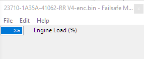

#### Failsafe Min RPM

All tests will only be carried out while the engine RPM is greater than this value.

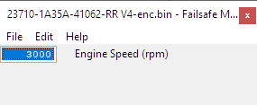

#### Failsafe Torque Limit

Once a failsafe trip has been triggered and the ECU puts the car into limp mode a torque limit will be applied using this value.

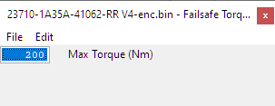

#### Fuel Pressure Relative Min

As detailed in the section on fueling, relative fuel pressure should be consistent with boost, so a single value can be used to determine if the fuel pump is coping with the current demand.If you are adding a fuel pressure sensor for the first time you may find that this threshold causes the limp mode to be set, but ignorance is not bliss!

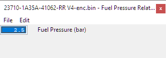

#### Fuel Pressure Relative Timeout

Delay timer in seconds for the **Fuel Pressure Relative** Min safety trip, this is set to 1 Seconds by default to ensure a pulsations don't trigger the failsafe inadvertently but sustained pressure drops triger the failsafe.

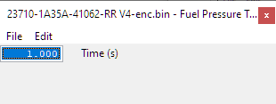

#### Knock Maximum

A threshold of the maximum level of knock retard that is permitted before limp mode is triggered. The values in the map equate to retard, so a limit of 5 will be triggered when *Knock Correction* reaches -5 degrees.

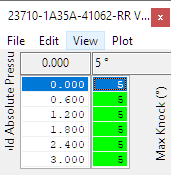

#### Knock Timeout

Delay threshold for **Knock Maximum** limp mode, the knock retard will have to exceed the maximum for at least this time to trigger a failsafe condition.

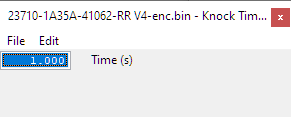

#### Oil Pressure Minimum

The 370Z does not have an oil pressure sensor as standard. To add an input for oil pressure, sensors must be set up in the custom sensors section. To trip the oil pressure limp mode, the measured pressure needs to drop below **Oil Pressure Minimum** for at least **Oil Pressure Timeout**.

**LM Min Load** and **LM Min Load** are ignored when testing oil pressure for limp mode purposes, instead the engine RPM must be above 600RPM to avoid triggering the limp mode when the engine isn't running or on start-up.

#### Oil Pressure Timeout

Delay threshold for **Oil Pressure Minimum** limp mode, the oil pressure will have to drop below the minimum for at least this time to trigger a failsafe condition.

#### Oil Temp Max

A maximum safe oil temperature above which limp mode will be entered. Primarily useful for cars used on circuit or in situations with sustained high power.

#### Oil Temperature Timeout

*Oil Temperature* will need to exceed **Oil Temp Max** for this time for limp mode to be triggered. Given the slow rate at which oil temperate changes, this can be extended to ignore brief peaks that might be encountered.

**Map List**

**Monitor List**

- **Failsafe Flags** – A single integer value that shows the reason limp mode was initially triggered
- **Failsafe Stored Flag** – An integer value that has been stored in Memory and cleared by reprogramming
- **Failsafe Reset Timer** – Timer since failsafe function last checked the channel was active and channel was not outside the threshold

---

## RaceROM Sensor Scaling

While some OEM tables are available for adjusting the sensor parameters in order to run different sensors, we noticed a few shortcomings in the factory tables and decided to rectify those issues with some custom code.

### Wheel Speed

Adjusts the tire size which will have an impact on wheel slip calculations used in custom maps.

### Manifold Absolute Pressure

The new table allows for sensors with negative offset to be used. This table is always used when active so any changes away from stock will need to be done with this map. Set the values to match the sensor scaling you are using. Keep in mind that you may need to extrapolate the voltage values for larger sensors as it won't read below the minimum voltage in the first column of the map.  
  

### Mass Air Flow (MAF) Multiplier

**MAF Multiplier (RaceROM)** can be used to multiply the measured airflow in line with the relative change in the MAF cross sectional area. All calculations are carried out using high precision numbers and there is no loss of accuracy as a result. Typically, a 70mm MAF housing will work well with this set to 1.33, for 76mm or other MAF multiplier value calculations you can use the factor of the square of the diameters. for example (stock MAF for 370Z = 60.5mm)

MAF Multiplier = new MAF diameter ^2 / old MAF Diameter ^2 = 76^2 / 60.5^2 = 1.57

Do not adjust the stock value in **MAF Sensor Scaling (% to g/s) for Load** when using this, otherwise the load will be adjusted twice.

In previous versions of RaceROM larger MAF housings could be catered for by changing the OEM conversion from MAF load to airflow. However, it was found that at some stages of the airflow calculation, the scaling of large MAF housings caused some internal low precision variables to max out, and irregularities to occur in the load and airflow.

---

## RaceROM Controller (RRC)

RaceROM Controller is a driver-adjustable input to the Custom Maps system. The driver can select a value using the cruise control buttons and it is displayed on the Oil Temp gauge. The tuner can create a custom map to adjust any of the engine parameters based on the driver's input. This could be used on a forced induction car, for example, to select a desired level of boost. It can also be used by the tuner to provide a certain amount of live tunability.

The RaceROM Controller is a driver-adjustable input to the Custom Maps system. To use, create a custom map with RaceROM Controller as one of its inputs (see custom maps manual), enable RaceROM Controller in the appropriate map, then flash the file into the car. With those items complete, it's time to test your custom map and ensure that it works as envisaged.

#### Driver Operation

- Ensure that the Cruise control is OFF.
- Press Cruise up or down.
- The current value of the RaceROM controller parameter will be displayed on the Oil Temp Gauge.
- Press up or down to alter the value.
- After a few seconds the gauge will return to normal operation

The Default values, Min and Max can be configured as desired, see the bellow screen shot.

The map below will **add** and **subtract** valve angle to the VTC using RRC whilst the engine is running.

The X axis of the map below shows the temperature (°C) displayed on the Oil Temp Gauge (OTG) when RaceROM controller is activated, the initial default value is 110 so the OTG will show 110 though this default can be changed as shown in the map above. The value in the map is a compensation that can be applied depending on the value that the driver has selected with the RaceROM controller. In this example the output of the map will be **added** to the current VTC angle. So when the RRC is set to 120 (the OTG shows 120) then the VTC has been increased (advanced) by +10 deg C. RRC can be configured to adjust VVEL as well as many other output functions as shown in the Custom Map Output Definition map. The following log file screen shots shows the VTC and the VVEL being adjusted live using the RRC. The left hand screen shot shows the VTC being adjusted live, as the RRC is adjusted up to 140 (140 shown on OTG) the VTC has advanced to 56 Degrees. The right hand screen shot shows the VVEL being adjusted live, as the RRC is adjusted up to 130 (130 shown on OTG) the VVEL has advanced to 47 Degrees.

See in both examples how the Manifold Pressure, Mass Air Flow and Fuel Trim Short Term are affected by the VTC and VVEL, the RRC can be used adjust the VTC and VVEL live to produce the optimum angle, lift and duration. In addition the Custom maps Rear 02 import feature allows a 2 x 0-5volt potentiometers to be imported and these in turn can be used to adjust both VTC and VVEL giving ultimate adjustability and control. See the EcuTek YouTube video showing Cosworth using this feature on a Toyota GT86 on EcuTek's dyno, Cosworth adjusted the Inlet and Exhaust cams to produce the optimum angle and they also adjusted the Direct Injection Firing Angle to produce the best power. [https://www.youtube.com/watch?v=bB3PDkSqNo0](https://www.youtube.com/watch?v=bB3PDkSqNo0). In addition the VTC, or VVEL, Fuel Trims or AFR/Lambda values can be shown on the Oil Temp Gauge, see the Custom Maps manual for Gauge Hi-jack for further suggestions.

### **Map List**

## Custom Maps

EcuTek RaceROM Custom Maps is an advanced feature for expert tuners only. It provides the tuner with the ability to modify the control algorithms within the ECU. The tuner can take advantage of this in order to develop their own features that few other tuner can provide. It can also be used to develop one-off fixes to overcome specific problems encountered while tuning a highly modified vehicle.

The following special features are only possible because of Custom Maps. For a more in-depth look at how RaceROM custom maps work, check out our guide [RaceROM Custom Maps Tuning Guide](https://ecutek.atlassian.net/wiki/spaces/SUPPORT/pages/13598721/RaceROM+Custom+Maps+Tuning+Guide)

|   |   |
| --- | --- |
| **Map Switching** | *Rev counter indication of the four different map switch modes* |
| **Launch Control** | *Adjustable Launch RPM using the cruise control* |
| **Flat Foot Shift** | *Full throttle gear changes* |
| **Speed Density** | *MAP sensor based tuning* |
| **RaceROM Controller** | *Use the cruise control switch gear for adjust calibration* |
| **Knock Warning** | *Check engine light flashes when knocking is detected* |
| **Per Gear Rev Limit** | *A different rev limit in each gear* |
| **Custom Maps** | *Create a map to do almost anything!* |
| **Traction Control** | *Adjustable traction control using custom maps* |
| **AFR Control** | *Closed loop target AFR control using custom maps* |
| **Gauge Hi-Jack** | *Display lambda or fuel trims on the oil temp gauge* |

### **Map List**

****

## RaceROM Oil Temp Gauge

#### Method of Operation

By default, the Oil Temp Gauge displays oil temperature, but it can be configured to display the result of a custom map. A multiplier and offset are provided in case you need to scale the value to fit the range of the display. It is important to select the correct type of gauge, Celcius or Fahrenheit that is fitted to the vehicle.

### **Map List**

****

## RaceROM Valet Mode

The RaceROM Valet Mode feature allows the customer to select a special mode that will reduce engine power output via a unique key code entry process. This engine torque reduction feature is configured against vehicle speed, torque and distance. This feature can be used during vehicle servicing, valet parking or when the vehicle is driven by family members or loyal trusted friends etc.

#### Configuration

Valet mode is operated using the cruise control switches in the same way as map switching. Instead of selecting map switch mode 1,2,3 or 4, select mode 7. The map switch mode does not change.

**To turn on the Valet mode**

- Ensure that the cruise control is OFF.
- Hold the CANCEL button for 1 second.
- The Rev Counter will move to indicate the current mode.
- Use the cruise up until the tachometer shows 7000rpm.
- Press CANCEL to enable the valet mode.

**To turn off the Valet mode**

- Ensure that the cruise control is OFF.
- Hold the CANCEL button for 1 second.
- The Rev Counter will move to indicate the current mode.
- Use the cruise up until the tachometer shows one of your other drive modes.
- Press CANCEL to disable the valet mode.

### **Map List**

****

### **Valet Mode Torque Limiter** and **Valet Mode Speed Limiter**

Using these maps you can control how fast the car can accelerate, the maximum speed it can achieve, and the distance it can travel. Distance Travelled axis is measured from when the valet mode is turned on and is subject to a maximum of just over 1150km (740 miles).

 

### **Valet Mode Enable**

The "Enable Valet Mode" checkbox enables operation of the Valet Mode feature.

## Forced Induction Tuning – Speed Density

One of the biggest issues with tuning a Forced Induction setup is the MAF scaling, where the MAFs are located and are they joined together in a common pipe or not! In those types of situations Speed Density can be used in order to help solve these problems, its useful when a supercharger (SC) or turbocharger has been fitted and the Intakes/MAF sensors are housed too close to the compressor wheel. This causes pulsing or general poor airflow between the two MAF sensors and means accurate calibration is impossible. Other considerations are fitting a blow off valve and measuring charge air temperature. There are several useful logging parameters that should be considered and understood to help with MAF and SD tuning.

#### <u>MAF sensor related logging parameters</u>

- **Mass Airflow Measured** is the output of the MAF sensor, if the MAF sensor is unplugged this would show zero
- **SD Volumetric Efficiency (Calculated)** is a MAF sensor based VE calculation, if the MAF sensor is unplugged this would show zero

#### <u>Speed Density related logging parameters</u>

- **Mass Airflow Estimated** is the output of the SD-VE map, this will read all the time regardless if the ECU is currently running on SD or not.
- **SD Volumetric Efficiency (Estimated)** is the output of the SD-VE map (multiplied by the VVEL comp map), this will read all the time regardless if the ECU is running on SD or not.

#### MAF tuning issues - Idle

See below on a SC version where the MAF reading between banks is very different, Bank 1 is 1.25v whilst Bank 2 is 0.97v. As the engine speed is lifted the MAF volts reading is very erratic.

The standard intake system has two separate banks (1 and 2) with two separate throttle butterflies for each bank. The ECM will use the individual throttles to try and balance the mass airflow between each bank. Now the supercharger or turbo will have a common inlet feed into the compressor (or SC inlet) so the two banks are no longer separate, when the ECM moves bank 1 throttle butterfly the mass airflow will change for bank 1 and bank 2. This will cause problems for idle stability and if the MAF volts drop below the 'MAF Voltage Min Allowed' then the ECM will enter a 'safe' or 'limp' mode but no DTC will be shown. So it's important that the MAF Voltage Min Allowed is reduced, we suggest 0.1v

By running Speed Density we do not have these 'per bank' MAF sensor issues as the mass airflow is generated from our SD-VE map, so the mass airflow will be the same for both banks, so running SD vastly improves idle stability.

#### MAF Tuning issue – Fast Idle

This next log file screen shot shows a fast idle condition where the ECM is running on MAF and the MAF reverberations are clearly visible.

- The SD mass airflow is the Yellow line and it has been accurately calibrated and is very smooth.
- The MAF reading is the Red line, it's very erratic and is over reading when compared to the true mass airflow shown by the SD Yellow
- The Fuel Trim Short Term (FTST) has reduced from 100% down to 75% (its minimum amount) but the AFR is still far too rich (11.15 AFR vs the Target AFR of 14.7).

By simply enabling SD the mass airflow reading will be correct and the FTST will be corrected, this issue is caused by a combination of short MAF tube that's too close to the compressor wheel and a recirc valve that vents into the Inlet and far too close to the MAF sensors. As the engine speed and airflow rises this is less of a problem but at lower rpm it certainly is an issue that needs fixing and SD is the easiest solution.

#### Intake rescaling using SD

You can use SD to help rescale for new Intakes, simply enable SD and then log the output of the MAF sensor, then adjust the MAF scaling to match the SD.

See below on the left where the MAF scaling is over reading and on the right after the MAF scaling has been corrected by simply analysing the log file and cross referencing MAF Volts it was quick and easy to correct the MAF sensor scaling.

#### MAP sensor reading at High RPM

At higher RPM the SD based MAP sensor may pulsate depending on it location. In the Stillen SC we tested the MAP sensor location is in the plenum chamber and it suffers from pulsations at high RPM, this in turn reflects into a pulsating Engine Load, along with erratic Ignition timing and Injector open time, this can be clearly seen on the next log file.

There are several things that can solve this issue

- Remote mount the MAP sensor and include a pressure reservoir in-line so the pulsations are dampened, we would advise to use a GM Map sensor that uses a zero offset.
- Place a very small restrictor in the map sensor orifice to dampen the pressure waves (though this is not possible with the Juke sensor due to the integrated Charge Air sensor)
- Switch to MAF instead of SD at higher RPM utilising EcuTek Hybrid SD function, this is what we would advise.

The example shows a hybrid switch from SD to MAF around 4500rpm when the MAP sensor output became erratic. See how close the SD and MAF scaling is when the switch took place. Switching to MAF made around 40bhp more simply by having a smooth and consistent engine load. So this is very important if you are tuning on SD, make sure the MAP sensor output is smooth at high RPM.

#### Blow Off Valve (BOV)

Other SD advantages are when a recirculation valve (dump or blow off valve BOV) has been fitted and the air is recirculated back into the Intake, this can seriously upset the MAF sensor reading (see the previous 2 screen shots for this problem). Furthermore venting BOV to atmosphere will 'dump' the metered air to atmosphere and this will cause a rich hesitation during gear change or deceleration.

In this example we are running on SD with a recirculation valve venting back into the intake, see how the MAF reading goes crazy on lift off, the Green circle. The Cyan line shows the reading from the MAF Sensor and it reads excessively high. The Yellow line shows the reading from the MAP sensor and shows the true current mass airflow. This is not so much a problem on blow thru MAF setups assuming the MAF sensors are in a clean straight section of intercooler piping, though oil contamination is a long term concern

### Fitting a MAP sensor with Charge Air Temp

The standard MAP sensor will flat line at 1.07bar so you will need to replace the MAP sensor when running SD with a FI model. For our testing we used the popular GTR SD 'Plug n Play' conversion from Got Boosted, this uses a Nissan Juke 2.72 bar MAP sensor that has a built in Charge Air sensor. The simple 'PnP' wiring harness replaces the factory MAF sensor 'Intake Air Temp' signal with the charge air temp signal. So the ECM is now looking at Charge Air and NOT Intake Air, the harness is long enough so this makes for a simple conversion. One slight problem is the Juke MAP sensor scaling requires a negative offset value and Nissan's sensor scaling code will only allow positive values, this is now easily fixed using the 2D RaceROM MAP sensor scaling map (a pain in v3 patches).

For Sensors with an offset and multiplier available simply use the Multiplier and offset formula to generate the correct MAP for the chosen voltage

MAP = Sensor Multiplier value x Sensor Voltage + MAP sensor Offset value

For sensors with voltage set points you can simply put the minimum and maximum values (1-4 below) data sheet set points into the 2D RaceROM map sensor scaling maps and interpolate the voltage and pressure ranges.

> [!NOTE]
> **Alternate Map Sensor Info**
>
> **Standard 370z (1 bar) Map Sensor Scaling:**
>
> Multiplier (bar/volt) 0.22
>
> Offset (bar) 0.02
>
> So: 0.22bar x 5 volt = 1.1bar PLUS the 0.02bar Offset is 1.12 bar sensor
>
> **Standard Juke or GTR (2.8 bar) Map Sensor Scaling:**
>
> Multiplier (bar/volt) 0.613
>
> Offset (bar) -0.235
>
> So: 0.613 x 5 volt = 3.065bar PLUS the -0.235bar Offset is 2.83 bar sensor
>
> As the 370z Offset value cannot be a negative value the Offset value will be zero, this means the MAP sensor reading will be 0.23 bar too high when a Juke or GTR MAP senor is fitted.

There is an additional MAP sensor located in the Brake Boost pipe and this is used to measure Brake Servo pressure during cruise conditions, the ECM will close the throttle and create a depression should the servo pressure become too low.

## Custom Maps Example ROMs

Custom Maps is an advanced feature for expert tuners only. It provides the tuner with the ability to modify the control algorithms within the ECU. The tuner can take advantage of this in order to develop their own features that no other tuner can provide. It can also be used to develop one-off fixes to overcome specific problems encountered while tuning a highly modified vehicle. The Custom Map feature is described in detail in a separate **ProECU RaceROM Custom Maps** manual.

**We have created various example ROMs that can be found in your Nissan 370z folder as shown below. The examples have the following special features pre-configured:**

- Closed Loop Fuelling
- Closed Loop Boost Control
- Boost Limit
- Traction Control
- Fail Safe
- Oil Temp Gauge Hi-Jack

Each Example ROM has certain Custom Maps pre-defined and the description of the Custom Maps populated are shown in the ROM DESCRIPTION section under the KEYING tab. Each of the Custom Map Example ROM features have been defined over the next few pages.

> [!WARNING]
> In the example, None of the Custom Maps have been enabled, to enable simply deselect the Debug check box and enable each Custom Map in each of the Map Switch Modes.

## Closed Loop Fuelling

The 370z uses closed loop fuel control under light load conditions, the FTST (Fuel Trim Short Term) will be active in this range and will adjust the injector open time by up to 25% (shown as 75% to 125%). Once on mid to full load the fuel control will be open loop (no feedback control) and the FTST will become inactive and will show 100% indicating open loop. Using Custom Maps we can create a closed loop fuel control with proportional and integral corrections, there is an example ROM available on EcuTek Update, see **Section 5.7** for more details. This feature combined with a Custom Map providing a AFR Fail Safe protection (should the engine run lean at high rpm for example) means we can truly offer accurate, secure and protected calibration that was previously unthinkable from the factory ECU! The following Closed Loop example will show how the difference between an AFR Target and the Actual AFR (AFR Average) are compared and an output multiplier is used to adjust the Injector Open Time Ms.

The following screenshot example shows how the closed loop control will dial in the AFR when the MAF scaling is wrong (like a new intake has been fitted), this particular example had been configured to reduce Engine Load by 10% in Map Switch Mode 4. You will see the Mass Airflow is constant between both log files but the Custom Map F Integral value has increased to keep the AFR constant between both pulls despite the difference in Engine Load. This shows the Closed Loop Fuelling fully working and adding 20% (Map F Interim 1.2) to the Injector Ms to hit the AFR Target.

The two custom maps needed for closed loop fuel control are configured as follows:

- Map E is a **proportional correction** (one time only addition) that will multiply the current Injector Ms for a given AFR error
- Map F is an **integral correction** (a continuously added accumulative value) for the current given AFR error

With each map having addition control like activation thresholds and time delays this truly is a comprehensive and powerful feature for the factory fuel control.

#### Custom Map E – Proportional Correction

- X axis is AFR Target – Output of the fuel map
- Y axis is AFR Average - Average of B1 and B2 factory AF sensors
- Map Output - The current Injector Ms will be multiplied by this value
- Activation Mode – The map is enabled when the Engine Load is over 65%

So when the Engine Load exceeds 65% Custom Map E will become active, when engine load drops below 62% the map will be deactivated.

#### Custom Map F – Integral Correction

- X axis is AFR Target - comes from fuel map
- Y axis is AFR Average - average of B1 and B2 factory AF sensors
- Map Output will multiply the current Injector Ms
- Activation Mode - The map is enabled when the Engine Load is over 65%
- Integral Limits are 0.8 and 1.2 with an Initial value of 1

So when the Engine Load exceeds 65% Custom Map F will become active, when engine load drops below 62% the map will be deactivated.

In this example the AFR Target is 11.5 but the AFR Average from the factory sensors is 14.0:1 so the map output will be 0.00333, this will be added as an integral so the value will quickly increase to a larger number which will be ADDED to the Injector Ms and alter the current AFR Whenever the map becomes active (Engine Load over 65%) the Integral will start from 1, the Minimum value will be 0.8 and the maximum will be 1.2. This prevents the Integral from ramping up during transient condition and the delay period allows a settle time.

Map E and F show the closed loop fuelling control acting on the factory AF sensors but it's possible to improve this closed loop control by importing true wideband through the rear 02 sensors, see the next section for how to do this.

#### Importing Wideband sensors**

Using Map E again (just for the purpose of example) we are showing how to import a pair of Innovate LM2 sensors through the rear 02 sensors using the stock Innovate scaling of 0v=7.35:1 and 5v = 22.39:1

This map is active all the time and the average wideband AFR value will be stored as a calculation 1 for future use. The output of this map would be used as the Y axis in Custom Map E and F for a wideband closed loop fuelling control.

- X axis is Wideband sensor B1 – imported through the Rear O2 sensor B1
- Y axis is Wideband sensor B2 – imported through the Rear O2 sensor B2
- Map Output is the average wideband sensor AFR from B1 and B2

Due to condition like wideband sensor failure or sensor warm up timing we advise that is an extreme reading of say 0 volt or 5 volt was received then the proportion and integral compensations should do 'nothing' and the result should be multiplied by 1.

An additional safe guard is to configure an AFR Fail Safe map as shown in the Custom Maps manual. This will always protect the engine if the AFR runs very rich or very lean on full load for any reasons.

**Though we have imported wideband sensors voltages through the rear 02 sensors (as shown in section 5.2) at the time of writing some tuners have reported some issues so we have temporarily removed the import option from Custom Maps. We hope to investigate and solve these issues and reintroduce the feature again in the near future, if you have a specific requirement at this time then please email <u>[support@ecutek.com](mailto:support@ecutek.com)</u> to see if there have been any further developments.

## Closed Loop Boost Control - Using Custom Maps

In RaceROM V4 you can use the hardcoded Boost control feature, however, you can also create you own boost control or further modify the target and WG duty output by using custom maps.

Using Custom Maps it's possible to configure a clever closed (or open loop) boost control by replacing the Carbon Purge Control (CPC) solenoid valve with a Wastegate Duty solenoid. This can also be used on vehicles which have a superchargers fitted where the solenoid is used to vent/recirc Supercharger pressure at light load and high rpm. You can find a Closed Loop Boost Control Example ROM in your 370z folder, see Section 5.7 for its location. If you prefer a simpler open loop boost control then simply calibrate Map I as a WG Duty and set Map I Output CPC Valve Duty.

Here are the Custom Maps used to create a closed loop boost control:

#### Custom Map I – Creates a Target Boost Pressure

- X axis is Accel Pedal
- Y axis is Engine Speed
- Map Output will be a Target Boost Pressure in Bar Absolute as Calculation 1

#### Custom Map J – Target Boost Temperature Compensation

- X axis is Coolant Temp
- Y axis is Air Temp
- Target Boost Pressure stored in Calculation 1 will be multiplied by the result of Map J

So if the Coolant Temp is below 40 degC and the Air Temp is below -15 Deg C then the boost target will be multiplied by 0.5 making it half of what it will be when the engine is within normal operating range

#### Custom Map K – Base WG Duty

- X axis is the compensated Target Boost (Output of Map J)
- Y axis is Engine Speed
- Map Output will be Boost Error in Bar

By fitting a Wastegate Duty Solenoid Valve in place of the factory Canister Purge Solenoid Valve we now have boost control.

#### Custom Map L – Boost Error

- X axis is Manifold Absolute Pressure in Bar
- Y axis is the compensated Target Boost (Output of Map J)
- Target Boost Pressure stored in Calculation 1 will be multiplied by the result of Map J

By comparing the current boost pressure with the target boost pressure we now have a boost error that can be stored (Map Output) as Calculation 2. In the example below we can see the current boost is 1.9bar and target boost is 1.8bar, so we have an overboost of +0.1bar

#### Custom Map M – Proportional Compensation

- X axis is Boost Error (Custom Map L result)
- Y axis is Engine Speed
- Map Output is WG Duty compensation that will be added for a boost error

The proportional map M will add a specific value to the WG Duty for a given boost error.

In this instance you can see that at 4000rpm the boost error is 0.1bar (so overboosting) and the

WG Duty will be reduced by -8.3% therefor reducing the manifold absolute pressure

#### Custom Map N – Integral Compensation

- X axis is Boost Error (Custom Map L result)
- Y axis is Engine Speed
- Map Output is WG Duty compensation that will be added as an Integral for a boost error

The integral map N will add a specific value to the WG Duty for a given boost error but will continue to add that value each time the calculation is made. So the wastegate duty will increase or decrease over a time period.

In this instance you can see that at 4000rpm the boost error is 0.1bar (so overboosting) and the WG Duty will be reduced by -0.46% which is a small amount but this value will continued to be subtracted many times a second.

Custom Map N has a Map Activation threshold and the Integral is only allowed to work when the manifold absolute pressure is within 0.2 bar of the target. This helps prevents the integral value from ramping up at part load conditions.

The Integral is also capped with the minimum allowed reduction of -50% and the maximum of +10% to be added, each time Custom Map N is activated the Integral will start from zero.

#### Custom Map O – Boost Limit

- X axis is Manifold Absolute Pressure
- Y axis is Engine Speed
- Map Output will multiply the current Injector Ms

If the manifold absolute pressure (Boost) is over 2.0bar for more than 1 second then the Fuel Injector Duty will be multiplier by zero, causing a fuel cut.

A deactivation delay of 1 second will ensure that the fuel cut is long enough to reduce the boost pressure and therefor cylinder pressure before injector restore.

**IMPORTANT:** the X axis step value from 2.0bar to 2.02bar which will provide an instant fuel cut rather than a high risk interpolated fuel cut which would cause the engine to run lean

Using Custom Maps it's possible to create Traction Control maps that will reduce engine torque for a given wheel slip ratio%

You can find a Traction Control Example ROM in your 370z folder, see Section 5.7 for its location.

To create Traction Control we only need two Custom Maps, in the Example ROM we used maps D and E

#### Custom Map D – Ignition Timing Retard

- X axis is Wheel Slip Ratio%
- Y axis is Engine Speed
- The Map Output will be added to the current ignition timing for a given Engine Speed and Wheel Slip Ratio

As the differential speed between front and rear wheel speed increase then more ignition retard is applied and the engine torque will be reduced, as the RPM increases the retard amount is increased further reducing engine torque avoiding the fuel cut rev limiter

#### Custom Map E – Throttle Multiplier

- X axis is Wheel Slip Ratio%
- Y axis is Engine Speed
- The Map Output will multiply the current Throttle Target for a given Engine Speed and Wheel Slip Ratio

As the differential speed between front and rear wheel speed increases the throttle target will be reduced by the map output multiplier. Due to two large diameter throttle butterflies being fitted we need to significantly reduce the throttle opening amount at low RPM (low airspeed) for the closing throttle to actually achieve any worthwhile reduction in airflow and therefore engine torque

The Traction Control can be further enhanced with the addition weighting factors like vehicle speed, steering angle, G force lateral and rotational and we can even set up a dash mounted potentiometer and import the 0v - 5v signal to be used as an overall gain from the aggression of the feature

## Gauge Hi-Jack

This feature allows the tuner to repurpose the oil temp gauge to display a different parameter such as AFR or Fuel Ethanol Content.

Using Custom Maps we can repurpose the oil temp gauge (OTG) to show any value we like.

This works particularly well on OTG that display Celcius as the gauge shows 70deg C to 150deg C In the Custom Map Examples we have configured the gauges to display Fuel Trims Short Term (FTST) and Air Fuel Ration (AFR)

#### Custom Map H – Fuel Trim Short Term Hijack

- X axis is FTST Bank 1
- Y axis is FTST Bank 2
- Map Output will the highest FTST value

The Fuel Trim value is now stored as Calculation 1 ready to be displayed on the Oil Temp Gauge which is decided by Custom Map J

#### Custom Map I – AFR Hijack

- X axis is Air Fuel Ratio Bank 1
- Y axis is Air Fuel Ratio Bank 2
- Map Output will AFR Ratio

The X and Y axis are AFR from Bank 1 and Bank 2, the map look up value is AFR multiplied by 10, so an AFR of 12:1 is 120 rather than 12, AFR of 14.5 would be 145 so they can be displayed on the OTG correctly. The output is now stored as Calculation 2 ready to be displayed on the OTG which is decided by Custom Map J

#### Custom Map J – OTG Display

- X axis is Air Fuel Ratio Bank 1
- Y axis is Air Fuel Ratio Bank 2
- Map Output will be either the result of Map H or Map I

Depending which of Map H or Map I is enabled in which map switch mode will dictate which result is shown on the OTG by Map J

## Fail Safe - using custom maps

Using Custom Maps it's possible to create fail safe protection maps if certain events occur. You can now (with RaceROM V4) simply set the output of a custom map to custom fail safe and the output value to 1. This will (when enabled in hard coded fail safes feature ) impose a torque limit for a set time and flash the CEL 5 times. You can find old style Fail Safe Example ROM in your 370z folder, see Section 5.7 for its location.

#### Custom Map G – AFR Fail Safe (in custom maps)

- X axis is AFR Bank 1
- Y axis is AFR Bank 2
- Map Output will set custom failsafe (or use custom maps to multiply the Throttle Target for a given AFR)

In the Custom Map example if the AFR is leaner than 13:1 on either bank then the throttle target will be multiplied by a value less than 1 which in turn will reduce the throttle opening.

The Map Activation map has been calibrated so that Engine Load has to be over 120% for more than 1 second before the fail safe map is allowed to work. This will prevent false alarms like during transient conditions or when slow sensor reading or excessive oxygen in the exhaust would trigger a throttle reduce.

#### High Temperature Protection

The check engine light (DTC) may illuminate on a track day session. This can be caused by the oil or coolant temp getting too hot and the ECU entering a failsafe condition, the Oil Temp trigger is known to activate around 125deg C.

It's also possible to rescale the 2d Sensor scaling to avoid the ECM seeing the true Coolant or Oil temp, see below an example where the 2d scaling can be manipulated to prevent the issue. If the temperature really does climb high (over 125 deg C) the ECU will see the true temp and the safe will still kick in. In this suggested example below the ECU will think the coolant temp is 112deg C all the way to a true 124deg C (0.48 volts). The 0.32 volts is a true 150 deg C but in the example we increased to 160 deg C.

This is so that at 0.4 volts where the temp should be a true 137 deg C then example will show a temp of 136 deg C, if you prefer greater increment then raise 160 to 170 or 180 deg C so that once past the chosen threshold that the true temperature is seen. The correct answer here should be to fit an Oil Cooler and a better radiator and/or a lower temp high flow thermostat rather than disabling a DTC.

> [!CAUTION]
> EcuTek ProECU tuning tools tools should only be used by experienced tuners who understand the product and engine calibration.   
> If you do not fully understand this product then you WILL damage your engine, ECU or your vehicle.   
> Please ensure you fully read all EcuTek manuals BEFORE attempting to use ProECU with your laptop or your vehicle.   
> Use with extreme caution and understanding at all times, if in doubt then do not proceed.   
> EcuTek accepts no responsibility for any damage to the engine, ECU or any part of the vehicle that results directly or indirectly from using the product.
>
> ** If you are in any doubt that you do NOT have the experienced required to use this product then you should NOT USE IT **
>
> Retail customers
>
> ** If you have any doubt that you do NOT have the experienced required to use this product then you should NOT USE IT, you should simply contact your EcuTek Master Tuner shown clearly on the top of your Programming Kit or visit your preferred tuning shop to have a professional tuner to use it for you **

### **Contact Us:**

**[EcuTek Technical Support](https://ecutek.atlassian.net/wiki/spaces/SUPPORT/pages/3145770/EcuTek+Technical+Support)**

[support@ecutek.com](mailto:support@ecutek.com)

(+44) 1895 811200

When dialing from within the UK, the country code is not required so dial 01895 811200

**Open Hours**

**Monday to Friday 9:00am - 5:00pm BST (UK Time)**

**(4am-1230pm Eastern Standard TIme US)**

*Visitors by appointment only*

***EcuTek Tehnologies Ltd.***  
***8 Union Buildings  
Wallingford Road  
Uxbridge, UB8 2FR  
England  
  
VAT No:*** *GB 235 2616 23*

---
