# 370Z ProECU Tuning Guide

> Source: [https://ecutek.atlassian.net/wiki/spaces/SUPPORT/pages/7143430](https://ecutek.atlassian.net/wiki/spaces/SUPPORT/pages/7143430)
> EcuTek Support Confluence, space SUPPORT, version 22 (2025-10-21), retrieved 2026-07-16. Images are in `images/` next to this file.

Table of contents

- [370Z ProECU Tuning Guide](#370z-proecu-tuning-guide)
- [Introduction](#introduction)
- [Summary of Software](#summary-of-software)
  - [Programming](#programming)
- [Table of Contents](#table-of-contents)
  - [Supplemental Content](#supplemental-content)
- [Tuning Guide](#tuning-guide)
  - [Accelerator and Throttle](#accelerator-and-throttle)
  - [Boost Control](#boost-control)
  - [Camshaft Timing](#camshaft-timing)
  - [Fuelling](#fuelling)
    - [Fuel Map Mode1 to Mode 4](#fuel-map-mode1-to-mode-4)
    - [Fuel Trim Per Cylinder](#fuel-trim-per-cylinder)
    - [Injection Angle](#injection-angle)
    - [Injector Size](#injector-size)
    - [Injector Lag Time Multiplier and Offset](#injector-lag-time-multiplier-and-offset)
    - [Injector Minimum Open Time](#injector-minimum-open-time)
    - [Over Run Fuel Cut #2](#over-run-fuel-cut-2)
    - [Over Run Fuel Cut Restore #2](#over-run-fuel-cut-restore-2)
  - [Idle](#idle)
    - [Idle Target #1 & #2 (Drive and Neutral)](#idle-target-1--2-drive-and-neutral)
  - [Ignition](#ignition)
    - [Ignition Timing IAT Comp (RaceROM)](#ignition-timing-iat-comp-racerom)
    - [Knock Control Enable (RaceROM)](#knock-control-enable-racerom)
    - [Knock Sensitivity](#knock-sensitivity)
    - [Engine Cold/Warm Thresholds](#engine-coldwarm-thresholds)
    - [Enable Dynamic Advance (Special Features Menu)](#enable-dynamic-advance-special-features-menu)
  - [Limiters](#limiters)
    - [Rev Limit - Fuel Cut](#rev-limit---fuel-cut)
    - [Rev Limit – Fuel Cut Restore](#rev-limit--fuel-cut-restore)
    - [Rev Limit – Fuel Cut Maximum](#rev-limit--fuel-cut-maximum)
    - [Speed Limiter - Throttle Cut On/Off](#speed-limiter---throttle-cut-onoff)
    - [Speed Limiter - Fuel Cut On/Off](#speed-limiter---fuel-cut-onoff)
    - [Cruise Control Cruise Control Set Speed Maximum](#cruise-control-cruise-control-set-speed-maximum)
    - [Cruise Control Target Max Allowed](#cruise-control-target-max-allowed)
  - [Sensor Scaling](#sensor-scaling)
    - [MAP Sensor](#map-sensor)
    - [Coolant and Intake Air Temp Scale](#coolant-and-intake-air-temp-scale)
    - [MAF Sensor Scaling (% to g/s) for Load](#maf-sensor-scaling--to-gs-for-load)
    - [MAF Sensor Scaling Bank #1 / #2 (V to %)](#maf-sensor-scaling-bank-1--2-v-to-)
    - [100% Engine Load](#100-engine-load)
    - [BFS Multiplier (K-Factor)](#bfs-multiplier-k-factor)
  - [Torque](#torque)
    - [Torque Demand](#torque-demand)
    - [Torque Demand – Trustful](#torque-demand--trustful)
    - [Torque Demand Multiplier](#torque-demand-multiplier)
    - [Torque Actual](#torque-actual)
    - [Torque Filtering WOT Hi (including the Trustful)](#torque-filtering-wot-hi-including-the-trustful)
    - [Torque Filtering WOT Lo (including the Trustful)](#torque-filtering-wot-lo-including-the-trustful)
  - [Misc.](#misc)
    - [Traction Control ESP](#traction-control-esp)
    - [Radiator Fan Control Radiator Fan Duty](#radiator-fan-control-radiator-fan-duty)
    - [Radiator Fan A/C ON](#radiator-fan-ac-on)
    - [Radiator Fan A/C Related](#radiator-fan-ac-related)
    - [Gear Ratio Gear Ratio Manual and Auto Transmission](#gear-ratio-gear-ratio-manual-and-auto-transmission)
    - [Naturally Aspirated Tuning](#naturally-aspirated-tuning)
    - [Forced Induction Tuning](#forced-induction-tuning)
    - [Contact Us:](#contact-us)
- [Table of Contents](#table-of-contents-1)

[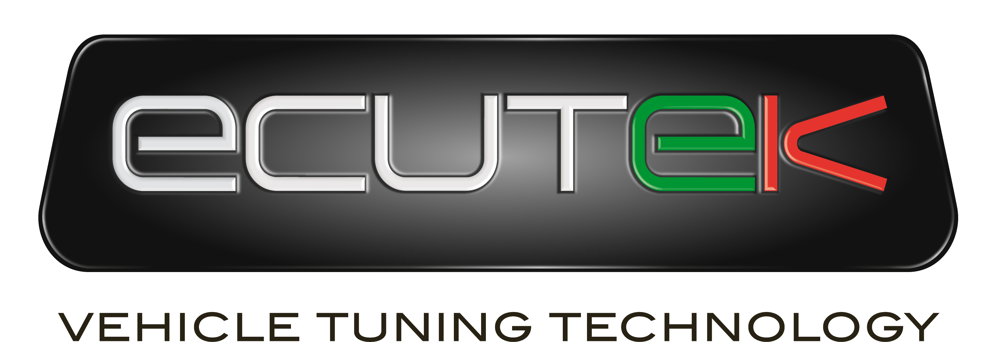](http://www.ecutek.com)

# 370Z ProECU Tuning Guide

*[image unavailable: Nissan 370z]*<!-- source: http://www.ecutek.com/getattachment/Products/Retail/ECU-Connect/Features-by-vehicle/Nissan-370Z/image1.jpg.aspx -->

# Introduction

EcuTek ProECU proudly supports the Nissan 3.7ltr V6 engine called VQ37VHR found in the following Nissan and Infiniti vehicles:

- Nissan 370Z
- Nissan G37
- Nissan M37
- Nissan V36
- Infiniti G37
- Infiniti FX37
- Infiniti M37
- Infinity Q50
- Infinity Q60
- Infinity Q70

This naturally aspirated V6 engine has a compression ratio around 11:1 and produces around 326bhp and 269 lbs·ft (365 Nm) Torque depend on the exact model and market. The VQ37 also includes Variable Timing Control (VTC) and Variable Valve Event and Lift (VVEL). The VTC is Intake Cam Shaft Opening Angle and the VVEL controls the Valve Duration amount. Aftermarket supercharged and turbocharged conversions will offer 450+bhp with around 0.5bar boost.

The RaceROM features currently available for the Nissan 370Z suite are shown here, and are listed below

[370Z ProECU RaceROM Supplement](https://ecutek.atlassian.net/wiki/spaces/SUPPORT/pages/6881638/370Z+ProECU+RaceROM+Supplement)

- RaceROM Custom Ignition Timing
- Map Switching
- Launch Control
- Flat Foot Shifting
- Per-gear Rev Limits
- RaceROM Gauge Hijack
- Speed Density
- Knock Warning
- RaceROM Custom Maps
- RaceROM Controller
- Valet Mode
- Custom Parameter Data Logging

**!!! CAUTION !!!**

EcuTek ProECU tuning tools should only be used by experienced tuners who understand the product and engine calibration.

If you do not fully understand this product then you WILL damage your engine, the ECU or your vehicle.

Please ensure you fully read all EcuTek manuals BEFORE attempting to use ProECU with your laptop or your vehicle.

Use with extreme caution and understanding at all times, if in doubt then do not proceed.

EcuTek accepts no responsibility for any damage to the engine, ECU or any part of the vehicle that results directly or indirectly from using the product.

** If you are in any doubt that you do NOT have the experienced required to use this product then you should NOT USE IT **

# Summary of Software

ProECU software has been introduced to allow reprogramming of the factory ECU in order to tune the necessary components of the calibration in order to allow for modifications and increases in power. This is not a standalone repalcement ECU so you shouldn't run into the associated issues or disadvantages of setting up a purpose-built ECU and control system from scratch.

The software allows easy control over most factory parameters including:

- Boost Targets and wastegate control
- Target AFR
- Ignition Timing
- Fuel Delivery including fuel pump calibration (using the same style pump as OEM)
- Airflow Measurement and fuel compensation

## Programming

For information on how to program as well as flash recovery, check out.

- [ECU Programming Overview](https://ecutek.atlassian.net/wiki/spaces/SUPPORT/pages/1572880/ECU+Programming+Overview)
- [How to Recover an ECU](https://ecutek.atlassian.net/wiki/spaces/SUPPORT/pages/1114114/How+to+Recover+an+ECU)

For more software guides check out:

- [Software Help and How-To](https://ecutek.atlassian.net/wiki/spaces/SUPPORT/pages/327682/Software+Help+and+How-To)

# Table of Contents

## Supplemental Content

**Platform Specific**

- [370Z ProECU Tuning Guide](https://ecutek.atlassian.net/wiki/spaces/SUPPORT/pages/7143430/370Z+ProECU+Tuning+Guide)
- [370Z ProECU RaceROM Supplement](https://ecutek.atlassian.net/wiki/spaces/SUPPORT/pages/6881638/370Z+ProECU+RaceROM+Supplement)
- [370Z Manufacturer Tools](https://ecutek.atlassian.net/wiki/spaces/SUPPORT/pages/7602235/370Z+Manufacturer+Tools)
- [Nissan 370Z DTC List](https://ecutek.atlassian.net/wiki/spaces/SUPPORT/pages/7078030/Nissan+370Z+DTC+List)
- [Nissan 370Z FAQ](https://ecutek.atlassian.net/wiki/spaces/SUPPORT/pages/7635028/Nissan+370Z+FAQ)
- [370z Sensor Input / Output Hijack](https://ecutek.atlassian.net/wiki/spaces/SUPPORT/pages/60031081/370z+Sensor+Input+Output+Hijack)
- [370z Common Issues: Idle Learning](https://ecutek.atlassian.net/wiki/spaces/SUPPORT/pages/641368065/370z+Common+Issues+Idle+Learning)
- [370Z- Live Tuning](https://ecutek.atlassian.net/wiki/spaces/SUPPORT/pages/908951572/370Z-+Live+Tuning)
- [370Z Knock Control, dynamic advance and Octane Judgement](https://ecutek.atlassian.net/wiki/spaces/SUPPORT/pages/1653997569/370Z+Knock+Control+dynamic+advance+and+Octane+Judgement)
- [370Z CAN Input and Output](https://ecutek.atlassian.net/wiki/spaces/SUPPORT/pages/2367258628/370Z+CAN+Input+and+Output)

**General**

- [ECU Programming Overview](https://ecutek.atlassian.net/wiki/spaces/SUPPORT/pages/1572880/ECU+Programming+Overview)
- [Software Help and How-To](https://ecutek.atlassian.net/wiki/spaces/SUPPORT/pages/327682/Software+Help+and+How-To)
- [EcuTek Knowledge Base](https://ecutek.atlassian.net/wiki/spaces/SUPPORT/pages/327698/EcuTek+Knowledge+Base)

---

# Tuning Guide

## Accelerator and Throttle

The factory throttle maps are concave as shown in the factory calibration below. By making these maps more linear the engine will deliver more power and torque for a given Accel pedal position. See where the modified map has been interpolated between 10% and 76% to produce a much more linear shaped curve, so for a given Accel pedal position the ECU will open the butterfly further. Note that this is only altering the Accel pedal output and doesn't physically create any more power or torque!

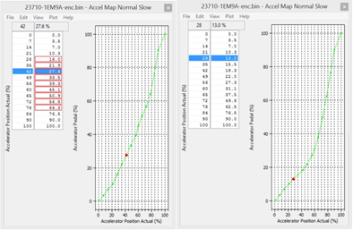

The 370z has a complex relationship between accel pedal and throttle butterfly opening angle that includes cylinder fill and torque calculations. While exact operation details aren't important, one important thing to note is that the throttle does not fully open below 2400 RPM and in some cases even higher (we have seen logs on some cars where it doesn't fully open till 3200rpm!) See the before and after shown below.

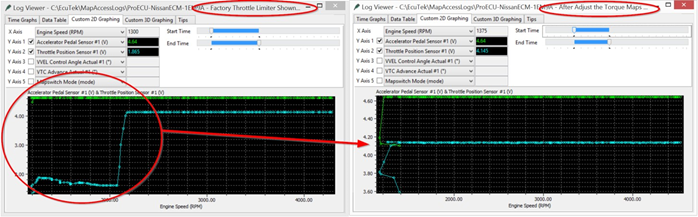

This behavior is controlled by the Torque Filtering maps. Adjusting the two maps shown below in a similar manner will cause the throttle to be fully open at low RPM. This is a very important change for Turbo and Supercharged Forced Induction models.

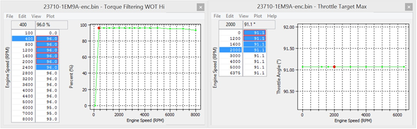

The Torque Actual map values can be raised in order to influence the Auto gearbox control (AT models). Raising the values on higher load will provide faster harder shifting though high power models may still hit the rev limiter in D mode.

The Torque Demand map (and its corresponding Trustful check map requiring the same values) can also be used to influence gearbox control on forced induction models. Increasing the map values (Nm) will tighten gearshifts and enable faster gear shifting in manual mode.

Raising the values on high load may help the gearbox change gear before hitting the rev limiter but ultimately this projection of gear shift in Auto mode is out of the ECMs control.

There is no need to change this maps on manual gearbox models (MT) and changing them may have undesirable effects on throttle control and VVEL operation.

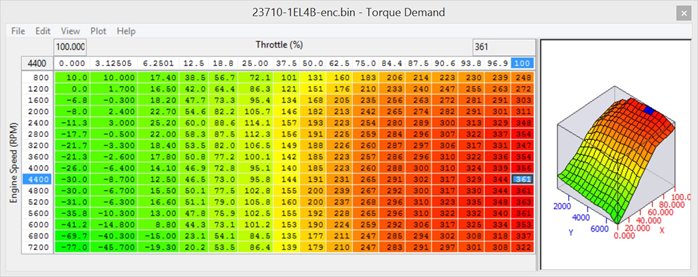

There are two stages to the accelerator and throttle control. Firstly the physical accelerator pedal position is mapped to a logical position. This allows the manufacturer to offer different drive modes with varying throttle response. Secondly the logical accelerator position is mapped to a target throttle angle.

The relationship between the physical Accel pedal position and the Logical Accel pedal position is controlled by several sets of 2d maps. For vehicles that support the Infinity "Drive Mode" switch, there are four sets of maps: Normal, Eco, Sport and Snow. These maps are also present on some Nissan vehicles without the Drive Mode switch fitted. In this case we suggest that all values are set the same as per the factory settings.

Each drive mode has a slow map and a fast map. These are for different vehicle speeds. It allows the vehicle to be very responsive when driving at high speed, but less responsive for low speed manoeuvres like parking. The transition between the slow and fast maps is controlled by the "Accel Map Slow/Fast Switch" map.

Each of the Accel pedal maps has a corresponding Trustful check map, these must be set the same or a DTC fail safe condition will occur.

There are two Accel position to Throttle Angle maps. One is for low speed, the other for high speed. The transition between low and high speed is governed by the "Accel to Throttle Lo/Hi Switch" map. Typically the two maps are set the same and the switch map is calibrated so that only one of the Accel to Throttle maps is used.

When the car is in reverse, there is a reverse gear multiplier map which applies a correction so that the vehicle response in reverse gear can be made to feel the same as in 1st gear.

**Map List**

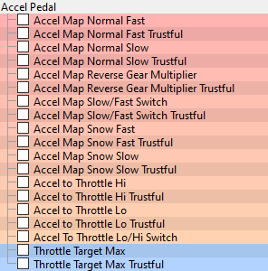

**Live Data Parameters**

- Accelerator Pedal Sensor #1 & 2
- Throttle Position Relative
- Throttle Position Sensor #1 & 2
- Throttle Position Sensor Bank #1 & 2

---

## Boost Control

The 370Z is an NA car so does not have boost control natively, however EcuTek has added a feature to control the CPC output pins to drive a boost control solenoid like a MAC or Pierburg vstyle valve at any given frequency.

For more inforamtion on this please see the RaceROm supplement here.

[370Z ProECU RaceROM Supplement](https://ecutek.atlassian.net/wiki/spaces/SUPPORT/pages/6881638/370Z+ProECU+RaceROM+Supplement)

[RaceROM Boost Control](https://ecutek.atlassian.net/wiki/spaces/SUPPORT/pages/443678725/RaceROM+Boost+Control)

*[image unavailable: CPC Enable.jpg]*<!-- source: https://api.media.atlassian.com/file/f0bd79b6-7b10-4b7a-be8d-e68bb93139cb/image -->

#### CPC Output Hijack Frequency

When using Boost control (and custom maps CPC output) the OEM functionality is completely overwritten by this function and the valve is driven at this set frequency. On some vehicles this frequency isn't capable of being adjusted due to limitations of the ecu.  
  
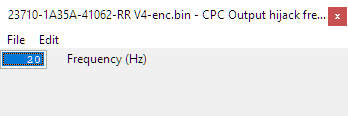

**Map List**

**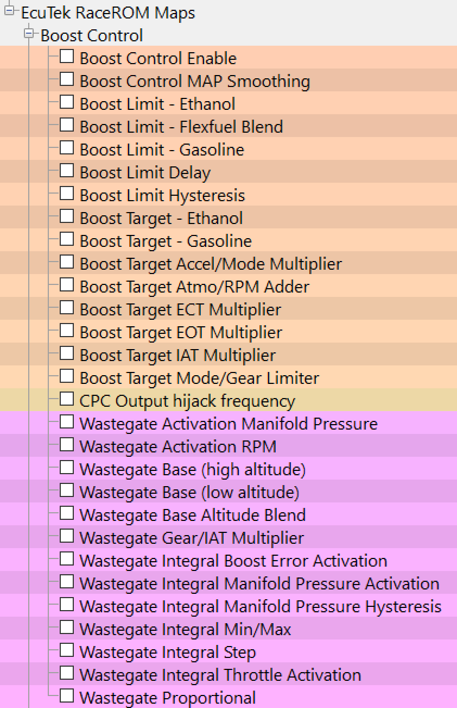**

**Live Data Parameters**

- **Boost Target** – Absolute pressure target in bar, measured by the intake manifold pressure sensor
- **Boost Error** – Difference between MAP and Boost Target, positive numbers are over boost
- **Manifold Absolute Pressure** – Absolute pressure in bar, measured by the intake manifold pressure sensor
- **WG Final Duty** – The duty cycle applied to the wastegate solenoid (Same as Final Duty)
- **WG Duty Base** – Output from **Wastegate Duty Base** maps
- **WG Duty Adder** – Correction resulting from Gear/IAT multiplier step
- **WG Duty Integral** – WG duty added by Integral correction of EcuTek boost control strategy
- **WG Duty Proportional** – WG duty added by Proportional correction of EcuTek boost control strategy

---

## Camshaft Timing

The engine is fitted with a complex variable valve timing system that allows the ECU to control both the timing (VTC) and the duration/lift of the inlet valves (VVEL).

#### VTC (Variable Timing Control)

The first system, known as VTC, adjusts the valve timing. It rotates the camshaft relative to the sprocket. The lift and duration of the valve is unaffected. The diagram below shows valve lift against crank angle to illustrate how VTC works. If the VTC system was turned off, the valve would be fully open (centre line) at the VTC reference angle of 118°Crank.

In this diagram the tuner has requested 18 degrees of VTC Advance. So the centre line has moved 18 degrees to the left and is now at 100°Crank. The inlet valves open 18 degrees earlier and they close 18 degrees earlier.

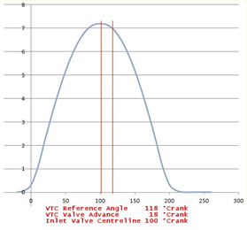

#### VVEL (Variable Valve Event and Lift)

The second system, known as VVEL, adjusts the valve <u>duration</u> by moving the pivot point of the rocker arm. Valve duration is often measured from valve open to shut in °Crank. But Nissan do not use this convention. Nissan measure the duration from the point at which the valve opens, to the point of maximum lift (centre line). The units are in °Cam. In the diagram below, the VVEL Duration is 55°Cam which would commonly be regarded as 220°Crank. The °Crank measurement is <u>four</u> <u>times</u> the Nissan measurement.

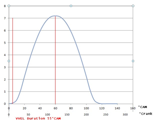

There is a fixed relationship between the valve duration and lift. As duration increases so does the valve lift. The diagram below shows valve lift in mm against crank angle for various durations. Requesting a VVEL duration of 25°Cam will result in a valve lift of about 0.75mm. At the other end of the scale, a VVEL duration of 70°Cam will give a valve lift of about 11.50mm.

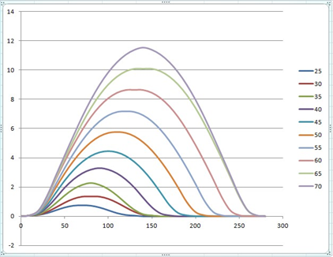

#### VTC and VVEL activity

You can see the ECM controlling the VTC and VVEL after this hot restart, the VVEL angle is reduced as the VTC angle is advanced in this example shown below. Notice how the FTST quickly compensates for the change in airflow.

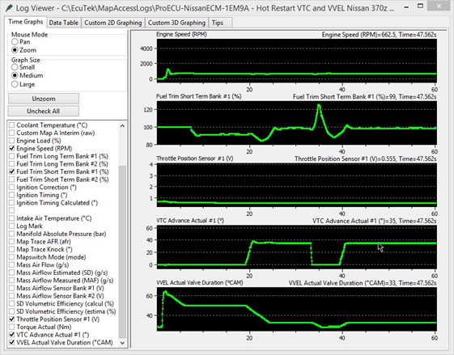

#### Tuning the Cam Timing

Tuning the VTC and VVEL systems, at a basic level, is fairly straightforward. The main thing is to adjust the appropriate target maps and the ECU will follow them while remaining within the safety limits that are present to avoid interference.

The VTC Valve Advance maps contain the target advance in °Crank. There is a 3D map for normal driving. Separate 2D maps are used for Wide Open Throttle and Overrun conditions.

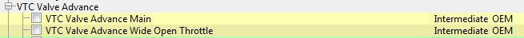

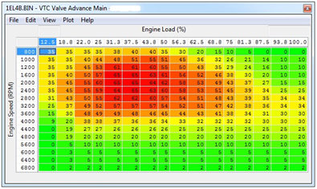 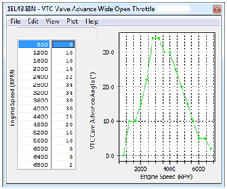

The VVEL Value Duration maps contain the target duration in °Cam from the point at which the valve opens to the point of maximum lift (centre line). As before, there is a 3D map for normal driving and separate 2D maps for Wide Open Throttle and Overrun.

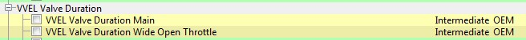

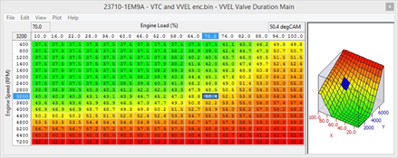  
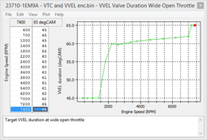

The valve duration is physically controlled by a stepper motor that rotates a shaft under the control of the VVEL control module. Having chosen a target duration, the ECU determines the desired Control Shaft Angle and sends this to the VVEL control module.

The ECU uses the "VVEL Control Shaft Angle to Duration" map to determine the Control Shaft Angle. This is a bi-directional map. When the ECU needs to determine the desired control shaft angle from the target duration, it reads the map from right to left. When the ECU needs to determine the actual current duration from the measured control shaft angle, it reads the map from left to right.

You should only need to recalibrate this map if you physically adjust the VVEL hardware.

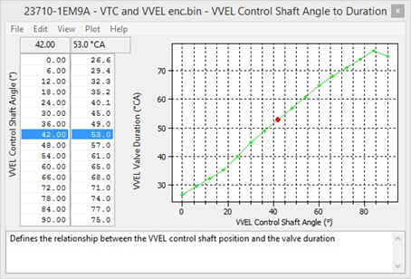

#### VVEL Min and Max Limits

The VVEL system has a number of maps that limit the position of the control shaft, and therefore the valve duration (see above). The two maps shown below limit the VVEL control shaft angle by RPM. At 2400 RPM, the minimum CS Angle is 2.88° and the maximum is 47.8°. This allows a target duration somewhere between approximately 28.5°CAM and 61.9°CAM. The stock calibration runs close to these limits so you will probably need to adjust them in order to tune the VVEL system.

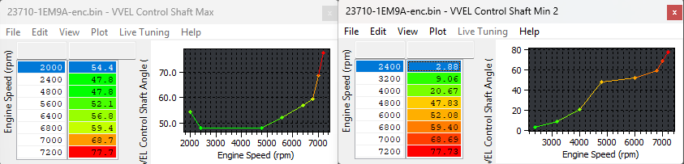

#### Interference Limits

When adjusting the cam timing, it is important to avoid using long valve duration and large cam advance at the same time. <u>Doing so may result in engine damage</u> due to the inlet valves interfering with the exhaust valves or the piston.

There are two safety limit maps to prevent this from happening. The maps have been included in ProECU for reference purposes only. **<u>We strongly recommend that you do not adjust them.</u>**

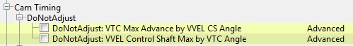

When the ECU is selecting the VTC target, it looks at the current VVEL Control Shaft Angle and uses the "VTC Max Advance by VVEL CS Angle" map to determine the maximum allowed VTC target. Conversely, when the ECU is calculating the VVEL Control Shaft Angle, it looks at the current VTC advance and uses the "VVEL Control Shaft Max by VTC Angle" map to determine the maximum allowed control shaft angle.

#### Starting and Warm Up Cycle

During starting, the ECU will use the "Start-up" Map. Once the engine has started, it will switch to the "First Idle" map for approximately 40 seconds before switching to the "Cold" map. Once the coolant temperature has reached 70°C, the ECU will begin using the "Main", "WOT" and "Overrun" maps as described above.

#### EcuTek Custom Live Data Parameters

As part of our RaceROM features, we have provided some custom logging parameters to help our tuners achieve optimum control of the VTC and VVEL systems.

The custom parameters, "*Inlet Valve Duration*", "*Inlet Valve Open*", "*Inlet Valve Shut*" and "*Inlet Valve Centre Line*", all use the familiars units of °Crank. The picture below shows the parameters changing under deceleration from about 3000rpm.

The left window shows the valve has an advance of 30°. The Centre Line is therefore at 118°30°=88°. The duration is 149°. Half of the duration is 74.5°. The Open Angle is therefore 88°-74.5 = 14° and the Shut Angle is 88+74.5 = 163°.

The right window shows that the VTC advance has increased to 33°, but the duration has dropped to 143°. The Centre Line and Shut Angle have advanced accordingly, but the Open Angle remains at 14°. The tuner has presumably calibrated the maps to keep the Open Angle constant.

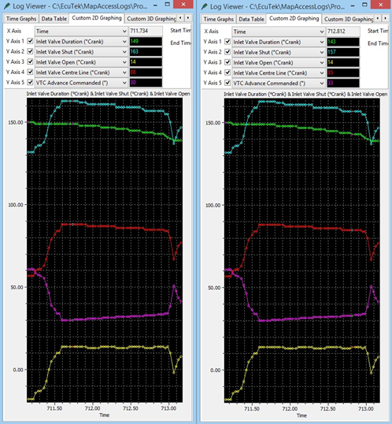

Next are the maps controlling the VTC and VVEL at the time of the log. When looking at the VVEL map, remember that the VVEL Duration in the maps is in °Cam from valve open to full lift, which is one quarter of actual full duration in °Crank. Therefore 37°Cam means 148°Crank and 35°Cam means 140°Crank.

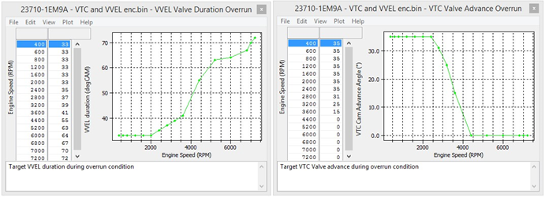

**Map List**

**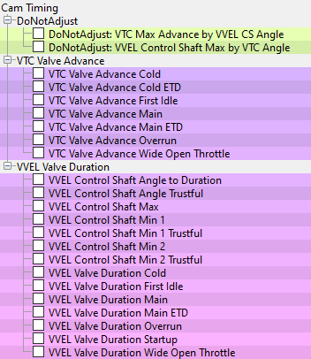**

**Live Data Parameters**

- VTC Advance Actual #1 & 2
- VTC Advance Commanded
- VVEL COntrol Angle Actual #1 & 2
- VVEL Position Sensor Bank #1 & 2
- VVEL Sensor Learned Bank #1 & 2

---

## Fuelling

### Fuel Map **Mode**1 to **Mode** 4

The fuel map contains target AFR based on Engine Speed (RPM) and Engine Load (%). The vehicle has two factory fitted wideband sensors (one for bank 1 and another for bank 2). The ECU uses *Fuel Trim Short Term* B1 and B2 to ensure the target AFR is achieved during light load closed loop. Further to this the *Fuel Trim Long Term* Bank 1 & 2 will make long term adaption trim for continuous Short Term Fuel Trim corrections.

When Engine Load increases the fuelling will operate in open loop and the FTST feedback will not work and the Target AFR will not necessarily be achieved.

The Nissan factory fuel map is very small with very little resolution (8x8).

EcuTek have replaced this factory Fuel Map with 4 new high resolution fuel maps (24x20) that can be calibrated for each of the Map Switch Modes. Mode 1 is the default fuel map if Map Switching is not enabled.

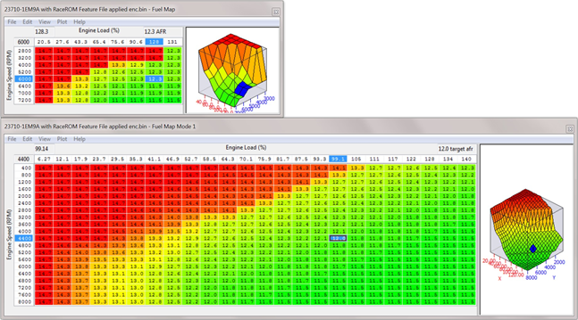

The Fuel Maps are an AFR Target, the ECU will generally strive to achieve a target AFR of 14.7 (or Lambda 1) during Closed Loop conditions.

At higher load a more favourable AFR target is needed, at this point the fuelling will go Open Loop where there is no feedback control to the ECU to maintain the fuel target value.

Closed loop will only work at light load. The easiest indication of when closed loop is active is that Fuel Trim Short Term (FTST) are active.

During mid to full load the FTST will stop working and the ECU will operate in open loop.

Entering a value of less than 14.7 in the fuel map will force the ECU into Open Loop (FTST not working), this trick can be used on forced induction models with big injectors if you are struggling for Idle control and general Idle stability.

Changing something simple like fuel pressure from say 3.0Bar to 4.0Bar would make the fuel table inaccurate, the FTST will compensate whilst in closed loop and this will transition into a negative Fuel Trim Long Term (FTLT) over a time period.

It's important to understand that FTLT **will** be applied in Open Loop so it's important that your FTST are tight and accurate or long term adaptation will mean that FTLT are applied on full load. This could make the engine run rich or lean over a long term.

Long Term Fuel Trims can be cleared by using the ECU RESET under the Nissan GTR ECM Tool. They are also cleared after ECM programming.

EcuTek have converted the factory Nissan Lambda voltage into a more useful logging parameter called *AFR Bank 1* and *AFR Bank 2*. These AFR logging parameters have been accurately scaled by EcuTek against two Innovate LM2 sensors, see the following screen shot below showing the calibration testing we made.

The factory sensors are quite accurate at richer AFRs but we still suggest that the values shown should only be used for indication and we strongly suggest that all AFR tuning is verified with a **trusted** standalone wideband sensor.

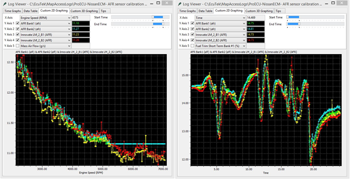

Be sure to check both Bank 1 and Bank 2, as they have different MAF scaling due to different air box designs. Also watch *Fuel Trim Long Term* and *Fuel Trim Short Temp* for bank 1 and 2.

Where different intakes are fitted the MAF scaling should be adjusted so that the FTST are between 90 and 110% at all times during closed loop.

#### Fuel Injector Scaling

The injector scaling works in a conventional manner, there are options for Injector Size, Voltage Multiplier and the Offset Time (ms). The standard Injectors are 370cc which are good for around 370bhp. The factory injectors are open at 84% at 7600rpm (335bhp) at 12.2:1 AFR. This means that factory injectors have a limited capacity for Ethanol tuning. The factory Nissan GTR injectors (570cc) can make a good replacement for the 370z. The Injector Scaling and Offset values would need to be changed, here are the GTR settings.

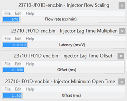

For more information on scaling fuel injectors using the OEM method check out our article [Scaling Injectors For Nissan Using OEM Method (GT-R, 370z)](https://ecutek.atlassian.net/wiki/spaces/SUPPORT/pages/20971521/Scaling+Injectors+For+Nissan+Using+OEM+Method+GT-R+370z)

#### Cranking Fuel maps

When using larger Injectors or running on Ethanol it becomes necessary to change the cranking fuel volume amount. There are numerous cranking fuel maps that are shown below, the Initial and step values are an open time period (ms) whereas the compensation maps are a % that affect the overall cranking and starting fuel volume amount. The full control cannot be defined at this time but the results of changing the various cranking maps can be seen below. The Cranking Fuel Injector Pulse Width #3 map shown below has been calibrated with 36ms and 96ms for the purpose of example. See on the left hand log file how the Injector pulse width (ms) reduces and decays much more quickly when compared to the right hand side where the Injector is open for a much longer period with higher values in the map.

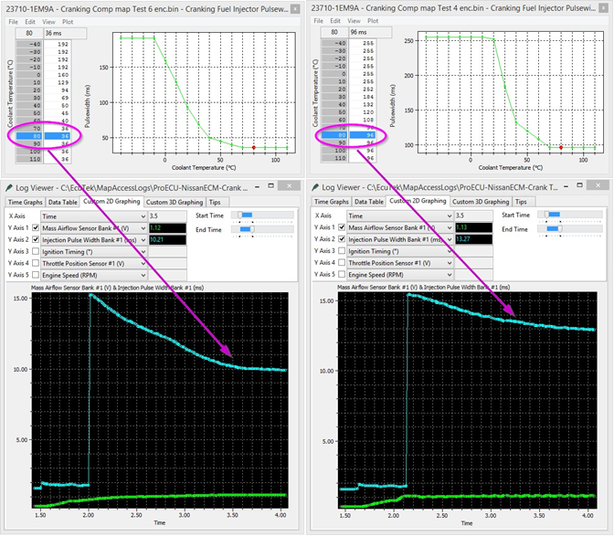

The Cranking Fuel Compensation maps can be used as a global 'compensation' for the complete cranking period. The next test results show the effect of adjusting the Cranking Fuel Injector Compensation #1 - #3  
  
  
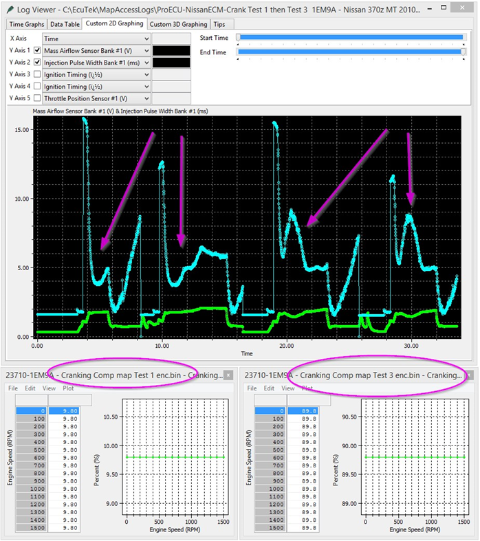

**Map List**

**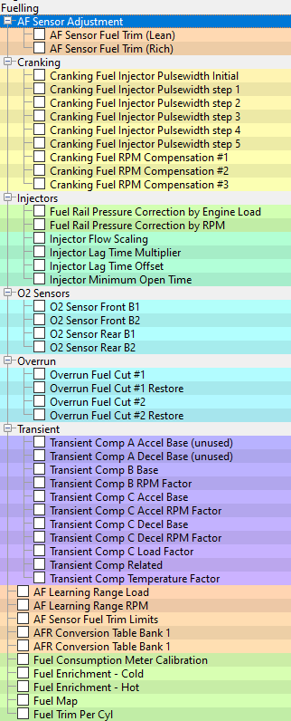**

**Live Data Parameters**

- AFR Sensor V (Volts)
- Air Fuel Ratio (AFR) #1 - #2
- Air Fuel Target (AFR)
- Injector Pulse Width (ms)
- Fuel Trim Short Term (%) #1 - #2
- Fuel Trim Long Term (%) #1 - #2
- Injector Duty #1 - #2 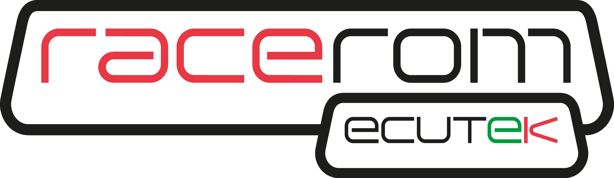 RaceROM only
- AFR Bank #1 & #2  RaceROM only

**Fuel Map Enrichment Warm & Cold**

The hot and cold fuel map enrichment maps are used to trim the desired AFR by a percentage to attain the correct AFR for a given RPM and Engine Load. The warm map works above 70 deg C and the cold below this threshold.

Values above 100% will cause the engine to run Richer, (e.g. 110% will be 10% more fuel than desired) and values below 100% will cause the engine to run leaner. This map can be used to fine tune for larger Fuel Injectors without having to alter MAF scaling.

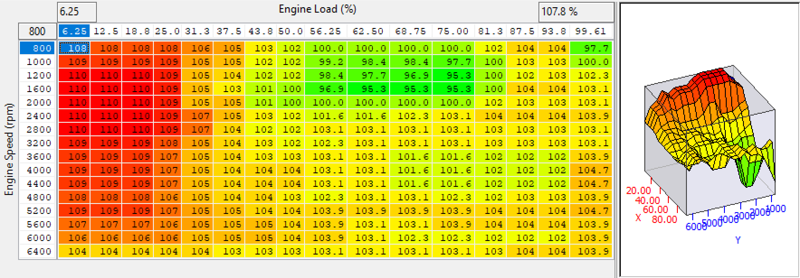

### Fuel Trim Per Cylinder

This map can be used to add extra fuel to certain cylinders, see the map help text for further information. We advise that the Injector Open Time is measured with an oscilloscope to ensure the correct Injector delivers the additional fuel, it appears that this map input axis shows cylinder numbers but it could be firing order. We hope to test and verify this in the near future.

There is now a RaceROM map to give more granularity for the per cylinder fuel enrichment function.

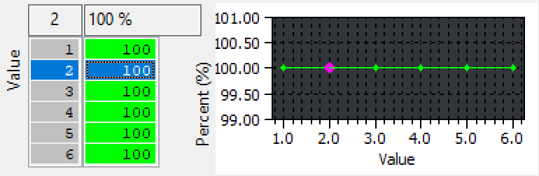

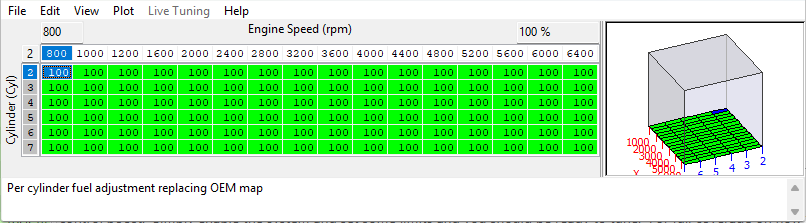

**Cranking**

The various cranking fuel maps can be increased or decreased to improving engine starting when using Ethanol or larger Injectors that may cause issues, the staged pulse width maps are an open time period in Ms and this global fueling period can be adjusted using the compensation maps. It's generally suggested that all common maps are adjusted by the same % amount.

The 370Z and GTR share similar cranking injection strategies so looking at the GTR cranking page will help to understand when a map is used in the start up sequence.

[GTR/370Z Cranking Fueling](https://ecutek.atlassian.net/wiki/spaces/SUPPORT/pages/1655832593/GTR+370Z+Cranking+Fueling)

When using larger Injectors or running on Ethanol its necessary to change the cranking fuel volume amount.

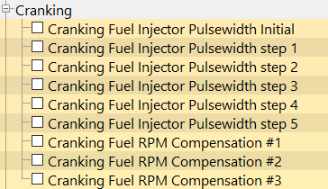

There are numerous cranking fuel maps that are shown below, the Initial and step values are an open time period (ms) whereas the compensation maps are a % that affect the overall cranking and starting fuel volume amount. The full control cannot be defined at this time but the results of changing the various cranking maps can be seen below.

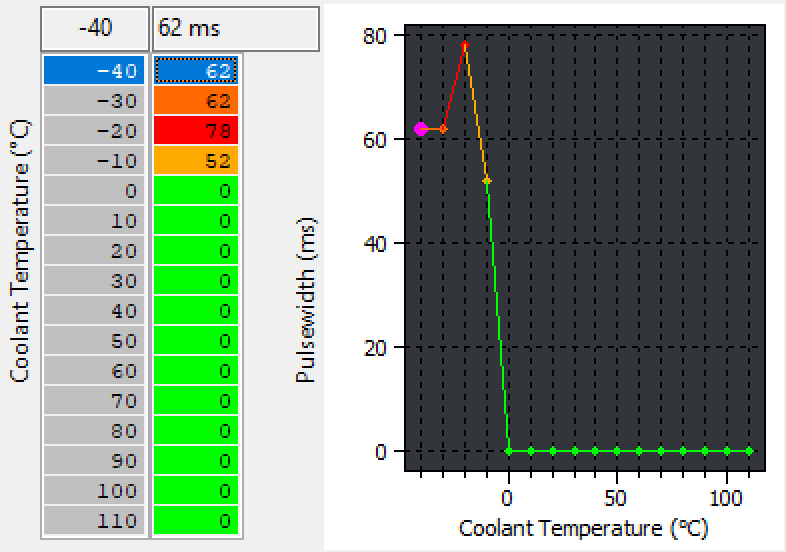

The Cranking Fuel Injector Pulse Width #3 map shown below has been calibrated with 36ms and 96ms for the purpose of example.

See on the left hand log file how the Injector pulse width (ms) reduces and decays much more quickly when compared to the right hand side where the Injector is open for a much longer period with higher values in the map.

The Cranking Fuel Compensation maps can be used as a global 'compensation' for the complete cranking period.

The next test results show the effect of adjusting the Cranking Fuel Injector Compensation #1 - #3

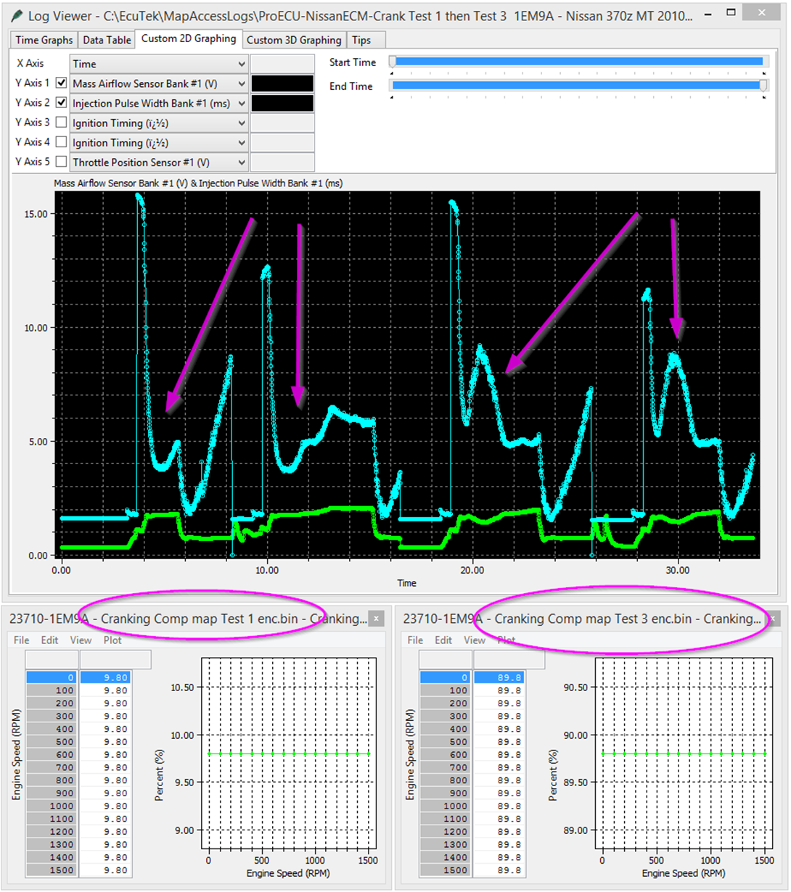

### Injection Angle

This is the end of the injection (EOI) crankshaft angle before TDC on the firing stroke, so 180deg would be actual BDC and 270 deg would mean EOI would occur half during the Induction stroke.

### Injector Size

The Injector Size (RaceROM) can be set differently for all 4 map switch modes, this enables quicker tuning by setting different injector size bytes and also tuning for Ethanol where 30%+ extra Injection volume is required.

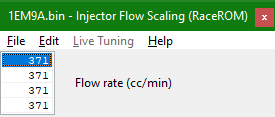

### Injector Lag Time Multiplier and Offset

This should be used to recalibrate for larger fuel injectors. This is sometimes called injector dead time or injector latency. Different design fuel injectors will have a different response time to the original injectors so always check with the Injector manufacture if this information is available before purchasing.

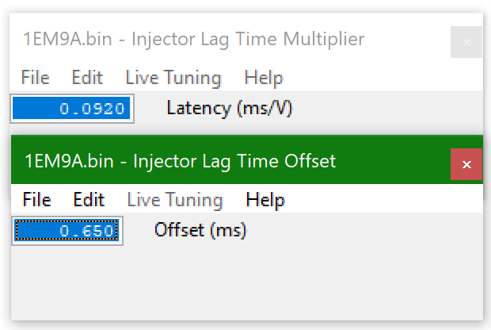

### Injector Minimum Open Time

This value may need to be reduced when fitting larger injectors, Injectors twice the size will be open for half the time at Idle.

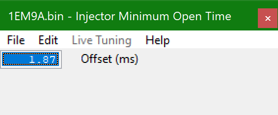

### Over Run Fuel Cut #2

The Engine Speed must be over this RPM for fuel injectors to be cut during a period of deceleration (lift off over run). Only the #2 maps are used during our testing.

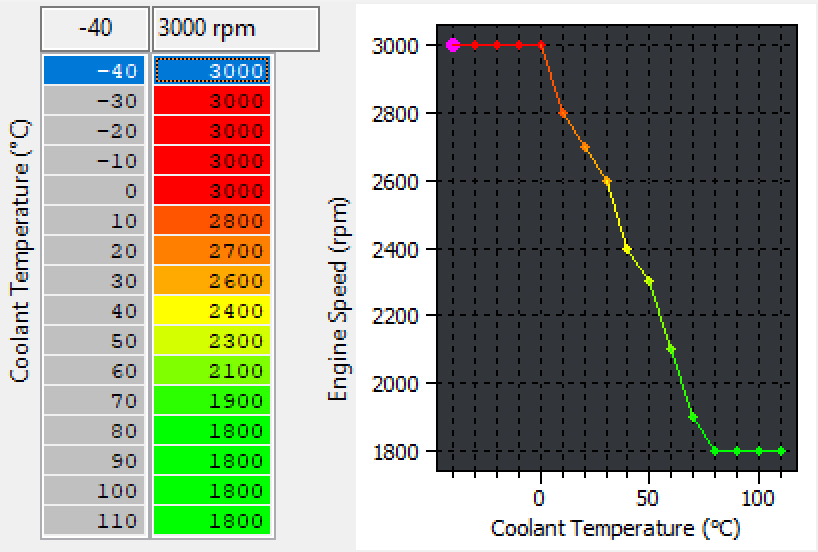

### Over Run Fuel Cut Restore #2

This is the Engine Speed where the Fuel Injectors will be restored (turned on again). The Injector Open Time (ms) during overrun will never show zero and will be around 0.74ms, this is the Injector lag time period being shown but the injectors are not physically open. These values should always be at least 2300rpm above any target Idle speed (or the engine will stall on overrun). Raising these values to say 5000rpm when the coolant temp is hot will encourage pops and bangs during gear change and decal conditions. Only the #2 maps are used during our testing.

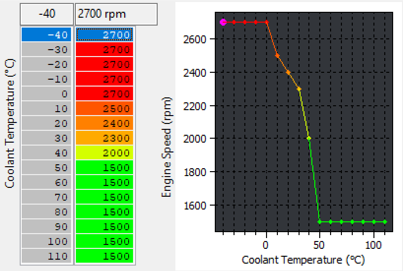

---

## Idle

### Idle Target #1 & #2 (Drive and Neutral)

The Idle Target maps are used to control the engine speed for drive and neutral gear shift position. It is advised that you adjust both the maps to the same value to avoid discrepancies in the idle speed.

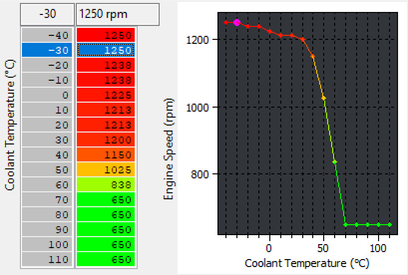

While not defined fully the 370Z uses a similar idle control stratey to the GTR where it calculated idle airlfow in l/min and makes closed loop correction within a deadband. This all starts with the base airflow to engine speed demand map, if you cannot achieve adequate idle control with just these map please contact [support@ecutek.com](mailto:support@ecutek.com) for more definitions.

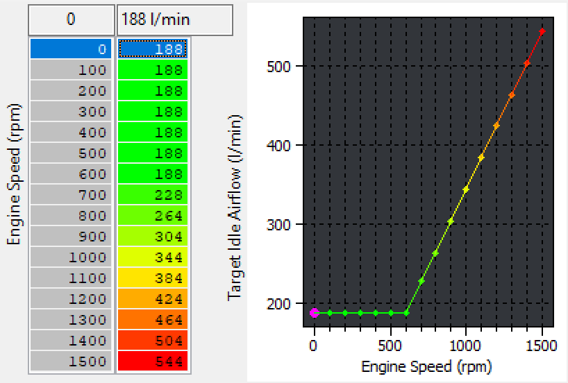

There are also ignition timing maps for base igntiion timing during idle that are available to help set the timing when the ECU is in closed loop idle control mode and corrects ignition tiing to keep the idle stable. Keep in mid that idle control ignition is used when in decel fuel cut as well.

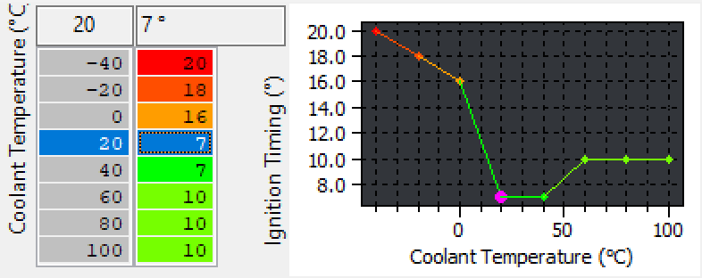

The GTR idle control strategy is outlined here.

[GTR Idle Control](https://ecutek.atlassian.net/wiki/spaces/SUPPORT/pages/739835909/GTR+Idle+Control)

**Map List**

**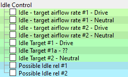**

****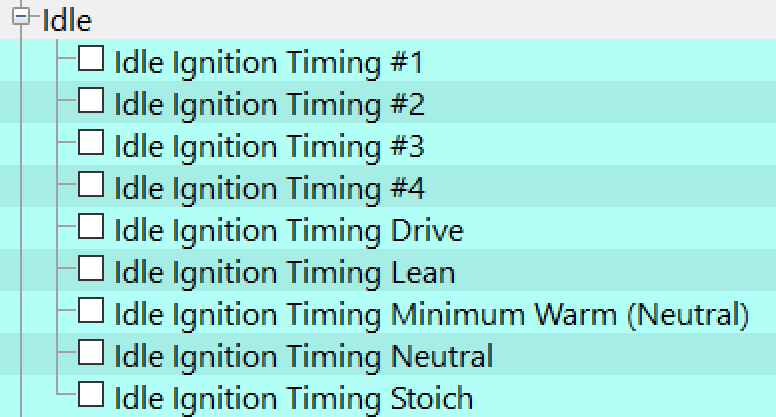****

**Live Data Parameters**

- Engine RPM
- Mass Airflow (g/s)
- Ignition TIming (deg)

---

## Ignition

The factory Nissan Ignition maps are low resolution and complex to understand.

EcuTek have rewritten the Ignition control to provide 4 simple high resolution Ignition maps with real Ignition values for each map switch mode.

The RaceROM Ignition maps offer 24x20 resolution vs the factory 16x16. This provides extended RPM and extended engine load rescaling ability that's critical for forced induction vehicles. See the comparison below showing the factory Ignition map filled with meaningless values vs the RaceROM high resolution Ignition map with Ignition Timing values.

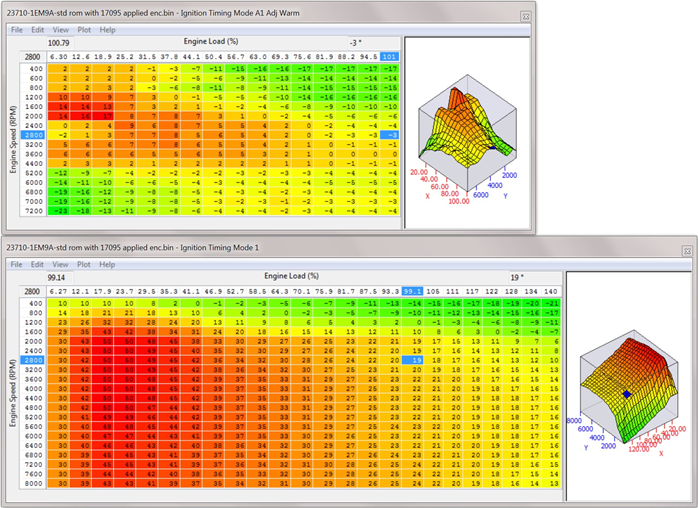

*** NOTE *** As the complex factory Ignition calculations have been over written and simplified by the RaceROM variant it's important to calibrate the RaceROM Ignition maps accurately for your particular vehicle, the region of your vehicle and the fuel quality that is used.

The default the RaceROM ignition map is calibrated from a Euro spec 370z with 97 RON fuel, these timing values may be too advanced for US 91 octane fuel or too little for Japanese 100RON fuel.

When logging you should compare the actual 'Ignition Timing' parameter from the RaceROM Ignition Map against the 'Ignition Timing Calculated' parameter that was generated by the factory Ignition Timing calculation before it was replaced by the RaceROM Ignition value.

The four different Ignition maps can be calibrated with different values for different fuels like low octane, high octane and race fuel, another map could be for ethanol etc.

The 4 maps can also be calibrated to see how much ignition timing the engine will take by quickly switching through the modes whilst testing, you could add +1 degree in Mode 2 and +2 deg in Mode 3 etc. then make a power run in each of the modes and watch the Ignition Correction to see if the ECU shows any negative retard values. If there is no knock retard present then try a slightly more advanced Ignition map, this makes Ignition tuning much faster.

#### Ignition Correction

The Ignition Correction logging parameter will show knock retard as a negative value (example -3 deg) but will also add Ignition in the event of no knocking (example +2 deg). In this example you can see that the Ignition Correction is dynamic and it is advancing the Ignition Timing by +2 deg, it then detects knocking and gently removes the positive advance and levels at -2 deg.

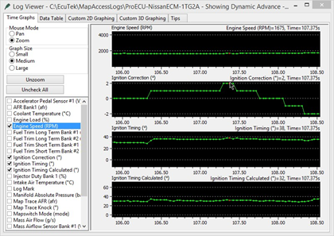

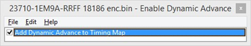

You can see the Ignition Timing (what the ECU actually runs) and the Ignition Timing Calculated (what the ECU would have run before RaceROM overwrote the Ignition control) advancing and retarding as the Ignition Correction is adding and removing the ignition.

The dynamic advance will only become active in the event of no knocking, the complete strategy is unknown at this time but as shown in the above log file the ECU will advance the timing.

If you do not want the positive dynamic advance to work then simply uncheck the RaceROM map. The negative dynamic advance will still work (so knock retard will still be active) though detonation should always be listened for even though the ECU will remove Ignition timing if detonation occurs.

#### Knock Retard

As well as four hi-res Ignition maps we have also written four hi-resolution 'Knock Control Enable' maps which are used to enable and disable the knock control against RPM and Load. We suggest to enable the Knock Detection at high RPM so that the ECU can use active knock correction past 6000rpm as shown on the left in this screen shot below.

With the standard knock switched off past 6000rpm the ECU will hold that knock retard to the rev limiter but if we allow knock detection to take place at high RPM then the ECU will build out any negative knock retard at high RPM (assuming the knocking has stopped).

The factory map on the Nissan GTR is also configured to allow knock correction to work up to the rev limiter.

The Knock Sensitivity map can also be altered to raise the knock threshold where the ECU will determine a knock retard value is required. Each row is a cylinder number and the values in the map are the threshold.

Raising these maps by 5% (or maybe 10%) will make the ECU less sensitive to knock retard but you MUST always check for detonation with a 3rd party device.

RaceROM offers Per Cylinder Knock and Per Cylinder Knock Threshold logging ability to aid this calibration process and help identify noisy cylinders so the threshold can be raised without raising the other more quiet cylinders.

You can see in this example where cylinders 4 and 5 are making excessive noise and are breaking the threshold, this in turn is shown in the Ignition Correction parameter (green line) is producing more and more knock retard each time the threshold is breached.

Considerations should be made for logging speed that is available from the factory ECU, not every knock event can be shown in the sampling rate that's available.

Note the central two cylinders 3 and 4 have higher thresholds due to these cylinders being more 'noisy' as they encased by cylinders 1, 2 and 5 and 6 in the V6 engine block design.

The Knock Retard Multipliers can also be increased and decreased to provide a global gain on the output of the knock sensors but as above you MUST ensure you check for detonation with det cans or a similar knock detection device.

**Map List**

****

**Live Data Parameters**

- Ignition Timing (Deg)
- Ignition Timing Calculated (Deg) (RaceROM) Ignition Correction (Deg) (RaceROM)

### Ignition Timing IAT Comp (RaceROM)

This additional EcuTek RaceROM map can be used to advance and retard the Ignition timing based on Intake Air Temperature, it can be used when running a 'blow through' MAF setup when IAT measures Charge Air Temp or when Speed Density is enabled.

### Knock Control Enable (RaceROM)

These maps can be used to turn the knock control ON/OFF at different RPM and Load for each of the 4 different Map Switch Modes.   
A value of 1 indicates Knock Control is active at that RPM and Engine Load.  
A value of 0 indicates Knock Control is NOT active at that RPM and Engine Load.

### Knock Sensitivity

This per cylinder threshold map is the point where knock correction will become active for each cylinder. If the values against RPM are breached then the knock correction parameter will start to show knock retard. Built engines often generate excessive engine noise that can be detected as knock, raising these values will help prevent this being detected as knock though care must be taken that the sensitivity will still show true knock! The centre two cylinders are noisier due to cylinders either side (1-3 or 4-6) so the noise thresholds are higher. See the tuning section for more information.

> [!CAUTION]
> Must be used with caution and understanding!

### Engine Cold/Warm Thresholds

These parameters specify the Coolant temp thresholds for when the VTC Cam maps **Cold** or **Warm** should be used. The ECU will switch between the maps at 70deg Celsius.

### Enable Dynamic Advance (Special Features Menu)

On certain ROMs which use the dynamic advance feature (adding positive Ignition Correction under load) this can be used to disable this feature and stop it from adding additional advance over the RaceROM Ignition Timing map values. See the Tuning section for more information.

---

## Limiters

### Rev Limit - Fuel Cut

The Engine Speed at which the ECU will cut the Fuel Injectors, this is a hard cut rev limiter, set all values the same. The Input axis to these maps is currently unknown.

### Rev Limit – Fuel Cut Restore

The Engine Speed at which the fuel injector will be restored after the Fuel Cut, set all values the same. The Input axis to these maps is currently unknown.

### Rev Limit – Fuel Cut Maximum

This is the maximum Rev Limit, the top value is when the Fuel Injectors will be cut, the lower value is when the injectors will be restored. These values should be set the same (or above) the 2d maps called **Rev Limit – Fuel Cut** and **Rev Limit – Fuel Cut Restore**

### Speed Limiter - Throttle Cut On/Off

The Vehicle Speed at which the ECU will close the throttle to maintain a target vehicle speed. The Throttle Cut Off value is always set high so we advise to keep it this way.

### Speed Limiter - Fuel Cut On/Off

The Vehicle Speed at which the ECU will cut and restore the fuel Injectors to maintain a target vehicle speed. It's not advised to use the fuel cut method of speed control.

### Cruise Control Cruise Control Set Speed Maximum

Max vehicle speed at which cruise control can be set, this can be quite low in some regions.

### Cruise Control Target Max Allowed

Max vehicle speed at which cruise control is allowed to operate, this can be set quite low in some regions.

**Map List**

****

**Live Data Parameters**

- Engine Speed
- Vehicle Speed

---

## Sensor Scaling

### MAP Sensor

The MAP is located in the Inlet Manifold, it's a 1 bar sensor and there is a simple 'bar per volt' multiplier, the MAP Sensor Offset will be **added** to the 'bar per volt' pressure reading. Please note that the Offset value cannot be a negative value. There is a second MAP sensor located in the Brake Boost pipe and this is used to measure Brake Servo pressure during cruise conditions, the ECM will close the throttle and create a depression should the servo pressure become too low.

### Coolant and Intake Air Temp Scale

This map can be used to rescale the Coolant and Intake Air Temp sensor voltage to temperature scaling.

### MAF Sensor Scaling (% to g/s) for Load

When fitting larger MAF housings (or Induction kits) then this value should be increased proportionally relative to the surface area increase of the larger MAF housing, (MAF sensor diameter of stock 370Z should be 60.5mm)

This is a coarse adjustment for MAF scaling, it converts the MAF sensor % value into grams of air per second. See the tuning section for more information on adjusting this parameter.

> [!WARNING]
> Some forced induction setups may cause DTC and DTC conditions that do not illuminate the DTC. With larger MAF tubes and if you exceed 4.85 MAF volts you may need to disable various MAF related codes, P0100 through to P010D.

### MAF Sensor Scaling Bank #1 / #2 (V to %)

These maps should be used to fine tune the MAF sensor scaling after the MAF Sensor Scaling map has been calibrated. When fitting larger Intakes it is critical that the MAF scaling on both banks are corrected. The value in the map is percentage of 100% Mass Air Flow, this is then multiplied by the **MAF Sensor Scaling (% to g/s)** 1D value to give a Mass Air Flow in g/s.

### 100% Engine Load

The point where 100% Engine Load will be achieved, this is factory set at 39.8 *Base Fuel Schedule* (BFS), increasing this map will advance ignition timing and reduce the Torque Actual output value so Ignition and Torque map rescaling must be made accordingly.

EcuTek RaceROM allows the engine load to scale well past 100%. It is not recommended to adjust this map.

### BFS Multiplier (K-Factor)

This multiples Mass Airflow into Engine Load. This has been used in other software suites to rescale the MAF Tube size. It is recommended that the map not be altered unless you are constrained by an engine load limit. In all other cases, leave this set to its default value of 26806. Use the 1d map called 'MAF Sensor Scaling (% to g/s) for Load' for larger MAF Tubes and aftermarket Intake rescaling. Limiters

**Map List**

**Live Data Parameters**

- Base Fuel Schedule (ms)
- Engine Load (%)
- Engine Load RR (%)
- Engine Load Absolute (MAF) (g/rev)
- Engine Load Absolute (SD) (g/rev)
- Engine Load Calculated (%)
- Mass Airflow Sensor B1/B2 (Volts)
- Mass Airflow (g/s)
- Mass Airflow Estimated (SD) (g/s)
- Mass Airflow Measured (MAF) (g/s)

---

## Torque

### Torque Demand

This is the torque demanded (Nm) by the driver using the Accel pedal.

This can be used to influence Auto gearbox control, see the tuning section for more info.

### Torque Demand – Trustful

This is a check map for **Torque Demand** and must be set the same or a DTC condition will occur.

### Torque Demand Multiplier

This is a coarse multiplication for torque demand used to smooth out transition periods. The default maps are calibrated to provide extra torque during pull away to prevent the car bogging down. This can be used to influence Auto gearbox control, see the tuning section for more info.

### Torque Actual

This is the calibrated torque output of the engine, measured in Nm. It is important that the figures in this map are correct as it can seriously affect the driveability of the car, especially on the automatic transmission models which use the torque figures to control the TCM.

If the TCM is slipping then increasing these values should make it more firm and lock up quicker. Conversely If the gear change is hard, reducing these values will make it softer and allow more slip between each gearshift.

### Torque Filtering WOT Hi (including the Trustful)

WOT is Wide Open Throttle, this map will prevent the Throttle from fully opening at low RPM.

### Torque Filtering WOT Lo (including the Trustful)

WOT is Wide Open Throttle, this map will prevent the Throttle from fully opening at low RPM.

**Map List**

****

**Live Data Parameters**

- Torque Actual (Nm)
- Torque Demand (Nm)

---

## Misc.

### Traction Control ESP

The factory ESP system will act as a traction control by closing the throttle butterfly should a wheel slip event occur. If you alter the four TCS maps (as per the help text on the individual maps) then the throttle will no longer close if wheel spin occurs, use with caution!!

We recommend that you use the factory supplied ESP to turn off the ESP (traction control).

### Radiator Fan Control Radiator Fan Duty

The fan duty for the current Coolant Temp and Vehicle Speed (A/C Off).

### Radiator Fan A/C ON

The map output will be fan duty for the current Coolant Temp and Vehicle Speed (A/C On).

### Radiator Fan A/C Related

This additional fan control map is used in alternate circumstances and is related to AC control.

### Gear Ratio Gear Ratio Manual and Auto Transmission

When a taller Final Drive has been fitted the factory Sync Rev feature will not work correctly, simply increase these gear ratio values relative to the Final Drive percentage increment amount.

### Naturally Aspirated Tuning

This 1st example is naturally aspirated tuning on a 100% stock car with 'before and after' EcuTek tuning. The power increased from 321bhp to 335bhp at higher RPM, most of the power gain comes from 4500rpm onwards. The biggest improvement is actually made from VTC and VVEL calibration at lower RPM and +10bhp and +30 lbs.ft torque can be achieved around 2000rpm. Several EcuTek tuner report +25bhp to +30bhp with a quality sports exhaust system fitted

### Forced Induction Tuning

This 2nd example is the popular Stillen Forced Induction kit that uses the centrifugal Vortech Supercharger, this high quality kit produces around 470bhp and 360lbs.ft torque.

---

> [!CAUTION]
> EcuTek ProECU tuning tools tools should only be used by experienced tuners who understand the product and engine calibration.   
> If you do not fully understand this product then you WILL damage your engine, ECU or your vehicle.   
> Please ensure you fully read all EcuTek manuals BEFORE attempting to use ProECU with your laptop or your vehicle.   
> Use with extreme caution and understanding at all times, if in doubt then do not proceed.   
> EcuTek accepts no responsibility for any damage to the engine, ECU or any part of the vehicle that results directly or indirectly from using the product.
>
> ** If you are in any doubt that you do NOT have the experienced required to use this product then you should NOT USE IT **
>
> Retail customers
>
> ** If you have any doubt that you do NOT have the experienced required to use this product then you should NOT USE IT, you should simply contact your EcuTek Master Tuner shown clearly on the top of your Programming Kit or visit your preferred tuning shop to have a professional tuner to use it for you **

### **Contact Us:**

**[EcuTek Technical Support](https://ecutek.atlassian.net/wiki/spaces/SUPPORT/pages/3145770/EcuTek+Technical+Support)**

[support@ecutek.com](mailto:support@ecutek.com)

(+44) 1895 811200

When dialing from within the UK, the country code is not required so dial 01895 811200

**Open Hours**

**Monday to Friday 9:00am - 5:00pm BST (UK Time)**

**(4am-1230pm Eastern Standard TIme US)**

*Visitors by appointment only*

***EcuTek Tehnologies Ltd.***  
***8 Union Buildings  
Wallingford Road  
Uxbridge, UB8 2FR  
England  
  
VAT No:*** *GB 235 2616 23*

---

# Table of Contents
