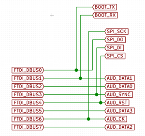
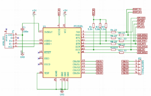
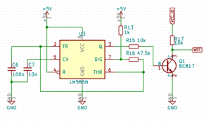
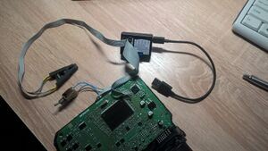

# AUD

> Local mirror of a NissanECU RE wiki page. Source: https://nissanecu.miraheze.org/wiki/AUD
> Retrieved: 2026-07-15. License: Creative Commons Attribution-ShareAlike 4.0 International (CC BY-SA 4.0) ()

---

## Interface description

The interface itself is 4 data lines, and 4 control lines (reset, clock, mode, sync). Refer to the mcu datasheet for more info, both in the AUD chapter and the Electrical Characteristics -> AC Characteristics section. 

## Modes of operation

### Branch trace mode

In this mode, the mcu generates the clock signal (typically @ 20MHz) and shifts out 4 bits every clock, therefore specialized or very fast hardware is required to read the data. FPGA / CPLD based interfaces, or a logic analyzer capable of sampling at least 6 simultaneous channels at >= 80MSps, can do this. 

### RAM monitor mode

The AUD port accepts commands to read/write to the RAM. This mode has also been used succesfully to dump the entire ROM. 

## Example code

There are a few examples floating around the oldweb, some of which were collected here: 

  * [mirror of old ecuhacking forum examples](<http://web.archive.org/web/20100328015152/www.macmadigan.no-ip.com/Public/ECU>)

## Simple AUD debug tool

This tool uses cheap FTDI FT232R USB-UART bridge in synchronous bitbang mode to allow communication with Hitachi SH705x CPU via Advanced User Debugger (AUD) parralel interface. It also contains UART for flashing SH705x CPUs in boot mode using Renesas Flash Development toolkit software and WDT pulse genrator on 555 timer to avoid watchdog IC resetting the CPU during bootmode refash. And as a bonus there also a SPI connector to read/write SPI EEPROM ICs like ST95320, 93c46/93c66 (SW support for 93cxx EEPROM is under development) 

Simple FT232R breakout board could be also used conforming below pin mapping: 

### Hardware

Below is the schematics, it's quite simple though, almost follows vendors documentation. Couple of important things: 

  * 22 Ohm series resistors on each data line. Minimizes voltage spikes at level transitions
  * 5,6 kOhm pull-up resistors on AUD_RST, AUD_CK and AUD_SYNC lines, allowing to get rid of data distortion when CPU for some reason misses one clock on these lines

 

This is how it looks on the table: 

Complete set of KiCAD project files is available along with the SW source on the github (link is below) 

### Software

It uses command line utility called _audprog_ , source codes and binaries are available on github <https://github.com/v-ladimir/audprog> Being run without parameters it shows usage tips. 

#### Typical usage scenarios

##### SH705x CPUs

Dump whole CPU ROM memory, CPU used is SH7055 512Kb ROM size: 
    
    
    	audprog.exe -i AUD -a dump -s 512 -f romdump.bin
    
    

Read memory area starting from 0x1000 and 16 bytes long (both ROM and RAM reading is supported) into file 
    
    
    	audprog.exe -i AUD -a read -o 0x1000 -l 16 -m byte -f romarea.bin
    
    

Same in dwords 
    
    
    	audprog.exe -i AUD -a read -o 0x1000 -l 16 -m longword -f romarea.bin
    
    

  
Print RAM area at 0xFFFF8474 and 0x100 bytes long (please refer to SH705x datasheet for possible memory access modes) 
    
    
    	audprog.exe -i AUD -a print -o 0xFFFF8474 -l 0x100 -m byte
    
    

  

##### EEPROM

Read 32kb EEPROM contensts into the file 
    
    
    	audprog.exe -i EE -a read -s 32 -f ee_backup.bin
    
    

Write 64kb EEPROM contensts with the data from file 
    
    
    	audprog.exe -i EE -a write -s 64 -f ee_new.bin
