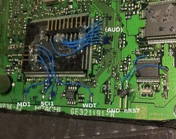
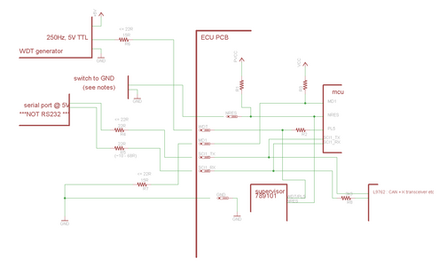
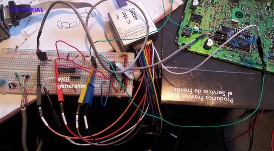

# Bootmode

> Local mirror of a NissanECU RE wiki page. Source: https://nissanecu.miraheze.org/wiki/Bootmode
> Retrieved: 2026-07-15. License: Creative Commons Attribution-ShareAlike 4.0 International (CC BY-SA 4.0) ()

---

# SHBootmode

The "Boot mode" feature of the SH705x mcus allows to reflash them even if the main ROM (referred to as "user MAT" in the Renesas docs") is hosed. It requires physical access to the PCB, however. 

## Wiring

### Testpoints

Location of the testpoints may vary between PCB [hardware versions](<https://nissanecu.miraheze.org/wiki/Ecu_hw> "Ecu hw"), but this patterns seems to be common : 

  * There are two sets of 6 test points on the PCB "back". The first is power (VBat, GND, +5V), the second has at least

  1. WDT (always PL5 ?)
  2. MD1
  3. SCI1_TX
  4. SCI1_RX
  5. nRES

  * They also seem to have equivalent TPs on the component side of the PCB, which may be easier to connect to. Here is an example of a 6Z68A PCB with the boot mode testpoints identified on the component side:

top side testpoints on "type A" 6Z68A

Note that nRES and GND are not proper testpoints but only wired to the nearest convenient locations. 

### ECU signals

  * The nRES pin of the MCU is pulled-up to Vcc internally on the PCB, and some circuits (at least the 789101 supervisor, maybe others) may pull this low with their open-drain outputs. This means hardwiring nRES to Vcc / PVcc is a bad idea !
  * The [WDT signal](<https://nissanecu.miraheze.org/wiki/Wdt> "Wdt") must be supplied artificially to prevent the supervisor IC from resetting the mcu.
  * There may be other ICs connected to the SCI1_TX and _RX pins, such as the K line transceiver. => On 6Z68A, SCI_RX is connected to L9762 through a 3.3k resistor, so having two transmitters (PC TX + L9762 TX) on the same line should not be a problem.

### Sequence of operations

The first steps will be the same regardless of the tool used (ECUflash, Renesas FDT, etc). 

  1. hold nRES to GND (thru <= 22R)
  2. hold MD1 to GND (through <= 22R)
  3. power up everything, generate WDT pulsetrain
  4. release nRES
  5. verify : 
     * good WDT pulsetrain
     * nRES still 5V (verify for at least 2-3 seconds)

**NOTE** \- these mcus automatically ERASE the whole ROM when entering programming mode, no matter what tool is used (FDT / ECUflash / etc). Do not attempt a reflash unless you have a backup of the original ROM !!! 

A quick test to make sure everything works - without entering programming mode - can be carried out with simple terminal software like Realterm / cutecom. 

  1. set COM to 19200bps 8n1
  2. send 0x00 a few times (max 30) until 0x00 is received
  3. send 0x55, this completes the "bit rate adjustment" phase.
  4. receive 0xE6 ("boot OK") !
  5. CAREFUL ! See commands in datasheet, section "ROM -> Further Information -> Serial communication interface specification for Boot Mode "
  6. send 0x20 , this is "Supported device inquiry"
  7. example response : 30 0F 01 0D 30 36 30 31 48 44 36 34 46 37 30 35 38 DC. Note the ASCII in there, "0601" followed by "HD64F7058".

### Example

Before attempting this on any ECU, some important points: 

  * Use the correct testpoints for the mcu (verify continuity to the MD1, PL5, SCI1, nRES pins !)
  * "normal" interlock signal : measure the pulse train on PL5, and make sure your generator can duplicate it !
  * Remove the conformal coat before soldering to the PCB
  * Do not connect directly to, or attempt to lift the mcu pins ! Use the testpoints !
  * Do **not** apply ANY kind of pulling or shearing effort to pads of the PCB !! They **WILL** lift/tear.

  * 

Example boot mode wiring, and internal connections on a 6Z68A ECU

  * 

Full boot mode setup with 6Z68A ECU and logic analyzer

## Links

Note : except for the first link here, pretty much all the info online refers to using SHbootmode to unbrick Subaru ECUs. The exact process they describe is **not** 100% applicable to Nissan ECUs, although very similar. 

  * [Nissan-specific unbricking](<http://www.romraider.com/forum/viewtopic.php?f=7&t=12821>)
  * [RR thread](<http://www.romraider.com/forum/viewtopic.php?f=7&t=7136>)
  * [RR thread](<http://www.romraider.com/forum/viewtopic.php?t=7384>)
  * [NASIOC thread](<http://forums.nasioc.com/forums/showthread.php?t=2200443>)
