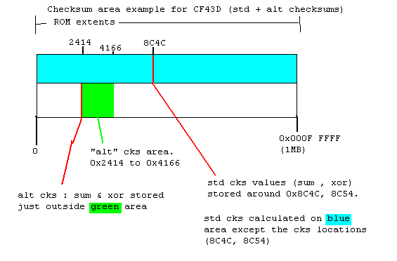

# Checksums

> Local mirror of a NissanECU RE wiki page. Source: https://nissanecu.miraheze.org/wiki/Checksums
> Retrieved: 2026-07-15. License: Creative Commons Attribution-ShareAlike 4.0 International (CC BY-SA 4.0) ()

---

# Checksum algorithms

Depending on model year, the checksums are a combination of sums + xors of the whole ROM. But newer ROMs have an implementation of RIPEMD-160 which needs to be investigated (see 1KA6A, etc). 

Example of areas covered by checksums in CF43D : 

## ck_std : "std"

Two u32 locations in the rom, "sumt" and "xort", are used to save this checksum. sumt = simple u32 sum of all u32 values of the ROM, excluding the sumt and xort locations. i.e. 
    
    
    for (i=0; i< romsize; i+=4) {
       if ((i == sumt_location) || (i == xort_location)) continue;
       sumt += get_u32(&rom[i]);
       xort ^= get_u32(&rom[i]);
    }
    
    

This checksum is constantly calculated and verified during runtime. 

## ck_alt : "secondary" / "alt"

most (all ?) ROMs have this one, as well as another cks. It is also calc'd + verified continuously. 

It is the same "std" algo as described above, but applied to a region of the ROM described in the RAMF struct. On the ROMs I've seen, the u32 "alt_sumt" and "alt_xort" values are stored after the secondary IVT (&IVT2 + 0x400). The region seems to always start after the alt_* values (&IVT2 + 0x408; RAMF.altcks_start). It ends @ ( RAMF.altcks_end) : either &struct FID, or some random shit (i.e. Juke) if the FID struct is before IVT2. The calc loop skips 2 locations (the cks_alt1 vals) => this seems to be unnecessary since they are stored outside the cks_alt1 area ? 

## ck_alt2

Seems to be present in ROMs that also have RIPEMD-160. Limited information due to "recentness" 

  * Area : &ECUREC to ROM_END; ECUREC is something also not found in older ROMs
  * Skips 4 locations : 
    * alt2 values (sumt and xort)
    * ?? (defined in longer struc RAMF) (8200 == RAMF.ECUREC - 4). Very likely to be the offset of first SUM16 value (see below the algo description), that covers ROM config area
    * ?? (&IVT2 - 4) ? Very likely to be the offset of second SUM16 value (for ROM code area)

  

## RIPEMD-160

TODO; see 1KA6A ROM. This algo is very similar to SHA1; it uses the same magic "initial numbers" as SHA1. Both should generate a 20-byte hash ? To locate the RIPEMD code in a ROM, searching for those magic numbers (such as 0x67452301) is a good method. 

  * [RIPEMD160 pseudocode](<http://homes.esat.kuleuven.be/~bosselae/ripemd/rmd160.txt>)
  * [SHA1 pseudocode](<https://en.wikipedia.org/wiki/SHA-1#SHA-1_pseudocode>).

## SUM16

Simple checksum algo that covers two areas in recent CAN-type ROMs. For example in EM62B following areas are covered: 

  * 0x8202...0x10000, probably ROM config and calibrations area, the u16 checksum value is stored @ 0x8200
  * 0x10002...0x80000, probably ROM code area, the u16 checksum value is stored @ 0x10000

The area bounds can be defined more generally as 

  * area A : [0x8202 ... (&IVT2 - 4)]
  * area B : [(&IVT2 - 2) ... end_of_ROM]

This appears to hold true for 7055,7058 and 7059 ROMs : 

ECUID | CPU (ROM size) | &IVT2 | area A | area B   
---|---|---|---|---  
EM62B | 7055 (512k, 0x80000) | 0x10004 | 0x8202...0x10000 | 0x10002...0x80000   
9HA7D | 7058 (1M, 0x100000) | 0x20004 | 0x8202...0x20000 | 0x20002...0x100000   
1A30D | 7059 (1.5M, 0x180000) | 0x20004 | 0x8202...0x20000 | 0x20002...0x180000   
  
(minor observation: u16 values @ 0x8202 and @(&IVT2 - 2) seem to be always 0xFFFF, most likely just padding bytes from a compiler-generated ".align 4" directive. ) 

This checksum is calculated by simpy adding all u16 values in the mentioned areas, i.e. 
    
    
    for (i = area_start; i <= area_end; i += 2) {
       sum16 += rom[i];
    }
