# Ecu hw

> Local mirror of a NissanECU RE wiki page. Source: https://nissanecu.miraheze.org/wiki/Ecu_hw
> Retrieved: 2026-07-15. License: Creative Commons Attribution-ShareAlike 4.0 International (CC BY-SA 4.0) ()

---

# ECU hardware information

Attempting to collect knowledge about different hardware revisions of these ECUs. It would be interesting to correlate the actual hardware (PCB layout, mcu type) with the outside markings and ECUID. I've grouped these by arbiratry type letters which have nothing to do (yet) with markings. [TODO - make a table out of this ] 

# Single microcontroller types

## type A

  * SH7058 (probably never SH7058S)
  * ECUIDs : CF43D (MY06 350Z USDM), 6Z68A (MY03 QG18DE Sentra CAN)
  * Outside markings : 
    * CF43D: "LP" and "MEC60-122 A1 6331"
    * 6Z68A: "0 N" and MEC63-161 A1"

  

### ICs

  * 93C66 : EEPROM (256*16bit SPI)
  * L9762 : all-in-one mess, with voltage regulators, CAN + K transceivers, unknown other stuff
  * 789101 : mask-ROM mcu, seems to be mainly a supervisor / reset controller. See [ext watchdog signal](<https://nissanecu.miraheze.org/wiki/Wdt> "Wdt")
  * misc : some "sub-versions" may have unpopulated IC footprints.

### wiring, pinouts, schem

  * Connections to 93C66:

    
    
      CS=193CPU (PJ15)
      SK=192CPU (PJ14)
      DI=191CPU (PJ13)
      DO=190 (PJ12)
      ORG=VCC ( => EEPROM is wired as 256 * 16bit )
    

  * mcu mode pin connections:

    
    
      MD2 VCC
      MD1 3.3k to MD0/FWE
      MD0 : direct connect to FWE
      FWE : VCC
    

  * Clocking : xtal = 10MHz, peripheral clock most probably 20MHz
  * K line transceiver is connected to SCI1_TX and _RX pins (165, 166 CPU)
  * WDT signal : 250Hz (2ms high, 2ms low) is output from cpu pin PL5
  * Testpoints (TP) on the back of the PCB : 2 groups of 6 TPs;
  * TP group A: 
    * 1,2 VBat
    * 3,4 GND
    * 5 +5V
    * 6 N/C ?
  * TP group B: 
    * 162CPU (PB14) = ?
    * 165CPU (PC0/SCI1_TX) => K
    * 55CPU (MD1)
    * 166CPU (PC1/SCI1_RX) => K
    * 221CPU (PL5) via 1kR => WDT
    * 58CPU (nRES), 3k pullup to PVCC2 ? (mesured)

### pix

  * [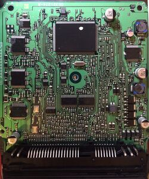](<https://nissanecu.miraheze.org/wiki/File:Pcb_CF43D.jpg> ""type A" PCB, ECUID=CF43D")

"type A" PCB, ECUID=CF43D

  * [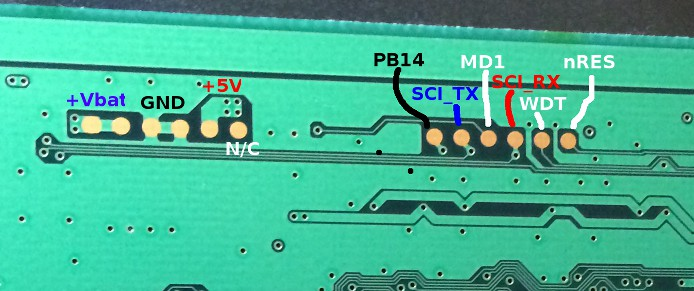](<https://nissanecu.miraheze.org/wiki/File:TypeA_TPs.JPG> ""type A" testpoints")

"type A" testpoints

  * [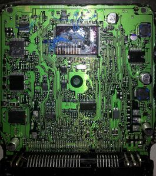](<https://nissanecu.miraheze.org/wiki/File:Pcb_6Z68A.jpg> ""type A" PCB, ECUID=6Z68A")

"type A" PCB, ECUID=6Z68A

## type B

Seems to be a more compact PCB ? And the mcu is mounted 180deg when compared with type A ECUs. 

  * SH7055
  * ECUIDs : EQ910 (MY05 Xtrail AUS)
  * Outside markings : 
    * EQ910: ?

### ICs

Probably the same population as type A ? 

### wiring, pinouts, schem

  * EEPROM : unknown type, but firmware spi_* functions are mostly identical to type A. Connected to the same PORTJ pins as type A.

### pix

[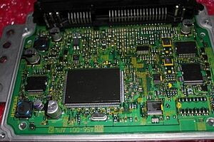](<https://nissanecu.miraheze.org/wiki/File:Xtrail_pcb2.jpg>)"type B" PCB; ECUID=EQ910

## type C

Probably same size PCB as type A. "upside down" mcu, like type B. 

  * SH7058
  * ECUIDs : ZD89A (MY06 Altima USDM)
  * Outside markings : 
    * ZD89A: "63" and "MEC85-521 A1 5913"

### ICs

Probably the same population as type A ? 

### pix

  * [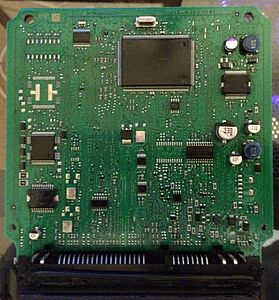](<https://nissanecu.miraheze.org/wiki/File:Pcb_ZD89A.jpg> ""type C" PCB; ECUID=ZD89A")

"type C" PCB; ECUID=ZD89A

  * [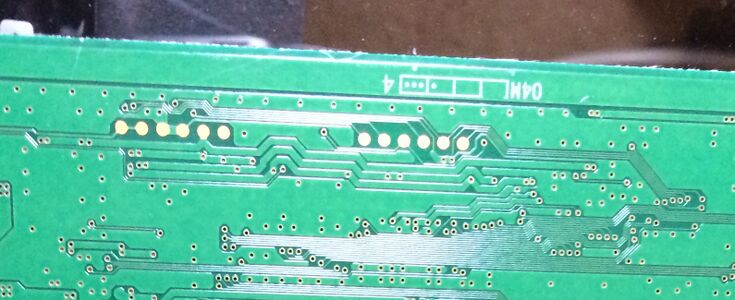](<https://nissanecu.miraheze.org/wiki/File:ZD89A_TPs.JPG> "PCB testpoints, ZD89A")

PCB testpoints, ZD89A

## type D

  * SH7055 0.18μ
  * ECUIDs : EC80A, EC82A, EC87A, EM63A : all HR16DE ECUs

### pix

Open images at full size to see IC definitions and connection pad names  

  * [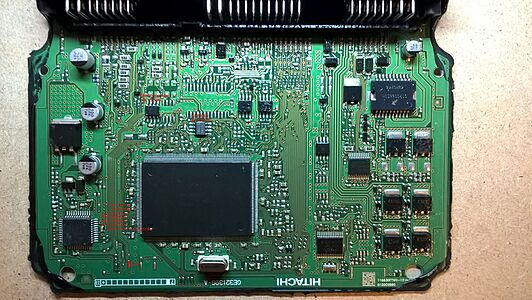](<https://nissanecu.miraheze.org/wiki/File:EC87A_top.jpg> "EC87A, top")

EC87A, top

  * [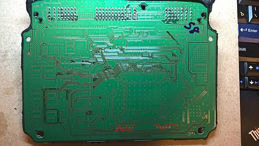](<https://nissanecu.miraheze.org/wiki/File:EC87A_bot.jpg> "EC87A, bottom")

EC87A, bottom

### ICs

EEPROM is M95320 SPI IC  
CAN transiever is TLE 6250 G 

### wiring, pinouts, schem

ECU dissasembling confirmed findings in [disassembly of the ROMs](<https://nissanecu.miraheze.org/wiki/Eeprom_code> "Eeprom code") indicating that the EEPROM is on PORTC, unlike the types A,B,C: 
    
    
    	CK - SCK2 (pin 164)
    	DI - TXD2 (pin 167)
    	DO - RXD2 (pin 168)
    	CS - PC4 (pin 169)
    
    

as observed by Shuher @ RR based on EC87A disasm. Note that the code uses the SCI2 peripheral instead of bitbanging the SPI proto. 

  
**Some useful ECU's main connector pins**

  * [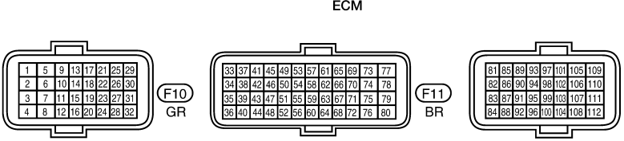](<https://nissanecu.miraheze.org/wiki/File:ECU_pinout.png> "ECU pinout")

ECU pinout

    
    
    	+12V BAT - 105
            +12V IGN - 93
    	GND - 108
    	CANL - 83
    	CANH - 84
    	K-Line - 88
    
    

**ECU pins to CPU ports connections**

Inputs: 

ECU pin | CPU port (SH7055) | Signal | Description   
---|---|---|---  
61 | PA0 / TI0A | POS | Crankshaft position sensor   
65 | PA8 / TIO4A | CAM | Camshaft position sensor   
45 | AN4 | MAF | Mass airflow sensor   
46 | AN29 | IAT | Intake air temperature sensor   
33 | AN22 | THRTL1 | Throttle position sensor 1   
34 | AN20 | THRTL2 | Throttle position sensor 2   
110 | AN8 | APS1 | Accelerator position sensor 1   
103 | AN21 | APS2 | Accelerator position sensor 2   
37 | AN25 | KNOCK | Knock sensor input   
  
Outputs: 

ECU pin | CPU port (SH7055) | Signal | Description   
---|---|---|---  
4 | PB1 | THRTL_CLOSE | Throttle actuator   
1 | PB0 | THRTL_OPEN | Throttle actuator   
73 | PB6 | VVT_VALVE | VVT control solenoid   
31 | PK0 | INJ1 | Fuel injector 1   
30 | PK1 | INJ2 | Fuel injector 2   
29 | PK2 | INJ3 | Fuel injector 3   
25 | PK3 | INJ4 | Fuel injector 4   
17 | PD8 | IGN1 | Ignition coil 1   
18 | PD9 | IGN2 | Ignition coil 2   
22 | PD10 | IGN3 | Ignition coil 3   
21 | PD11 | IGN4 | Ignition coil 4   
  
## type F

  * SH7055 0.35μ
  * ECUIDs : AU40B (MY2002 QR20DE); 8U023 (MY02 Sentra QR25DE)

### pix

  * [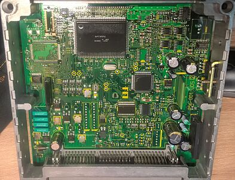](<https://nissanecu.miraheze.org/wiki/File:AU40B_top.jpg> "AU40B, top")

AU40B, top

  * [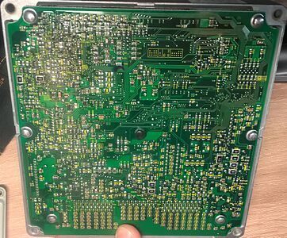](<https://nissanecu.miraheze.org/wiki/File:AU40B_bot.jpg> "AU40B, bottom")

AU40B, bottom

### ICs

EEPROM is 93C66 SPI IC  

### wiring, pinouts, schem

EEPROM: 
    
    
    CS - PJ15 (pin 193)
    CK - PJ14 (pin 192)
    DI - PJ13 (pin 191)
    DO - PJ12 (pin 190)
     
    

Some useful ECU's main connector pins 

  * [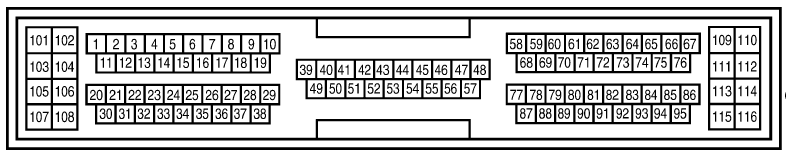](<https://nissanecu.miraheze.org/wiki/File:A40B_pinout.PNG> "ECU pinout")

ECU pinout

    
    
    	+12V BAT - 109, 111
            +12V IGN - 42
    	GND - 106, 108
    	CANL - 34
    	CANH - 33
    	K-Line - 50
     
    

## misc types

Some other PCB examples that are not similar enough to other types to fit in their categories. Some of these probably deserve their own "type" section when someone documents them enough. 

  * [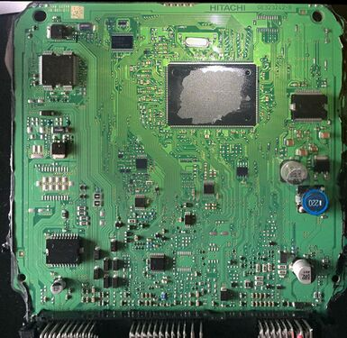](<https://nissanecu.miraheze.org/wiki/File:Pcb_9HA7D_top.jpg> "Altima 2011, 9HA7A/9HA7D")

Altima 2011, 9HA7A/9HA7D

  * [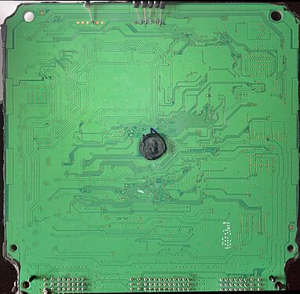](<https://nissanecu.miraheze.org/wiki/File:Pcb_9HA7D_bot.jpg> "Altima 2011, 9HA7A/9HA7D")

Altima 2011, 9HA7A/9HA7D

# Dual-microcontroller types

## type E

  * Two SH7051 mcus
  * Outside markings : 
    * AG920 (Y34 Gloria) : Q2, A56-M43 N01 9716 , UNISIA JECS
    * 2Y967 (A33 Maxima MY00): AB, A56-P35 Z46 9X22, UNISIA JECS

### ICs

  * One or two 93C56 EEPROMs

### pics

  * [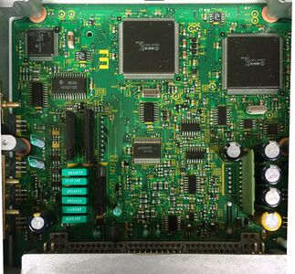](<https://nissanecu.miraheze.org/wiki/File:AG920_PCB_top.jpg> ""type E" PCB, ECUID=AG920")

"type E" PCB, ECUID=AG920

  * [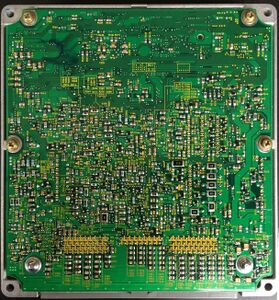](<https://nissanecu.miraheze.org/wiki/File:AG920_PCB_bot.jpg> ""type E" PCB, ECUID=AG920")

"type E" PCB, ECUID=AG920

### wiring, pinouts, schem

Some useful ECU main connector pins. Note, the same connector is used on many different ECUs and sometimes the pinouts may vary. Check the service manual to confirm ! 

  * 

ECU pinout

    
    
    These pinouts are verified on 2Y967 (00 Maxima) and 4M860 (01 Sentra)
    
    43	IGN
    106, 108	ECM GND
    110, 112	ECM B+
    115	K line
