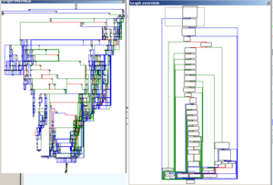
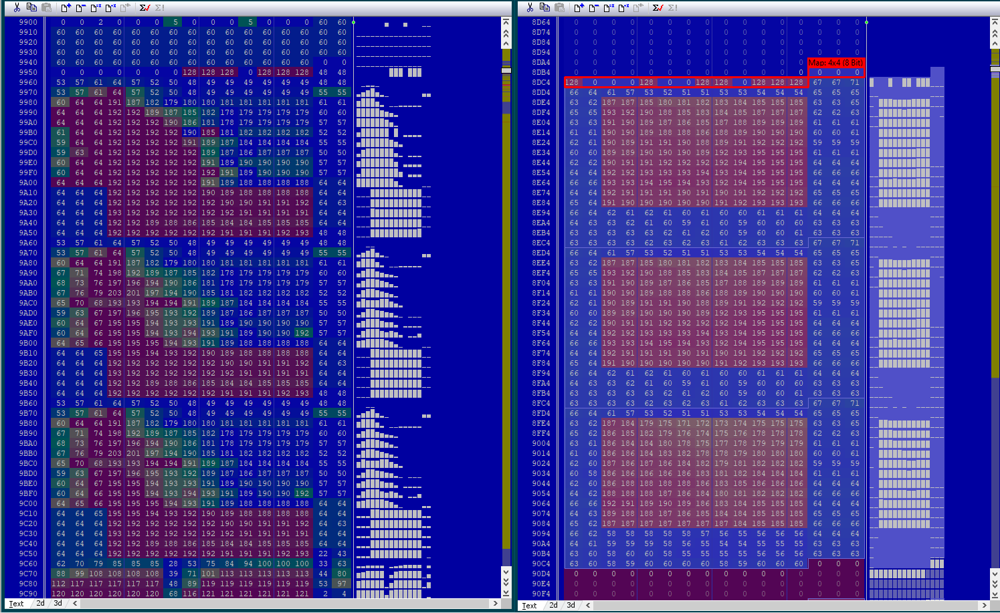
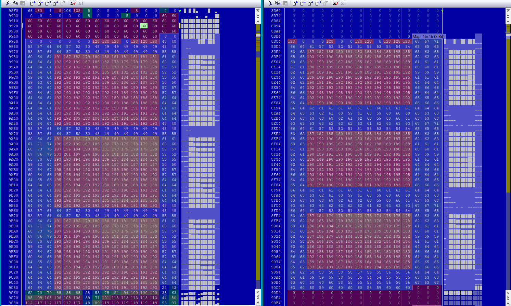
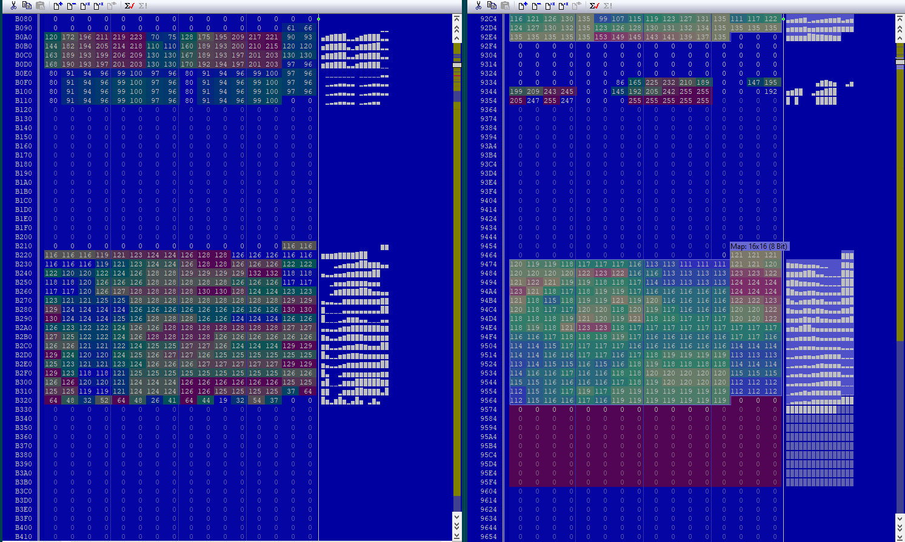
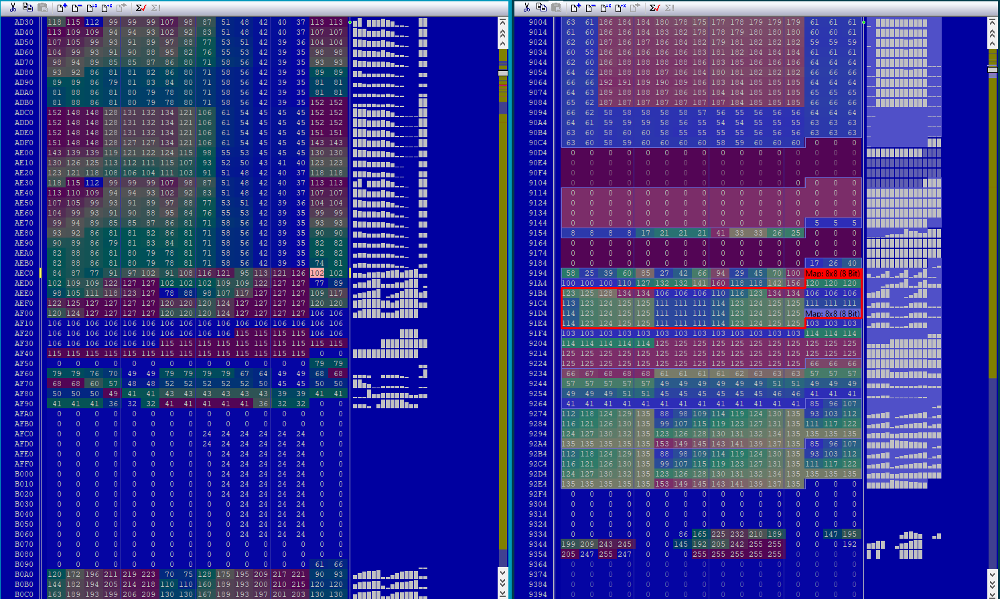
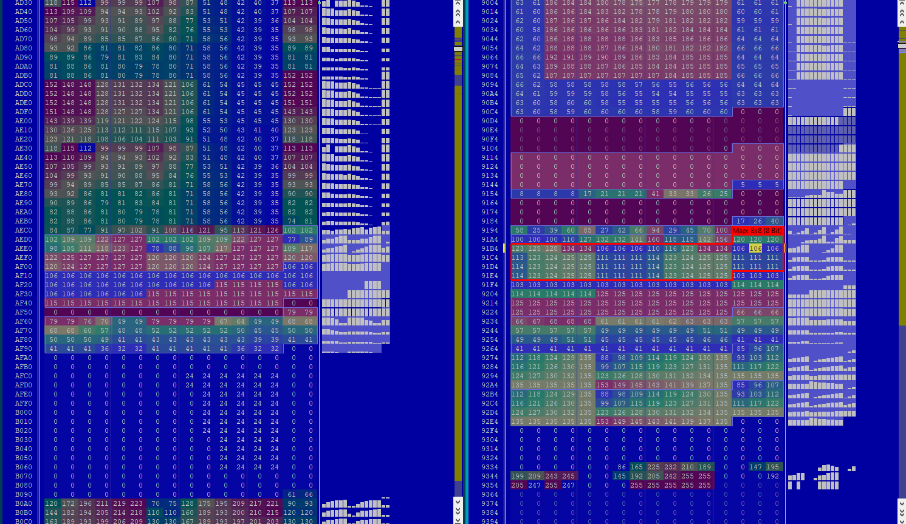
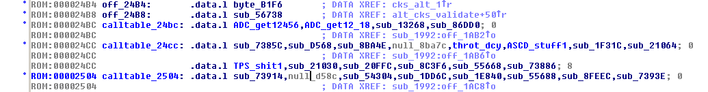

# Firmware re

> Local mirror of a NissanECU RE wiki page. Source: https://nissanecu.miraheze.org/wiki/Firmware_re
> Retrieved: 2026-07-15. License: Creative Commons Attribution-ShareAlike 4.0 International (CC BY-SA 4.0) ()

---

## General Structure

### IVT

The IVT (interrupt vector table / exception vector table) is an array of addresses, each of which is associated with certain exception number. When an interrupt or exception occurs (this includes power-on reset), the mcu fetches the appropriate address and continues execution at that address. This mechanism is described in detail in the datasheet. 

The mcu has a hardware register (vbr) that must be set to the desired IVT location, which can be anywhere in ROM or RAM. At power-on reset vbr is set to zero. Many ROMs use this flexibility to have both a minimal IVT used at power-on, and a secondary IVT for normal use. See Power-on reset code for more details. 

### Power-On Reset Code

There are two first checks for ROM state : 

  1. checks for a "NHU\0xF8" signature near the end of the ROM
  2. checks for possibly a "ROM_written" flag, also near the end of the ROM.

If either of these checks fail, the ROM boots in a type of Nissan bootloader mode; it seems it would accept a limited set of iso14230 commands, based on static analysis. This is untested. 

If the checks succeed, then the code sets the vbr register to point to the secondary vector table. Note : some older ROMs (without the "LOADERxx" metadata structure in the ROM) do not have a secondary vector table at all ! 

Sasha @ RR posts the following example of signatures in a "MY06 350Z ROM": 
    
    
    ROM:000A79B0 .datab.b h'585D0, h'FF
    ROM:000FFF80 NissanMarkWritten_byte_FFF80:.data.b 1 ; DATA XREF: ROM:off_2A8�o
    ROM:000FFF81 .data.b h'FF
    ROM:000FFF82 .data.b h'FF
    ROM:000FFF83 .data.b h'FF
    ROM:000FFF84 NissanSignature_byte_FFF84:.data.b h'4E ; N ; DATA XREF: ROM:off_2A0�o
    ROM:000FFF85 .data.b h'48 ; H
    ROM:000FFF86 .data.b h'55 ; U
    ROM:000FFF87 .data.b h'F8 ; °
    
    

It appears Nissan always use those same 4 bytes for all its ROMs {0x4E 0x48 0x55 0xF8} 

### LOADER Metadata

This " LOADER struct" is a small block of data (roughly 50 bytes), always found relatively near the beginning of the ROM, that contains a few strings: 

  * " LOADERxx" such as "LOADER40" etc. Most likely the loader version.
  * "DATABASE"
  * a CPU string such as "SH705513N". This doesn't necessarily indicate the mcu type; some ECUs have 7055 here even though the mcu is a 7058. The last two digits before 'N' seem to always match the CPUcode in the FID struct, and give some insight into the structure of the ROM.

This looks a lot like a type of primary bootloader that would be flashed at the ECU factory, before the final programming is determined. Then, later during manufacturing the final ROM would be reflashed using this bootloader. This is just speculation however. 

### FID Metadata

" FID struct " This is a slightly bigger block of data that I now split in two parts to ease analysis. The first part (FID base) is approximately 60 to 70 bytes long and contains these elements: 

  * FID string, for " firmware ID" (my own terminology, I have no official source to confirm what this is). This looks like "5X61BECCNA" and other seemingly random combinations of upper case letters and numbers. So far these strings have not proved to be very unique: some ROMs can be slightly different and still share the same FID, but have a different ECUID.
  * " DATABASE"
  * CPU string + CPU code, such as "SH705822". The first four digits are so far always the type of mcu used. The last two digits (CPU code) are some kind of version number, also giving some insight into the structure of the ROM, in particular of the fields present in the second part of the FID struct.
  * in some cases, MSTCR values. This may be a coincidence - often these values are the same as the ones used at reset to set the MSTCR/SYSCR register (this enables/disables certain peripheral clocks). I have found no code referencing these values directly.

The second half ("RAMF" - my own terminology) is mostly pointers to RAM areas, and in some cases information about checksum areas (see <https://nissanecu.miraheze.org/wiki/Checksums> ) TODO 

### Serial Comms : SID Tree

This is how I call the functions that parse ISO14230 requests. SID stands for service ID, see <https://nissanecu.miraheze.org/wiki/Std_14230> and in particular the standards themselves (the SSF version is freely available). 

There are two main types of trees: messy and clean. The type of tree is mainly decided by what compiler and compiler options were used, in other words "coin toss". 

messy vs clean trees

The original source code no doubt contained a few "switch" statements such as 
    
    
    switch (SID_requestnumber) {
    	case 0x1A:
    		...
    	case 0x27:
    	   ....
    }
    
    

With a number of complications: in some operating modes, certain requests are denied (especially during SID27 + SID36 operations). 

The messy tree (e.g. CF43D) has all the handling code inlined in one huge function. The clean tree (e.g. 6Z68A) has every SID handler in a separate subfunction; this makes it much easier to see how each handler works. 

In every ROM, there are at least two SID trees: a larger one handling all the requests available when connecting normally to the ECU, and a smaller one that may be part of a rescue/production reprogramming mode. Which tree is called depends on a complex selection function, and involves a ridiculous number of global variables and flags. 

So far most (all?) 7055 and 7058 ROMs have some interrupt driven code that parses each incoming byte and assembles them into complete 14230 frames. The data part of these frames gets copied at a fixed location in RAM, 0xffff8003. The few bytes at 0xffff8000, before the data payload, contain source/destination addresses (and length?) and usually aren't very important. 

Since the first byte the payload is the SID, the handlers work on the subsequent bytes. 

### Call Tables

These ECUs don't use an OS; they mainly use interrupts and large tables of function pointers, polled continuously in a loop. It turns out these call tables are fairly big (often over 100 entries), this is very helpful for delimiting functions and automating code analysis, for example in IDA. 

## Disassembly analysis and SH assembly patterns

I won't duplicate the info found in the datasheet and the software Manual (read them!!), these are just highlights and tips that aren't immediately obvious. Nissan ROMs are probably compiled with the Renesas "shc" C compiler, which generates sometimes confusing or obfuscated code sequences. 

### Finding RAM References

This is a big part of analyzing algorithms. Variables are stored in RAM and it becomes necessary to track who writes to those locations, and who reads them. I wrote a number of tools to assist with this, see [nissutils](<http://github.com/fenugrec/nissutils>) in particular cli_utils/test_findrefs.c. 

Many references will still elude automatic analysis, but luckily this often has a simple explanation. Many important variables in RAM are copied around in blocks - presumably to maintain state atomically. The pattern is roughly thus: 
    
    
    	;this is the reset code from the second IVT.
    alt_poweronreset:
    	;does a bunch of stuff, then
    	;in the last block of code (looped), we find something like this
    
    lastloop_top:
    	;unimportant
    	mov.l   @(h'10,r11), r13
    	stc     sr, r2
    	and     r10, r2
    	ldc     r2, sr
    
    shortloop:
    	;also unimportant
    	mov.b   @(h'11,gbr), r0
    	tst     #1, r0
    	bt      loc_1005A
    	mov.l   @(h'10,r11), r2
    	mov     #h'48, r0 ; 'H'
    	sub     r13, r2
    	mov.l   r2, @(r0,r9)
    
    	;here is the key: function main_copystuff()
    	mov.l   @(h'64,pc), r2 ; [000100D0] = main_copystuff
    	jsr     @r2 ; main_copystuff
    	nop
    
    	;...... other unimportant stuff
    	bra     lastloop_top
    	nop
    
    

The "main_copystuff" function is recognizable by its length (~ 0x394 bytes) and by its many calls to memcpy. In CF43D, there is a memcpy implementation at 0x4124 which takes 3 arguments : r0=length, r1=destination, r2=source. Here is an excerpt of main_copystuff that copies a 6-byte block from 0xFFFF843E to 0xFFFF8438 : 
    
    
    	;.... r9 was set to 6 a few lines higher.
    	;r0 = length
    	mov     r9, r0
    	;r1 = dest
    	mov.w   @(h'14E,pc), r1 ; [00002DCA] = h'FFFF8438
    	mov.b   r2, @r5
    	;r2 = src
    	mov.w   @(h'14C,pc), r2 ; [00002DCC] = h'FFFF843E
    	mov.w   @(h'14C,pc), r12 ; [00002DCE] = h'4124
    	jsr     @r12 ; memcpy_4124
    	;....
    
    

### Sign Extension for RAM Addresses

Very, very frequent. Put to good use since RAM addresses are often >= 0xFFFF 8000 , and the SH "mov" instruction is sign-extending. This allows the compiler to load a 16-bit value (the lower 16bits of the address) from a literal pool, which sign-extends to the desired RAM address, instead of storing the desired 32-bit value in the literal pool. 
    
    
    	mov.w @(0x60,PC), r11    ;if the 16bit word stored at (PC + 0x60) is 0x8438, this would set r11 = 0xFFFF8438
    
    

### Shll8 to get Peripheral Register Base Address

This is most probably due to the fact that peripheral registers are defined as a "struct" in the compiler headers, and the compiler almost always accesses the members by adding the base address of the struct with "offsetof(struct_member)" : 
    
    
    	mov 0xFFFFFFF5, r2	;encoded as "mov -0x0B, r2", or "mov -11, r2" !
    	shll8 r2		; now r2=0xFFFFF500 (&TCNT6A), the base address for the Channel 6 timer  !
    	mov 0, r0
    	mov.w r0, @(0x10,r2)	; clear 0xFFFF F510 (BFR6A), the actual register we're interested in.
    
    

### Function Calling Convention

Almost every function respects this ABI convention (described in the [Renesas compiler manual](<https://www.renesas.com/us/en/document/mat/superh-cc-compiler-package-v904-users-manual?language=en&r=1054751>); GCC and Renesas SHC ABIs are compatible): 

  * Arguments to functions are passed in r4,r5,r6,r7 as needed;
  * Return values of functions are returned in r0.

### Delay Slot

This is well explained in the datasheets, but easy to forget when starting out: most branch/jump instructions execute the next opcode before jumping to their destination. Some examples: 
    
    
    	bra next_iter
    	mov 0, r0
    	....
    next_iter:
    	more code
    
    

Easy. r0 gets set to zero before we reach next_iter. 

Also very common: 
    
    
    	mov @(0x66, pc), r2	;r2 = 0x6a24
    	jsr @r2		;sub_6A24
    	mov 0x68, r4
    
    

Here, as defined by the ABI, the first argument to sub_6A24 is passed in r4. 

More confusing: 
    
    
    	bsr sub_whatever1
    	mov 0x55, r5
    	bsr sub_whatever2
    	mov.w r0, @(0x18, gbr)
    
    

In this case, the last mov.w is actually storing the return value of the *first* function call (sub_whatever1), just before executing sub_whatever2 ! 

### Interrupt Disable/Lock

A very common pattern; quick to recognize. The first half updates the IMASK bits in the sr register to disable all interrupts, saving the original IMASK for later. The second half is the exact opposite and restores the IMASK bits. The purpose of this maneuver is to protect a section of code so it runs from beginning to end without interruption. 
    
    
    stc     sr, r0
    shlr2   r0
    shlr2   r0
    and     #h'F, r0
    mov     r0, r4	;saving original IMASK to r4
    stc     sr, r0
    mov.w   @(h'FA,pc), r1 ; [00045BB2] = h'FFFFFF0F
    and     r1, r0	;useless
    or      #h'F0, r0	;set IMASK to b'1111
    ldc     r0, sr	;update
    
    .....
    critical code here
    .....
    
    mov     r4, r0
    and     #h'F, r0
    shll2   r0
    shll2   r0
    stc     sr, r2
    mov.w   @(h'16,pc), r3 ; [00045BB2] = h'FFFFFF0F
    and     r3, r2	;clear IMASK bits
    or      r0, r2	;restore orig imask
    ldc     r2, sr
    
    

### Stack Management

How a stack works is mostly common knowledge and beyond the scope of this page, so I'll skip over the basics. Unlike x86, there are no dedicated push/pop opcodes. To accomplish the same, r15 is used as a stack pointer. Then, in function prologues, this type of code sequence is used to save registers: 
    
    
    mov.l   r13, @-r15
    mov.l   r14, @-r15
    sts.l   pr, @-r15
    stc.l   gbr, @-r15
    ...
    
    

The "@-" notation means "pre-decrement", so the r15 value is updated before storing each register to the stack area. Then just before returning, the function will restore the regs with the corresponding "@r15+" post-increment operator: 
    
    
    ...
    ldc.l   @r15+, gbr
    lds.l   @r15+, pr
    mov.l   @r15+, r14
    rts
    mov.l   @r15+, r13
    
    

Note the crafty use of the delay slot ! 

### Global Variable Structs

Confusing and inconsistent, some global vars are accessed sometimes with a direct address, sometimes with gbr-based addressing. TODO 

  

### WinOLS Demo Disassembly

**DISCLAIMER- I do want to note that the screenshots provided are being used for an educational purpose. Thus, falling under fair use.**

**Setup;**  
So to start, WinOLS will look a bit funky. Not very user friendly looking. If you open your ROM and it's just lines (2D Mode), then switch it to text mode. You can do this at the bottom left of your ROM view window. So what you'll want to do is go to the taskbar in WinOLS and click "_Miscellaneous_ " -> "_Configuration_ " -> Enable "_For hex values remove leading zeros_ " What this does is it makes those ugly 0000 values go down to just 0. This will make it so it's easier to distinguish between empty cells and actual values. 

Some basic key usages- "_a_ " will let you jump to an address. You do NOT need the 0x in front of it. "_k_ " will create a map wherever you last clicked. If you highlight anything, you will have to right click outside of the highlighted cells in order to create a new map. What I do is right click the potential starting cell of a map/value/table, copy the address, then click "_k_ ", set the axes length, then add the address to my definition file. 

  
  

You'll also want to change the values from Hex ("_FF_ ") to decimal ("_255_ ") as seen above. Don't forget to enable the coloring by click the colored box at the far right. This enables coloring based off the values. This makes it much easier to identify curves, maps, you name it! 

* * *

**Value Types;**  
The data will typically be viewed in either 8-bit or 16-bit mode. There are a few 32-bit values, but nowhere near as many as 8-bit and 16-bit. The main thing to look for with 8-bit is whether you should be in uint8 or int8 (unsigned or signed.) This will be map dependent. 16-bit is a tad bit different, as you can view the data as either LoHi or HiLo. You will need to set this to "_HiLo_ " for 16-bit values. WinOLS doesn't do this automatically most of the time. So whenever you switch from 8-bit to 16-bit, you'll need to switch it back to HiLo. You can do this by clicking the "_LoHi/HiLo_ " box next to the "_+/-_ " (unsigned/signed) box. By default, the values are unsigned. When you click the "_+/-_ " box, it changes the values to signed values. 

Typically, the value types will be setup in chunks. For example, the values between 0xA000-0xB000 will be uint8 values (for the most part), while 0xB000-0xD000 could be uint16 values (for the most part.) These ranges aren't legitimate, they're just to show an example. While most of the values within whatever range will be the same type, there will be outliers. So don't just assume that all the values will be the same type. If you're cross referencing with another ROM, this shouldn't be an issue. _If needed, you can always view the definition template xml and see what values/tables/maps are what value type._

* * *

**ROM Disassembly;**  
ROMs from the same market and vehicle will be extremely similar. Both in the values of the maps, as well as the patterns, what maps the ROM has, what flags are active, etc. So if you can find a ROM from the same market and vehicle as yours, then you're set. Do take note, the storage addresses will not be identical. When it comes to the 350z, I've had no trouble at all cross referencing my 06 Automatic (CF48D) with even an 03 Manual (CD002). So any 350z ROMs can be cross referenced with CF48D, which is the best ROM to cross reference besides the A2L. 

The one issue with the A2L is the fact that even though the A2L.xml definition template used by CF48D is based on the A2L file, the names are unique. So while you could use the A2L to cross reference, you wouldn't easily be able to add the maps you find to your definition template. I've tried remedying this by including the A2L abbreviation in all the maps' descriptions. So if you cross reference ZB060 (A2L ROM), then you can still use the A2L.xml template. You'll just have to search for the abbreviation inside to figure out what the table name is. 

So while same market/vehicle ROMs are easy to cross reference, what are you supposed to do if there isn't a ROM available like that? 

* * *

**Unique ROMs;**   
For this example, I'll be cross referencing _1KA6A_ (Left- 2010 Nissan Juke) with _CF48D_ (Right- 06 Nissan 350z) Two very different vehicles. 

borderless

  
On the right, you'll see the three ignition timing maps inside of _CF48D_. On the left, you'll notice that it might not look very similar at first glance. But when you start looking deeper, you start to pickup the little things. You might notice that there is a similar pattern at the very top. "**128 128 128 0 128 128 128** " in _1KA6A_ , and "**128 128 0 128 128 128** " in _CF48D_ right before the defined Cold Ignition Trim Map in _CF48D_. Then following that back a bit, you'll notice that right after the chunk of "**60** " values, there seems to be a bunch of zeros before those 128's, just like in _CF48D_. 

High Temp Fuel Compensation (0x8DC1 for _CF48D_) is the map defined in _CF48D_. So potentially, 0x994E (the start of the 0 values in _1KA6A_) is the same map! You can verify this in IDA by finding the axes and seeing if they line up with _CF48D_ or any other way of verification. I won't be discussing verification as that's something that you just need to have experience with. So after verifying/presuming, we know that 0x994E is in fact, High Temp Fuel Compensation for _1KA6A_! 

In _CF48D_ , the three ignition trim maps are right after this map. If you look in _1KA6A_ , you'll notice three very similar maps with similar values. As we know that the High Temp Fuel Compensation map is right before the beginning of the first map, it would be safe to presume that these three maps are the ignition timing maps. You would want to verify, but it's a safe bet that they're the right maps. So now we have the three timing maps defined. Directly going off of _CF48D_ map patterns, we find the possible Cold 0x995E High Octane 0x9A5E and High Detonation 0x9B5E ignition trim maps. 

Due to the vehicles being extremely different, it's not safe to presume that these are the actual order or that they retain the same functionality as in _CF48D_. So you would have to do further research through IDA/Ghidra, patents, others, etc. But you at least have the maps defined now. 

  
**So after defining those maps, you'll now notice that they look extremely similar in _1KA6A_ to _CF48D_! So that's why you need to look at the values around a potential map. They will be able to tell you what the map potentially is/help verify your suspicions.**

**Here you can see Fuel Compensation defined for _CF48D_ on the right, and a chunk of values that looks awfully similar. It would be safe to assume that 0xB21E in _1KA6A_ is probably the Fuel Compensation map. You would want to verify this, but it is most certainly a safe bet.**

Most importantly, now you have a lower and upper limit setup. So between (High Temp Fuel Compensation Map 0x994E-0xB21E (Fuel Compensation) in _1KA6A_ will potentially store similar maps as _CF48D_ does from 0x8DC1-0x9471. You'll notice that the gap between maps is significantly larger in _1KA6A_ . This is due to that ROM having maps not found in _CF48D_ within that range. But there's a very good chance that the maps between 0x8DC1-0x9471 in _CF48D_ will be in _1KA6A_ within the range of 0x994E-0xB21E.****

**Obviously, these two ROMs look extremely different in this side by side. In _CF48D_ , you can see the High Detonation Ignition Trim map, yet there are these weird values in _1KA6A_ instead of the high detonation map. This is once again due to _1KA6A_ having maps that _CF48D_ does not have. As both vehicles have different ways of controlling the vehicle, you're not guaranteed to have the same maps.**

For manual and automatic Z's, for instance, I've noticed that there are some maps that are completely unique to _CF48D_ that aren't defined in the A2L or an 06 manual 350z. Yet the target drive force maps used for CVT's are in nearly all Nissan ROMs :) 

Now, take note of the map in _CF48D_ that has the red outline. The more you look at it, the more obvious the patterns become. ****

So thanks to having that range defined from earlier, we were able to locate three maps that we never would've been able to locate otherwise! Oddly enough, they're in the same order as _CF48D_. So you could imply that the map locations pattern (the order of the maps in the ROM) in _CF48D_ is worth looking into for _1KA6A_. 

So now that you have these maps defined, you can shorten the range to find maps between the timing maps and the maps you just defined. You can continue doing this till you either define all the maps you can in that range, define the map you want to define, or conclude that the map doesn't exist at that position in one of the ROMs. 

It is crucial that the ROM you're cross referencing your ROM with is defined. Thanks to _CF48D_ being defined, I was able to open up a ROM that was extremely different from mine and still manage to define some maps for it with ease. So it's all about finding similarities and working from those similarities. Those ignition maps are the easiest ones to locate in most ROMs. Once you a point set where you know both the ROMs are the same, you can work off that and grow it into something much larger. It's how I went from a total of 35 maps defined to being well over 2100 maps defined for _CF48D_. I just started at the timing maps and worked my way from there! 

Do take note that just because _1KA6A_ is able to potentially follow the same map pattern as _CF48D_ doesn't mean that it will be this way for all ROMs. There will be some ROMs that are just too different to cross reference with _CF48D_ (I haven't found any that this was the case, but I'm sure they're out there) If that ever is the case, _CF48D_ could still be used, just not in the same way it can be used for similar ROMs. Also, I defined 3D maps above. These are the easiest things to define when cross referencing. You will start to struggle more once you try to compare 2D tables and 1D values, as the pattern is much more difficult to visualize (If there even is one) as well as the fact that 1D and 2D values are more likely to be ROM specific (whether it's in the ROM or not) than 3D maps. 

Do also note that _CF48D_ is a SH7058 ROM. So it has double the space as a SH7055 ROM. So it's pretty much guaranteed that it will have maps that are not found in a SH7055 ROM. If a ROM doesn't have a map, it'll either be zeroed out values or the space where the map would be just won't exist at all. 

* * *

**Saving Your Progress;**   
So how exactly do you go about saving your progress? So WinOLS will just number any ROM you open, with no easy way to identify ROMs when you start having quite a few in your history. So what you'll want to do is go to the taskbar in WinOLS and select "_Project_ " -> "_Properties: Version_ " -> "_Name_ " and then enter in the ECUID / whatever identifier you want. Make sure to check the description box to make sure that you're naming the proper ROM. It will pull up the version properties of whatever ROM window is the current primary one. 

So while this isn't a super in depth guide, hopefully it provides others with the basics so that they can at the very least, get started with basic ROM disassembly. I would highly recommend you start by opening up two similar ROMs (same year and model, or same model) and going to the addresses of maps that are defined in both ROMs to compare. You'll be able to see the pattern (what maps are around it) and hopefully be able to utilize it to define more maps. There's an endless amount of possibilities when it comes to ROM disassembly. You'll have different techniques depending on what your goal is. This is just a guide to help get you started if you're brand new and wanting to get into ROM disassembly. 

## Checksums

### algo

see [Checksum algorithms](<https://nissanecu.miraheze.org/wiki/Checksums> "Checksums")

### Checksum functions

For the standard checksum (calculated over the entire ROM), these functions are usually present: 

  * main checksum calculation function which computes the sums on a fraction of the ROM and updates the current totals. This function eventually runs a few times before the whole ROM is covered.
  * single step function, where one dword of the ROM is added to the current computation. I assume this is to make a very fast function, maybe called from time-sensitive sections where the main function would take too much time.
  * comparison function, that runs after the current computation is finished, and compares the calculated values with the hardcoded expected values.
  * validation function, checks the result of the comparison and sets some flags and DTCs if necessary.

For the alternate checksums (alt, alt2), the functions are very similar. 

## EEPROM

see [EEPROM access functions](<https://nissanecu.miraheze.org/wiki/Eeprom_code> "Eeprom code")

## security / encryption

It seems everything uses the same algorithm. Somewhere Nissan calls this algo "01", so I'll use that notation. It operates thus: 

  1. uint32_t fwd_01(uint32_t data, uint32_t scode); // encodes 'data' using 'scode'.
  2. uint32_t rev_01(uint32_t data, uint32_t scode); // decodes 'data' using 'scode'.

They are the inverse of each other, i.e. ( rev_01( fwd_01(data, scode), scode) == data ) 

In both forward (encrypt) and reverse (decrypt) directions, this uses three helper functions, one of which simply swaps data between registers and is common to both directions (the two other helper functions are different for encrypting and decrypting). The swap function is fairly easy to find and leads directly to SID27 and SID36 code. 

The details of the algorithm itself are not very important, but are implemented and partly documented in the source code for nisprog CLI tools (TODO : links ?). 

The fwd / rev functions, for some reason, don't strictly follow the ABI convention of passing the three first parameters in the r4, r5, r6 registers. Instead they assume the key to be stored in hardcoded RAM locations. Even more, these RAM locations are often the same between ROMs. One set of popular locations is 0xFFFF8416 and 0xFFFF8418, where each half-key is stored and used. Again the details of this aren't very important. 

The 01 algo is used for 

  * SID 27 key exchange (use "fwd_01" to generate key from seed)
  * SID 36 RAM bootloader kernel download ("rev_01" to decode the payload; fwd_01 was used to encrypt it)
  * SID 36 firmware payload download (rev_01 to decode the payload)

on most known ROMs. Algo description and equivalent C code [[posted here](<http://www.romraider.com/forum/viewtopic.php?p=102962#p102962>)]. 

### Of keys

Every ROM has a set of three keys, one for SID27 and two for SID36. The SID27 key is used in the first step of the reflashing process for the security handshake. 

The first SID36 key is used to decrypt the payload (such as a reflashing kernel) sent from the host, which is then executed from RAM. 

The second SID36 key is contained in the ROM, but not used directly by it (except in CAN ROMS perhaps ? e.g. 1A30D, with the sid36k2 0x6E6C2EE9, appears to be used in some bootloader code around 0x195C). In K-line ROMs, it is only copied into a "preload" structure just before running the payload (in effect passing a bunch of parameters to the payload); the original Nissan kernels then retrieve it and use it to decrypt the new incoming ROM payload. This third key is of course only used during a factory reflash, and is not very useful to us. 

### Finding keys in ROMs

[TODO] move this section to a separate page ? 

Some keysets are common to more than one ROM, so far there are a few ways to determine which keyset is used: 

  * maintain a list of ECUID - keyset pairs
  * similar ECUIDs often use the same keyset, this can be used to expand the list for new ECUIDs
  * dump the ROM and look for known keys, this often works because some keysets occur frequently
  * dump the ROM and run nisrom , this usually except for new code patterns that the utility isn't aware of
  * dump the ROM and manually find the keys, a last resort method.

#### technique for finding SID27 code and keys : SH705927

On SH705927 , like 1A30D, 1YZ5A, 1NH3A : it can be tricky to automate because of this type of pattern to load two halfkeys: 
    
    
    EA 05       mov     #5, r10
    EB 1B       mov     #h'1B, r11
    ...
    4A 18       shll8   r10
    4B 18       shll8   r11
    7A D6       add     #-h'2A, r10     ; r10 = 0x04d6 !!!
    7B 4D       add     #h'4D, r11 ; 'M' ; r11=1B4D !
    
    

This results in the key 0x04d61b4d , but it would be impossible to search for this literal value (or even either of the halfkeys) since they are "computed". A decompiler like ghidra definitely helps. 

To find the sid27 code, I manually search for a "mov 0x67, rX" opcode followed by a "mov.b rX, @(....)" which indicates building a SID 27 response. There are usually dozens of hits for the mov 0x67 instruction but only a handful that are followed by the response building, which looks like this : 
    
    
    ROM:0003C8D0 E2 67                       mov     #h'67, r2 ; 'g'
    ROM:0003C8D2 04 24                       mov.b   r2, @(r0,r4)
    ...
    ROM:0003C8DA E5 01                       mov     #1, r5
    ...
    ROM:0003C8E2 04 54                       mov.b   r5, @(r0,r4)  ; response looks like 67 01 XX XX XX XX ....
    ...
    ROM:0003C8EE 06 54                       mov.b   r5, @(r0,r6)
    ... more of the same, then
    ROM:0003C91C 47 0B                       jsr     @r7 ; prepare_txframe
    ROM:0003C91E 65 0C                       extu.b  r0, r5
    ROM:0003C920 49 0B                       jsr     @r9 ; sid27stuff
    

Or once decompiled: 
    
    
            (&tx_msgbuf?)[(int)DAT_fffeda91 & 0xff] = 0x67;
            (&tx_msgbuf?)[uVar5] = 1;
            uVar5 = uVar5 + 1 & 0xff;
            (&tx_msgbuf?)[uVar5] = (char)((uint)iVar26 >> 0x18);
            uVar5 = uVar5 + 1 & 0xff;
            (&tx_msgbuf?)[uVar5] = (char)((uint)iVar26 >> 0x10);
            uVar5 = uVar5 + 1 & 0xff;
            DAT_fffecf1c = iVar26;
            (&tx_msgbuf?)[uVar5] = (char)((uint)iVar26 >> 8);
            uVar5 = uVar5 + 1 & 0xff;
            (&tx_msgbuf?)[uVar5] = (char)iVar26;
            prepare_txframe((int)DAT_fffeda91,uVar5 + 1 & 0xff);
            uVar5 = sid27stuff();
    
    

## Arbitrary code execution

Note : this section applies mainly to K-line based ECUs. It's possible some of the steps will work on CAN-only ECUs ? 

This is the stepping stone towards reflashing over the OBD K line or CAN interface, without opening the ECU case. Some nice things that can be done : 

  * Run a "fastdump" kernel to read out the ROM much faster than the standard K line method
  * Read / write the external EEPROM
  * Reflash all, or part of the ROM

The method is as follows : 

  1. write / compile payload, either as position-independant code, or linked to run at the ECU's "RAMjump" address.
  2. Pad payload to next multiple of 32 bytes
  3. Calculate "cks16" : unsigned 16bit sum of all 8-bit bytes of the (unencrypted) payload
  4. encrypt payload using "sid36 key 1"
  5. Connect to ECU
  6. SID 27 seed/key exchange
  7. SID 34 80, enter programming mode
  8. SID 36 XX YY 0x20 B_00 B_01 B_02... B_31
  9. Increment XXYY at every line : "36 00 00 20 ...... 36 00 01 20 ...."
  10. SID 37 cks16_H cks16_L TransferExit
  11. SID BF 00 ramjump check
  12. SID BF 01 actual ramjump.

The payload must be crafted to disable all interrupts and take over the manual generation of the WDT pulse train. Or, it might be possible (if the goal isn't a reflash) to use the firmware's mechanism for the WDT ? i.e. enable a limited set of interrupts, etc) 

A very simple test payload that simply freezes the ECU (causing the supervisor to reset it) could look like 
    
    
    	00 02	stc	sr, r0
    	CB F0	or	#h'F0, r0
    	40 0E	ldc	r0, sr
    deathloop:
    	AF FE	bra	deathloop
    	00 09	nop
    
    

## DTC

### Finding DTC code and data

There's a few ways to go about this but here's my current method: 

  1. search the ROM for 4-byte values like 0x00000605 (for P0605), or any other DTC known to exist on that ROM. P0605 (ECM failure) seems pretty common accross most ROMs.
  2. from those multiple occurences it's pretty easy to recognize the DTC descriptor table (see Firmware_re#data structures section below)
  3. follow the xrefs to that table, to figure out 
     1. number of DTCs defined for this ROM (approx 250, give or take)
     2. location of the DTC status block in RAM
     3. DTC_set() function
     4. DTC options block

Older method, I don't do this any more 

  1. find the ISO 9141 code (hint : "mov 0x6B, X" near a "mov 0x48, X")
  2. go to the mode 1 request handler
  3. browse to the part of the code that handles mode 1 PID 1, this reports the number of DTCs set.
  4. it does this by looping over the DTC status block in RAM and checking some flags for each possible DTC. This gives two pieces of information: 
     1. number of DTCs defined for this ROM (approx 250, give or take)
     2. location of the DTC status block in RAM
  5. go back a few steps and find the OBD mode 3 request handler (this one returns the DTC numbers such as "12 20" for P1220, etc.). This gives us locations of two data structures in the ROM: 
     1. DTC descriptor block
     2. DTC options (?) block

### data structures

  * DTC_status block

Each DTC has 3 bytes of status: 
    
    
    struct dtc_status_t {
    	u8	flags_0;	//?
    	u8	flags_1;	//bit field ?
    	u8	flags_2;	//bit field ?
    };
    
    

Contents of each flag needs to be investigated. I expect them to contain the required info for multi-trip detection logic and clearing conditions, pending/set status, etc. 

The status block itself is an array of those 3-byte structures: 
    
    
    struct dtc_status_t DTC_status_block[total_number_of_DTCs];
    
    
    
    
    ;Example from 6Z68A showing DTC index # 34 (code P1612 according to descriptor block) with some other unknown flags set
    RAM:FFFFB23E                 dtcstatus <0, 0, 0>     ; 30
    RAM:FFFFB23E                 dtcstatus <0, 0, 0>     ; 31
    RAM:FFFFB23E                 dtcstatus <0, 0, 0>     ; 32
    RAM:FFFFB23E                 dtcstatus <0, 0, 0>     ; 33
    RAM:FFFFB23E                 dtcstatus <0, h'C0, h'4B>; 34
    RAM:FFFFB23E                 dtcstatus <0, 0, 0>     ; 35
    
    

  

  * DTC_descriptor block

    
    
    // Each DTC has a descriptor (0x0c bytes each)
    struct dtc_descr_t {
    	u8 field_0;	//DTC supmask address offset
    	u8 field_1;	//DTC supmask bit
    	u8 field 2;	//hardware flag 1=O2S1B1, 2=O2S1B2, haven't found a practical use for these yet
    	u8 padding_0;	//always 0 (so far)
    	u32 dtc_code;	//like 0x605 for DTC "P0605"
    	u32 flags_2;	//bit field, less specific than hardware flag, only 4 observed, again no practical use discovered yet
    };
    // And stored in the ROM is the descriptor table:
    struct dtc_descr_t DTC_descriptors[total_number_of_DTCs];
    
    

Note : a same dtc_code can used multiple times in that table, probably to distinguish between causes for the same DTC code. Here too, more investigation would be needed. 
    
    
    ;example from CF43D
    ROM:0000E0C4 DTC_descr:      dtcdescr <h'40000, h'500, 0>; 0
    ROM:0000E0C4
    ROM:0000E0C4                 dtcdescr <h'10000, h'1211, 0>; 1
    ROM:0000E0C4                 dtcdescr <h'1000000, h'1217, 0>; 2
    ROM:0000E0C4                 dtcdescr <h'2070000, h'605, 0>; 3
    ROM:0000E0C4                 dtcdescr <h'2060B00, h'400, h'10000000>; 4
    ROM:0000E0C4                 dtcdescr <h'2010000, h'1148, h'20000000>; 5
    ....
    
    

  * DTC_supmask

A bitfield at least as long as the maximum u8_field value in DTC descriptor block. The DTC descriptor block contains DTCs that the ECU may not support, the supmask is used to determine whether certain portions of code are executed to set DTCs. 1=enabled, 0=disabled 

  * DTC_options block

This one is a bit unusual; instead of being an array of data structures like the previous two blocks, this one is an array of pointers, each referencing the actual 16 bit value that contains the option flags. Some of these flags appear to enable/disable setting of the DTC, prevent it from being reported by standard OBD requests, etc ? 
    
    
    u16 *DTC_options[total_number_of_DTCs];
    
    

Example from CF43D: 
    
    
    ROM:0000ED78 DTC_optionwords:.data.l 0xD714       ; 0
    ROM:0000ED78                 .data.l 0xD704       ; 1
    ROM:0000ED78                 .data.l 0xD63A       ; 2
    ROM:0000ED78                 .data.l 0xD53A       ; 3
    ....
    ; and some example option words :
    ROM:0000D704 word_D704:      .data.w h'20
    ROM:0000D706 word_D706:      .data.w h'20
    ROM:0000D708 word_D708:      .data.w h'43E3
    
    

  * 

I don't know where to upload the photo???

## ADC

Unfortunately the ADC-related code is spread out across a number of access functions, and a few different methods are used throughout the ROM. Here are a few (incomplete) notes. 

### get_ADC_from_table method

This is used for about a dozen ADC channels. There's a data structure in the ROM that describes a set of channels, giving for each the address of the control and data registers: 
    
    
    struct ADC_descriptor_t {
    	u8 *p_AD_CR
    	u8 *p_AD_CSR;	//
    	u32 flags;	//unknown; top byte seems to be index of ADC channel within its block?
    	u16 *p_AD_data;
    };
    // Example from 6Z68A:
    ROM:000032C0 ADCtable_32C0:  ADC_descr1 <ADCR0_B, ADCSR0_B,  h'3000000, ADDR3H_B>; 0
    ROM:000032C0                 ADC_descr1 <ADCR0_B, ADCSR0_B,  h'7000000, ADDR7H_B>; 1
    ROM:000032C0                 ADC_descr1 <ADCR0_B, ADCSR0_B,  h'8000000, ADDR8H_B>; 2
    ROM:000032C0                 ADC_descr1 <ADCR0_B, ADCSR0_B,  h'A000000, ADDR10H_B>; 3
    ROM:000032C0                 ADC_descr1 <ADCR0_B, ADCSR0_B,  h'B000000, ADDR11H_B>; 4
    
    

This table is used by the ADC_getfromtable function, that takes one argument (index into that ADCtable) and returns the desired (ADC value >> 6). This shift simply aligns the 10 - bit data to the least significant bit positions. 

### Direct method

This uses the shll8 trick described above, adding the required offset to access the ADC value directly. Example from 6Z68A: 
    
    
    ROM:0008C51A                 mov     #h'FFFFFFF8, r14
    ROM:0008C51E                 shll8   r14             ; r14 = 0xffff f800 = &ADDR0H
    ROM:0008C520                 mov.w   @r14, r2        ; get ADDR0 val
    ROM:0008C522                 extu.w  r2, r0
    ROM:0008C524                 shlr2   r0
    ROM:0008C526                 shlr2   r0
    ROM:0008C528                 shlr2   r0		;align to LSB
    ROM:0008C52A                 mov.w   r0, @(h'11A,gbr) ; copy to ADCvals area in RAM
    ROM:0008C52C                 mov.w   @(2,r14), r0    ; get ADDR1 (ASCD)
    ...
    
    

## iso14230 Common Identifiers (CID)

These ROMs implement many CIDs for querying/retrieving both realtime parameters and built-in values. This is done with SID 22, documented in the 14230 docs and a dedicated [SID 22](<https://nissanecu.miraheze.org/wiki/SID22> "SID22") page. The data returned by the ECU seems is 1 to 4 bytes long depending on CIDH. 

Every CID is 2 bytes, CIDH and CIDL. 

  * 0x12 0x00 : get mask of supported CIDs in range 12 01 to 12 20. If 12 20 is supported:
  * 0x12 0x20 : get mask of supported CIDs in range 12 21 to 12 40.

etc. the "support mask" is implemented exactly like [OBD Mode 1 PID 00](<https://en.wikipedia.org/wiki/OBD-II_PIDs#Mode_1_PID_00>)
    
    
    struct CID_table_t {
    	u32 *support_mask;
    	u16 *CID_data[31];
    };
    //one for every supported CIDH range. example:
    struct CID_table_t CID12_00_table;
    struct CID_table_t CID12_20_table;
    struct CID_table_t CID13_00_table;
    //etc. They're usually near each other in the ROM but in no particular order.
    
    

Note: some CIDH ranges may have a truncated table, i.e. containing less than 31 CID_data pointers. 
    
    
    ;Example from 6Z68A
    ROM:000035D0 CID1200_table:  .data.l CID1200_supmask
    ROM:000035D0                 .data.l engRPM?_86C8, h'FFFFFFFF, unk_FFFFB168, unk_FFFF8452
    ROM:000035D0                 .data.l h'FFFFFFFF, unk_FFFF2566, h'FFFFFFFF, unk_FFFF84A2
    ROM:000035D0                 .data.l word_FFFF382C, h'FFFFFFFF, h'FFFFFFFF, unk_FFFF8458
    ROM:000035D0                 .data.l AN6_APS1_9764, unk_FFFF9768, unk_FFFF972C, unk_FFFF970E
    ROM:000035D0                 .data.l h'FFFFFFFF, h'FFFFFFFF, h'FFFFFFFF, unk_FFFF3684
    ROM:000035D0                 .data.l unk_FFFF368E, unk_FFFF3322, h'FFFFFFFF, unk_FFFF17C4
    ROM:000035D0                 .data.l unk_FFFF8604, unk_FFFF84E6, word_745A, unk_745C
    ROM:000035D0                 .data.l h'FFFFFFFF, h'FFFFFFFF, h'FFFFFFFF
    
    

## Timer blocks

Many parts of the code need to measure short time intervals. One method frequently used in these ROMs is the use of timer blocks. 

  1. each "timer block" is an array of variables (for example bytes) somewhere in RAM. Each of these variables is an independent timer.
  2. one of the ATU timers is set up to trigger a periodic interrupt, typically ATU31_IMI3A
  3. this interrupt handler decrements each value of every timer block by one, until they reach zero. I think all the timer blocks are down-counting like this?
  4. to use those timers, the code will set one of the timers to the desired time interval, and check when it reaches zero.

Excerpt from CF43D interrupt handler, updating the timer block at 0xffff3bd4 : 
    
    
    loc_25DC:                               ; CODE XREF: INT_ATU31_IMI3A+1AE
    	mov.l   #tmrblock_3BD4, r5
    	mov     #h'FFFFFFC9, r4
    	extu.b  r4, r4
    	mov     r5, r2
    	add     r4, r2          ; r2= &tmrblock_3bd4 + 0xc9 (end of tmr block)
    	cmp/hs  r2, r5
    	bt/s    finished_3bd4
    	mov     r5, r6
    
    tb_3bd4_loop:                           ; CODE XREF: INT_ATU31_IMI3A+1EE
    	mov.b   @r6, r2
    	tst     r2, r2
    	bt      t3bd4_next      ; b if tmr value reached 0
    	mov.b   @r6, r2
    	add     #-1, r2         ; decrement tmr
    	extu.b  r2, r2
    	mov.b   r2, @r6         ; update tmr value
    
    t3bd4_next:                             ; CODE XREF: INT_ATU31_IMI3A+1DC
    	add     #1, r6
    	mov     r5, r2
    	add     r4, r2          ; inc ptr
    	cmp/hs  r2, r6
    	bf      tb_3bd4_loop
    
    finished_3bd4:                          ; CODE XREF: INT_ATU31_IMI3A+1D4
    
    

  
And here's some typical code using timer # 0x55 with an interval of 0x0A: (also from CF43D) 
    
    
    	; assume gbr was set to the timerblock base address
    loc_55AAC:
    	mov.b   @(h'55,gbr), r0
    	tst     r0, r0
    	bf      exit	;exit if tmr hasn't reached 0
    	mov     #h'A, r0
    	bsr     sub_55AC4
    	mov.b   r0, @(h'55,gbr)	;reload tmr to 0x0A again
    	bsr     sub_55B3C
    	nop
    
    exit:
    	ldc.l   @r15+, gbr
    	lds.l   @r15+, pr
    	rts
    	nop
    
    

## ASCD code

To find the ASCD stuffI started with some code that parsed ADC values, then found an area in RAM where a couple of those values are stored; I already knew (from tracing signals on the PCB) which ADC channel was wired to the ASCD switch, so I just followed references to that channel and ended up in the ASCD stuff. 

Now it's easier to just look at the call tables; the ASCD function is always in the same place: the second call table, item number 5 or 6: 

## Fuel cut

Rough, rough guide to finding fuel cut values - refer to CF43D / CM31C xml defs for starting point 

  * second last calltable (big, ~100 funcs)
  * around item #21 (around #21 to #29, approx) : there's a fairly linear func, sized ~ 0x100 to 0x124, with a bunch of

    
    
    bsr X
    or r0, rN
    bsr
    or
    bsr
    or
    ...
    

  * pattern : there's a "tst 0x80; bf Y" that skips two 'bsr's. Skip those.
  * the third bsr leads to The Func
  * The Func has a bunch of "mov.w @(i,rN), r0" with i=2,4,6 at the beginning. Those are the u16 fuel cut vals
