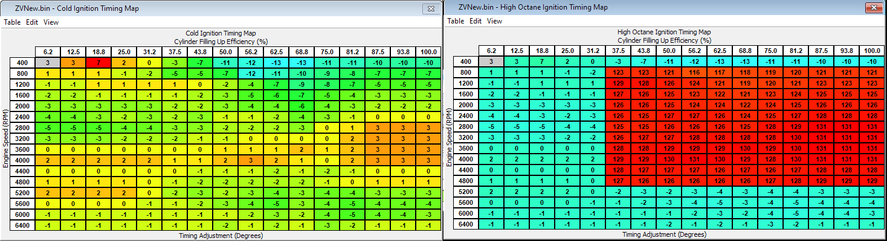

# Rom an cf48d

> Зеркало страницы NissanECU RE wiki. Источник: https://nissanecu.miraheze.org/wiki/Rom_an_cf48d
> Retrieved: 2026-07-15. License: Creative Commons Attribution-ShareAlike 4.0 International (CC BY-SA 4.0) ()

---

## General Information

Really going to mainly be a temporary space for logic analysis until relocated to other sections, as I could care less about the hardware of CF48D. Do note, everything will be focused on the 350z with a VQ35DE. But most of the information is applicable to other vehicles. 

  

* * *

_To Do_  

  * Add to the main page/ROM dissasembly page once it's complete.   

  * Formatting  

  

* * *

  

### Ignition Timing

Nissan's ignition timing system is an, at first glance, complex system. It calculates MBT (Minimum Spark Advance for Best Torque) through flame speed, air mass, and so forth. Then it applies compensation values to this calculated MBT value (See the ignition trimming maps) to then go and set the final ignition timing value. But while it appears complex, it's actually extremely simplified. Assuming the stock MBT calculations are still accurate for your vehicle (heavily modified vehicles potentially might not have accurate calculations), there's no dyno required! Nissan's MBT calculations are confirmed to be within +/- 3 degrees of actual MBT. (Confirmed by Nissan's engineers' within their patent) Do note, exceptions will apply. But 99% of the time, these calculations will be accurate enough. Based off the ECU's tables, being 3 degrees off from MBT is still making ~96% of potential torque. (100% being at MBT) 

So how do you go about tuning your ignition timing then? To begin with, you'll want to make the decision on what octane fuel you're going to be using and do some heavy research on how your engine handles ignition advance. I'd highly recommend making small increments while datalogging at least four knock strength RAM parameters (not possible until RR Logger supports CAN-logging unfortunately), as these will be the most accurate indicators of knock. No, knock headphones most likely won't pick up knock that the OEM wideband knock sensor doesn't pick up. If anything, the OEM knock sensor will be more likely to pick up false knock. So I personally have full faith in the OEM knock control system. If you must suffer with crappy K-line like I must, I'd recommend datalogging Knock Strength, Knock Count, as well as the knock control value. The main purpose of knock strength is so that you can see if knock is potentially creeping up. If the knock strength value exceeds the knock slice map value for that cylinder, it adds one to knock count. 

#### Ignition Timing Maps Guide

Just an extremely basic guide to tuning the timing maps for anyone who might have a hard time understanding. 

The photo below shows the SAME VALUES, except the one on the left has the knock window removed to help visualize the timing adjustment aspect of it. First, we need to understand the timing formula. Given that this is an extremely complex thing, let's just put it simply as Ignition Timing = MBT + Timing Adjustment + X. Where MBT is the calculated MBT value that ALL COMPENSATIONS are based on, Timing Adjustment being the Ignition Timing Map Value, and X being the knock window compensation. The knock window compensation is based off knock sensor feedback and so forth, but this compensation is ONLY active when you're within the knock window. So when you're outside of the knock window, the formula is Ignition Timing = MBT + Timing Adjustment. 

So we know how it's calculated, but how do we know how to tune it? So since we're relying on the ECU to calculate MBT accurately, we are now tuning based off the belief that the calculated MBT Value = Actual MBT. So instead of needing to focus on finding MBT, now we shift to preventing knock. Since anywhere outside the knock window is Ignition Timing = MBT + Timing Adjustment, this means that the MAXIMUM VALUE we want is 0. Because then we are running MBT. Anything higher will unnecessarily over-advance us. So if you know you're not knocking, you can raise the values closer and closer to 0 until you either hit 0, or knock starts to occur. Do be aware of what octane you're going to be running, because you don't want to run super close to MBT if you're going to be running on 87 octane. 

If you notice that from 6.2%-31.2% ITAC (X-Axis) we are actually using positive values in a few spots. This is because most of the time that we're in those cells, we will be transitioning from deceleration. So the positive values are there to offset some of the initial acceleration retarding that occurs when going from deceleration to acceleration. Same for within the knock window. Since within the knock window the formula is Ignition Timing = MBT + Timing Adjustment + X, we now are fighting the X compensation. This is why you see +3 in some cells. This is because due to the aggressive knock logic, it can potentially pull a decent bit of timing unnecessarily. So by having +3, we're offsetting a lot of the timing retard that is occurring due to knock sensor feedback. 

So outside of any areas where compensations are occurring, 0 is the maximum value you want to run for these maps. Within areas where compensations are occurring, you'll need to experiment through trial and error. Especially on any VVEL equipped vehicles. The reason the knock window is so frustrating to deal with is because Nissan's knock logic will retard ignition timing during a knock event, then leave it retarded for a predetermined amount of time to ensure that the engine stops knocking. I don't know the actual time frame, but just know that it will retard timing beyond the knock event to verify that knock stops occurring. When you're outside of the knock window, it doesn't give a crap about knock unless it trips the knock flag, where it'll then run off the high detonation ignition timing map. 

