# HOW TO: Unbrick and/or Hard Reflash Nissan ECU (Step-by-Step)

Local Markdown mirror of the complete five-page RomRaider forum thread.
All 64 posts and all 48 content images from the saved printable views are
preserved. Forum emoticons are represented by their text alternatives.
Downloadable non-image attachments were not present in the saved source;
their links still point to the original forum.

Source: https://www.romraider.com/forum/viewtopic.php?f=65&t=12821

## Page 1

### Post 1: AK_Eyes

**Posted:** Wed May 18, 2016 1:06 pm

**Subject:** HOW TO: Unbrick and/or Hard Reflash Nissan ECU(Step-by-Step)

**HOW TO: Unbrick and/or Hard Reflash Nissan ECU (Step-by-Step Instructions Made Simple)**

First off, many thanks goes to fenugrec and Shuher for all their help, also Sasha for helping trace my TP's and figuring out that we could in fact use the SHBootmode technique.

*Preliminary Note*: you have to open up your ECU and solder connections to the printed circuit board in order to utilize this method. It is not difficult as long as you are very careful and have a reasonable amount of experience with a soldering iron. If not, you could very well permanently damage your ECU. Before doing anything, ***I highly advise you dump a copy of your ROM*** (and make sure it isn't corrupt) by utilizing fenugrec's nisprog software which can give you a copy of your ROM using an OBD2 to USB "dumb" cable. When you connect your ECU to the Renesas FDT Software (Step 4) it ***automatically erases your ROM.***

**Step One: Access Hardware**  
Remove ECU from vehicle, remove ECU's cover screws and use a utility knife to remove the top cover. Cut through the adhesive sealant (*location shown in red below*) while at the same time carefully prying open the case with a flathead screwdriver or similar tool, the ECU has sealant all the way around the perimeter of the case. Be very careful not to damage the PCB during this process. Slow and steady wins the race. Some people also apply heat with a heat gun to make it easier to separate the sealant, I have heard mixed reviews on this approach. Remove the lower cover the same way, note that there is adhesive sealant in the center of the PCB that can also be carved out with your utility knife.

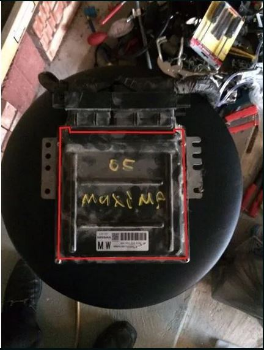

pic1.JPG [ 47.16 KiB | Viewed 1178 times ]

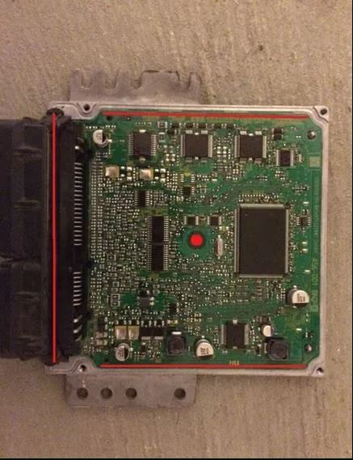

pic2.JPG [ 57.8 KiB | Viewed 1178 times ]

**Step 2: Solder Connections to PCB**  
Turn the ECU over and locate these test ports (note: many PCB's do not have the TP's labelled but TP use should be the same. To verify you have the right TP's you can measure voltages, frequency, and check continuity with a multi-meter between the TP and the corresponding MCU pin; the MCU pinout can be found in the MCU's datasheet. Examples: you can measure 5V between TP84 and TP80 or TP81 (both are ground) or measure continuity between MD1 TP and MCU pin 55. When measuring MCU pins, find the nearest resistor, capacitor, solder joint, TP, etc. to apply your test lead to, ***do not apply the test lead directly to the MCU pin since you can damage the pin***.)

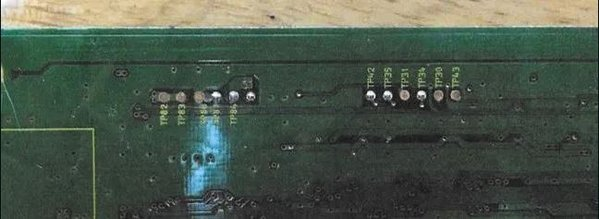  
pic3.JPG [ 33.72 KiB | Viewed 1178 times ]

TP82 = 12V+ (Optional Use)  
TP83 = 12V+ (Optional Use)  
TP80 = Ground  
TP81 = Ground  
TP84 = 5V+ (Optional Use)  
TP(unlabeled) = NA (Do Not Use)

TP42 = PB14 (Do Not Use)  
TP35 = SCI1 TX (Serial Communication Interface 1 Transfer)  
TP31 = MD1 (One of the MCU Mode Selection Pins)  
TP34 = SCI1 RX (Serial Communication Interface 1 Receive)  
TP30 = WDT (WatchDog Timer = 250Hz/50% Duty Cycle)  
TP43 = nRES (MCU Reset)

Next solder approximately 28-32 gauge wire (solid wire is much easier and better than stranded wire) to the necessary TP's as shown below. Use hot glue or similar to provide strain relief! I put the wiring in place and glued them to the PCB before soldering. I also used a solder-type DB9 D-SUB connector to make plugging in and unplugging my SHBootmode tool easier and quicker (more on this later).

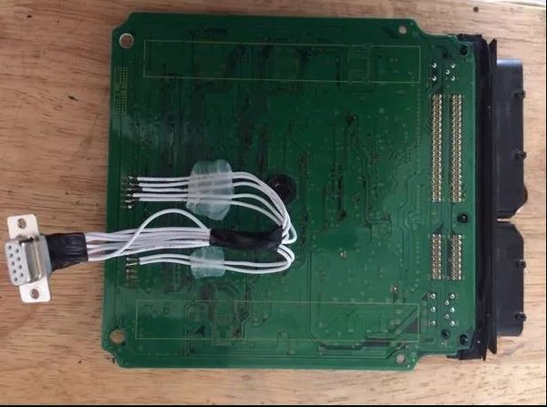  
pic4.JPG [ 51.72 KiB | Viewed 1178 times ]

**Step 3: Build SHBootmode Circuit**  
Next we have to make a circuit which will put the ECU's Renesas Super-H MCU in Bootmode, keep the WDT satisfied and allow serial communication between the MCU and your computer. This is much easier than it sounds. Here's an overall schematic of the circuit I ended up building:

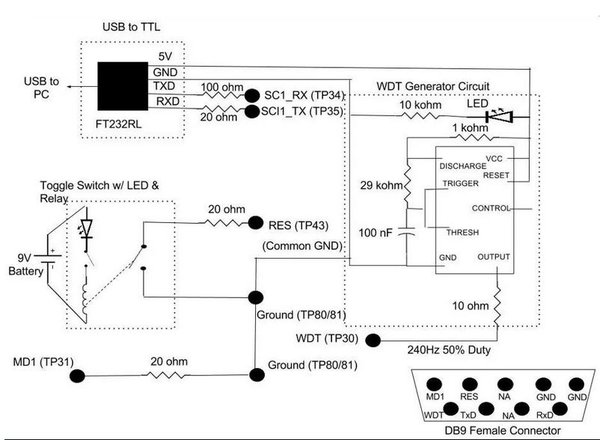  
pic5.JPG [ 69.14 KiB | Viewed 1178 times ]

Note that the "Toggle Switch w/ LED & Relay" is not necessary but was a personal preference. A simple SPST switch would suffice. This circuit has worked for me many times and is not difficult to build. Since I used a DB9 Female Connector for the ECU connection, the DB9 male connector will be mirrored from the above diagram.

First: solder a 20 ohm resistor from MD1 to Ground on the male connector. (note: this is the part of the circuit that actually enables bootmode on these ECU's. Much more information can be in Section 4 – Operating Modes of the Renesas SH7058 Hardware Manual.)

Second: solder a 20 ohm resistor to a switch and use it to connect nRES to GND.

USB to TTL Interface (FT232RL Breakout Board):

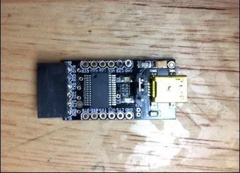

pic6.JPG [ 31.27 KiB | Viewed 1178 times ]

On the breakout board, solder wires to 5V power, GND, SCI TX, and SCI RX (note that SCI TX and SCI RX will be opposite the MCU connector, i.e. breakout board TXD goes to ECU SCI1_RX and breakout board RXD goes to ECU SCI1_TX). I used a 100 ohm resistor between TXD/SCI1_RX and a 20 ohm resistor between RXD/SCI_TX which has worked well for me and provides some circuit protection for your ECU. (note: Shuher noted that the TX and RX should be the same and that he used 20 ohm resistors for both.)

Third: build the WDT generator circuit, the goal here is to achieve a 250Hz/50% Duty Cycle signal but the supervisor chip allows some leniency in frequency and duty cycle so don't waste time trying to get it absolutely perfect. I used a 555 timer and produced a 240Hz/50% Duty Cycle signal which always seems to work. Make sure to look up the correct pinout for your 555 timer as they are not all the same. I powered mine via the FTDI breakout board's 5V power output and ground (make sure you ground the WDT generator the to the DB9 connector GND to ensure a common ground). Depending on what resistors you have (or don't have) lying around you can add them in series or parallel to get the right ohm reading. Here is what my circuit ended up looking like:

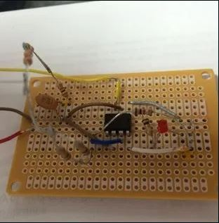

pic7.JPG [ 25.03 KiB | Viewed 1178 times ]

Here is what my SHBootmode tool looks like with all components assembled and put in a case:

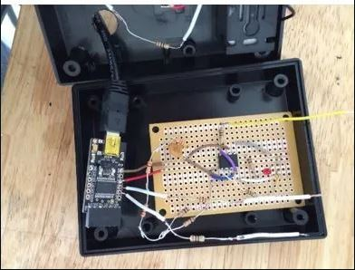

pic8.JPG [ 34.92 KiB | Viewed 1178 times ]

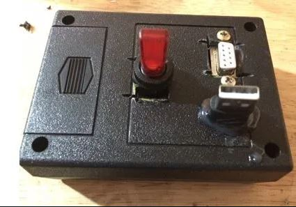

pic9.JPG [ 31.37 KiB | Viewed 1178 times ]

**Step 4: Software and Reflash**  
Connect your SHBootmode tool to your PC via USB port and ensure the FTDI driver loads. If it doesn't you can do this manually through Device Manager on Windows. After the driver installs, go to Device Manager, click on Port (COM & LPT) and see which communication port was assigned to your FTDI device (example: COM1).

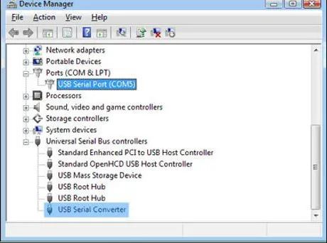

pic10.JPG [ 34.91 KiB | Viewed 1178 times ]

Connect your SHBootmode tool to your ECU (after doing this enough times you'll understand why I used a connector). First close your RES switch, then power up your ECU with an appropriate 12V source. Make sure to apply 12V to the ignition pin as well. After your ECU has power, open your RES switch and your MCU should now be in Bootmode. More information and a detailed sequence of operations can be found here: [https://nissanecu.miraheze.org/wiki/Bootmode#Sequence_of_operations](<https://nissanecu.miraheze.org/wiki/Bootmode#Sequence_of_operations>). (Also, there is A LOT of really good information on this wiki as well thanks to fenugrec and Shuher. I know fenugrec has spent countless hours for the past few years to come up with the information on this wiki so please give it the respect it deserves!)

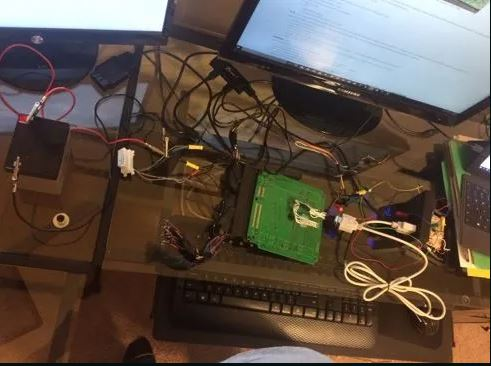

pic11.JPG [ 38.49 KiB | Viewed 1178 times ]

Download the Renesas Flash Development Toolkit (Free Software on Renesas Website) and start the Basic version of the application. (Note: when using the Renesas FDT software, ***as soon as it establishes a connection with your ECU it automatically erases your ROM!!!*** This is why it is so important to create a backup of your stock ROM before starting the reflash process.) Select Generic BOOT Device, Select the COM port you found in the previous step, After pressing next your MCU's type should be displayed, Enter 10 MHz Crystal (this is a very common crystal oscillator frequency on these ECU's but may differ between ECU's), Select BOOT Mode Connection, Enter your preferences then click finish.

You should end up at a screen that looks like this:

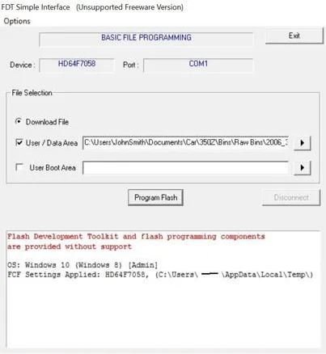

pic12.JPG [ 29.05 KiB | Viewed 1178 times ]

Select User/Data Area and select the ROM file location that you want to reflash to your ECU (SH7055 MCU is 512kb, SH7058 MCU is 1024kb), deselect User Boot Area, and hit Program Flash. If all goes well it will reflash your ECU in about 5 minutes (for a 1MB file) and you should see something like this:

OS: Windows 10 ( Windows 8 ) [Admin]  
FCF Settings Applied: HD64F7058, (C:\Users\JohnSmith\AppData\Local\Temp\)  
FDT API initialised: version 4, 09, 02, 000  
Clock Frequency (External) = 10.0000MHz, Clock Mode = 0, CKM = 4, and CKP = 2  
Connecting to device 'HD64F7058' on 'COM1'  
Configuration:  
'BOOT Mode' connection - using emulated interface  
Opening port 'COM1' ...  
Loading Comms DLL  
Loaded Comms DLL  
Initiating BOOT SCI sequence  
Attempting 9600  
Received immediate response from device: 0xE6  
Detected generic boot device  
Sending inquiry for getting line size  
Buffer size has been set to default (128 bytes)  
Sending selection of device command  
Selection of Device - Device selected, code 0601  
Sending selection of clock mode  
Sending selection of clock mode  
Selection of Clock Mode - Clock selected, code 0  
Changing baud rate to 38400 bps  
Set baud rate value = 38400  
Determining block usage  
Connection complete  
Processing file :"C:\Users\JohnSmith\Documents\Car\350Z\Bins\Raw Bins\2006_350Z_1CF43D_1.bin"  
Loading image file : 'C:\Users\JohnSmith\Documents\Car\350Z\Bins\Raw Bins\2006_350Z_1CF43D_1.bin'  
Loading image file : 'C:\Users\JohnSmith\Documents\Car\350Z\Bins\Raw Bins\2006_350Z_1CF43D_1.bin'  
Operation on User Flash 0  
Loaded the Write operation module  
Writing image to device... [0x00000000 - 0x00001C7F]  
Writing image to device... [0x00002000 - 0x0000447F]  
Writing image to device... [0x00004480 - 0x000044FF]  
Writing image to device... [0x00004500 - 0x0000457F]  
Writing image to device... [0x00004580 - 0x00004A7F]  
Writing image to device... [0x00004A80 - 0x00004B7F]  
Writing image to device... [0x00004C00 - 0x0000617F]  
Writing image to device... [0x00006180 - 0x0000627F]  
Writing image to device... [0x00006300 - 0x0000B17F]  
Writing image to device... [0x0000B180 - 0x0000C27F]  
Writing image to device... [0x0000C280 - 0x0000CAFF]  
Writing image to device... [0x0000CB00 - 0x0007FFFF]  
Data programmed at the following positions:  
0x00000000 - 0x00001C7F Length : 0x00001C80  
0x00002000 - 0x0000447F Length : 0x00002480  
0x00004480 - 0x000044FF Length : 0x00000080  
0x00004500 - 0x0000457F Length : 0x00000080  
0x00004580 - 0x00004A7F Length : 0x00000500  
0x00004A80 - 0x00004B7F Length : 0x00000100  
0x00004C00 - 0x0000617F Length : 0x00001580  
0x00006180 - 0x0000627F Length : 0x00000100  
0x00006300 - 0x0000B17F Length : 0x00004E80  
0x0000B180 - 0x0000C27F Length : 0x00001100  
0x0000C280 - 0x0000CAFF Length : 0x00000880  
0x0000CB00 - 0x0007FFFF Length : 0x00073500  
510.88 K programmed in 149 seconds

Operation on User Flash 1  
Loaded the Write operation module  
Writing image to device... [0x00080000 - 0x000A79FF]  
Writing image to device... [0x000FFF80 - 0x000FFFFF]  
Data programmed at the following positions:  
0x00080000 - 0x000A79FF Length : 0x00027A00  
0x000FFF80 - 0x000FFFFF Length : 0x00000080  
158.63 K programmed in 46 seconds  
Image written to device

**Troubleshooting**  
As you can imagine I ran into all kinds of issues throughout the process, here are a few I can remember off the top of my head:

-Double and triple check your wiring and hardware connections!  
-Systematically go through everything with your multi-meter to ensure everything is connected well and correctly.  
-Make sure everything has a common ground connection (ECU-USB to TTL-WDT Circuit-PC via USB)  
-Measure your WDT signal (buying even a cheap log analyzer can really help here)  
-Make sure nothing is connected to the obd2 k-line, this is directly related to the MCU's serial(1) TX/RX pins.  
-Download the hardware manual/MCU datasheet to help with miscellaneous issues and to get a better understanding of how all this works.  
-Download a serial terminal such as Realterm to test communication between PC and MCU  
-Check driver settings in Device Manager, lowering the latency timer can help with echo and communication errors.  
-Do a lot of reading!

I'm definitely forgetting some but this is a good place to start when running into issues.

### Post 2: fenugrec

**Posted:** Wed May 18, 2016 1:28 pm

**Subject:** Re: HOW TO: Unbrick and/or Hard Reflash Nissan ECU(Step-by-S

Thanks for that nice write-up AK.

Just a minor addition, don't forget to check out some of the wiki pages for more details:

[SHBootmode page](<https://nissanecu.miraheze.org/wiki/Bootmode>)  
[ECU hardware versions info (TPs etc)](<https://nissanecu.miraheze.org/wiki/Ecu_hw>)

@mods : could we have a Nissan subforum please : )

### Post 3: Shuher

**Posted:** Wed May 18, 2016 5:40 pm

**Subject:** Re: HOW TO: Unbrick and/or Hard Reflash Nissan ECU(Step-by-S

Heh... Seems it's time to share my FTDI AUD && EEPROM tool schematics & SW in similar topic :-) Just to put my 2 cents ))) Give me few days to write it up

### Post 4: swami

**Posted:** Tue Jun 07, 2016 12:06 am

**Subject:** Re: HOW TO: Unbrick and/or Hard Reflash Nissan ECU(Step-by-S

as a tip, using a heat gun or hair dryer to heat the case a bit softens the sealant before trying to pry it open.

### Post 5: Shuher

**Posted:** Tue Jun 07, 2016 12:15 am

**Subject:** Re: HOW TO: Unbrick and/or Hard Reflash Nissan ECU(Step-by-S

Hah... for me it was kitchen oven set to ~120 C degree :)

### Post 6: AK_Eyes

**Posted:** Tue Jun 07, 2016 3:39 am

**Subject:** Re: HOW TO: Unbrick and/or Hard Reflash Nissan ECU(Step-by-S

" Some people also apply heat with a heat gun to make it easier to separate the sealant, I have heard mixed reviews on this approach."

I always just used a utility knife to cut through the sealant, I think I have opened 3 or 4 now and this way worked for me pretty quick and easy :)

swami - have you tried this method of reflashing yet?

### Post 7: swami

**Posted:** Sat Jun 11, 2016 1:11 pm

**Subject:** Re: HOW TO: Unbrick and/or Hard Reflash Nissan ECU(Step-by-S

> **AK Eyes wrote:**  
>  
> " Some people also apply heat with a heat gun to make it easier to separate the sealant, I have heard mixed reviews on this approach."  
>  
> I always just used a utility knife to cut through the sealant, I think I have opened 3 or 4 now and this way worked for me pretty quick and easy :)  
>  
> swami - have you tried this method of reflashing yet?

i have not tried with the Z ecu yet ( busy with a few other projects at the moment) i will get back to the Z soon hopefully

but i have with countless denso diesel ecu

### Post 8: Shuher

**Posted:** Sun Oct 16, 2016 1:44 am

**Subject:** Re: HOW TO: Unbrick and/or Hard Reflash Nissan ECU(Step-by-S

Heh, it wasn't "few days" as I said above, but anyway [http://www.romraider.com/forum/viewtopic.php?f=45&t=13225](<https://www.romraider.com/forum/viewtopic.php?f=45&t=13225>) :)

### Post 9: a33b

**Posted:** Sun Mar 24, 2019 8:38 am

**Subject:** Re: HOW TO: Unbrick and/or Hard Reflash Nissan ECU(Step-by-S

I'm at my wits end trying to get this to work. I've got my WDT set up and it appears to be satisfying the MCU as nRES stays high at 5.1V when I release nRES. If I disconnect the WDT, nRES goes low so those two connections seem OK. MD1 is 3.4V if not connected to ground; 0V when connected to ground.

I've also tried reversing RX and TX in case I had them backwards. I get NO response at all if I reverse them, the only response I do get when I try to get RDT to connect is:

```text
Initiating BOOT SCI sequence
Attempting 9600
Received immediate response from device: 0x55
```

I have applied 12V to both the main power supply pins and the ignition (key on) pin. I have tied one of the main ground pins and one of the other smaller ones together back to battery ground. I have hooked all grounds together so they are common.

If I have all my connections correct (I believe I do) for my ECU the TPs were not located conveniently in a common location. My connections are:

HL01 -> PL5 (WDT)  
HL02 -> MD1  
HL17 -> SCI1_TX (Rx on FT232)  
HL18 -> SCI1_RX (Tx on FT232)  
TP12 -> nRES (on back side of board)

**Attachments:**

**File comment:** board connections  
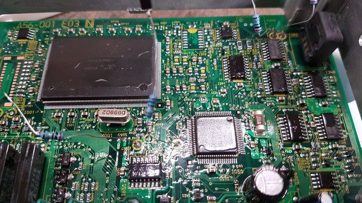  
20190323_153229.jpg [ 1.87 MiB | Viewed 1650 times ]

**File comment:** my setup  
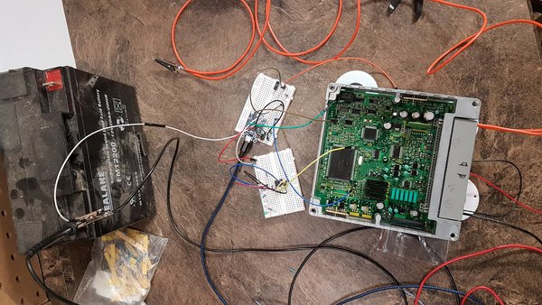  
20190323_153208.jpg [ 2.16 MiB | Viewed 1650 times ]

### Post 10: Sasha_A80

**Posted:** Sun Mar 24, 2019 4:40 pm

**Subject:** Re: HOW TO: Unbrick and/or Hard Reflash Nissan ECU(Step-by-S

Received immediate response from device: 0x55

Mean you have direct return path from UartTX to UartRX.  
You are to analyze schematics around TX RX circuitry.  
May be K-line circuitry is connected to those signals.

### Post 11: a33b

**Posted:** Mon Mar 25, 2019 7:54 am

**Subject:** Re: HOW TO: Unbrick and/or Hard Reflash Nissan ECU(Step-by-S

> **Sasha_A80 wrote:**  
>  
> Received immediate response from device: 0x55  
>  
> Mean you have direct return path from UartTX to UartRX.  
> You are to analyze schematics around TX RX circuitry.  
> May be K-line circuitry is connected to those signals.

I have nothing wired to K-line externally. It may be that these are tied to a transceiver? but surely disconnecting from that transceiver isn't necessary!  
[https://static.miraheze.org/nissanecuwi ... wiring.png](<https://static.miraheze.org/nissanecuwiki/5/5c/Bootmode_wiring.png>)

### Post 12: fenugrec

**Posted:** Mon Mar 25, 2019 10:36 am

**Subject:** Re: HOW TO: Unbrick and/or Hard Reflash Nissan ECU(Step-by-S

> **Sasha_A80 wrote:**  
>  
> Received immediate response from device: 0x55  
>  
> Mean you have direct return path from UartTX to UartRX.

I agree, very possible. A few things you can check:

- if you have resistors between SCI_* and TX/RX, make sure (measure !) they're no more than 22-33ohms

- with nothing connected, measure resistance between your SCI_RX/TX testpoints. If it's lower than ~2k, you'll need to investigate further

- make sure your powerup sequence is correct, i.e. MD1 always grounded, hold in reset until WDT valid, then release nRES, then proceed

- try the manual test procedure [https://nissanecu.miraheze.org/wiki/Boo ... operations](<https://nissanecu.miraheze.org/wiki/Bootmode#Sequence_of_operations>) with Realterm or similar. If you're getting an instant echo no matter what byte you send, then you have some RX/TX loopback going on that needs further study.

### Post 13: a33b

**Posted:** Mon Mar 25, 2019 3:27 pm

**Subject:** Re: HOW TO: Unbrick and/or Hard Reflash Nissan ECU(Step-by-S

> **fenugrec wrote:**  
>  
> - if you have resistors between SCI_* and TX/RX, make sure (measure !) they're no more than 22-33ohms

both 20 ohms

> **fenugrec wrote:**  
>  
> - with nothing connected, measure resistance between your SCI_RX/TX testpoints. If it's lower than ~2k, you'll need to investigate further

over 20k

> **fenugrec wrote:**  
>  
> - make sure your powerup sequence is correct, i.e. MD1 always grounded, hold in reset until WDT valid, then release nRES, then proceed

Yup, MD1 is always grounded. Reset is grounded for a few seconds after applying power to the ECU, then released (goes to 5V) and stays there.

> **fenugrec wrote:**  
>  
> - try the manual test procedure [https://nissanecu.miraheze.org/wiki/Boo ... operations](<https://nissanecu.miraheze.org/wiki/Bootmode#Sequence_of_operations>) with Realterm or similar. If you're getting an instant echo no matter what byte you send, then you have some RX/TX loopback going on that needs further study.

I don't see ANY responses via Realterm. Not sure why Renesas is showing 0x55 (it's either 0x55 or 0x00 when it tries different baud rates)

Kept Realterm open while re-attempting boot mode and noticed I was getting 0x00 responses with no power supplied to the ECU while the WDT is hooked up. As soon as I supply power OR disconnect my WDT circuit the 0x00 responses stop. There's probably some noise being generated?

### Post 14: Sasha_A80

**Posted:** Mon Mar 25, 2019 6:16 pm

**Subject:** Re: HOW TO: Unbrick and/or Hard Reflash Nissan ECU(Step-by-S

I have sourced a similar board and correct pinout is as follows

HL18 -> SCI1_TX (Rx on FT232)  
HL17 -> SCI1_RX (Tx on FT232)

and not as  
HL17 -> SCI1_TX (Rx on FT232)  
HL18 -> SCI1_RX (Tx on FT232)

Moreover there is k-line circuitry with R452 as a pullup resistor and Q451 as SCI1_RX driver.  
I would recommend to short R453 resistor to temporary disable SCI1_RX kline driver.

PCB is similar and not the same thus component markings may differ.

### Post 15: a33b

**Posted:** Tue Mar 26, 2019 2:13 pm

**Subject:** Re: HOW TO: Unbrick and/or Hard Reflash Nissan ECU(Step-by-S

Thanks again Sasha. You are correct, I did have Rx and Tx reversed. I re-connected in the correct arrangement but nothing shows up at all in Realterm.

So, if I haven't destroyed this thing beyond repair already... I traced Rx and Tx further on the circuit and found Rx goes to R912 (pullup resistor?) to Q904 (SCI1_RX driver?) So would I tie the point circled to ground to disable the kline driver temporarily?

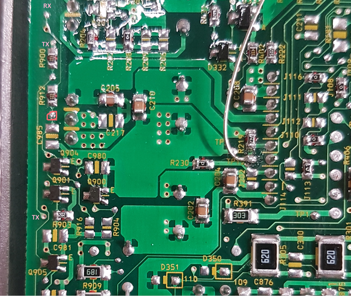  
Image 033.png [ 1.64 MiB | Viewed 1613 times ]

## Page 2

### Post 16: fenugrec

**Posted:** Tue Mar 26, 2019 2:43 pm

**Subject:** Re: HOW TO: Unbrick and/or Hard Reflash Nissan ECU(Step-by-S

> **a33b wrote:**  
>  
> if I haven't destroyed this thing beyond repair already.

Nah I think you're fine, you should've seen AKEyes' ECU when he finally killed it !

> **Quote:**  
>  
> Rx goes to R912 (pullup resistor?) to Q904 (SCI1_RX driver?) So would I tie the point circled to ground to disable the kline driver temporarily?

Hmm, not so sure... it depends if Q904 is an NPN, and where R912 connects to - base or collector. If your multimeter has a diode test function, can you confirm the pinout ?

You *could* try removing R912 but it's glued there and finnicky to remove if you haven't worked with SMD much (practice on some scrap PCBs before !) Plus, it's a long shot anyway without seeing more of the circuit traced.

Also I see you labeled "TX" on both sides of R900, which one goes to the mcu pin ?

### Post 17: a33b

**Posted:** Tue Mar 26, 2019 3:21 pm

**Subject:** Re: HOW TO: Unbrick and/or Hard Reflash Nissan ECU(Step-by-S

Here's what's going on in that bottom corner. Above that, both go straight to HL17 and HL18 and over to the MCU. Circled some points the same color to ease matching top/bottom

**File comment:** bottom near SCI drivers  
  
Image 033.png [ 1.63 MiB | Viewed 213 times ]

**File comment:** top near SCI drivers  
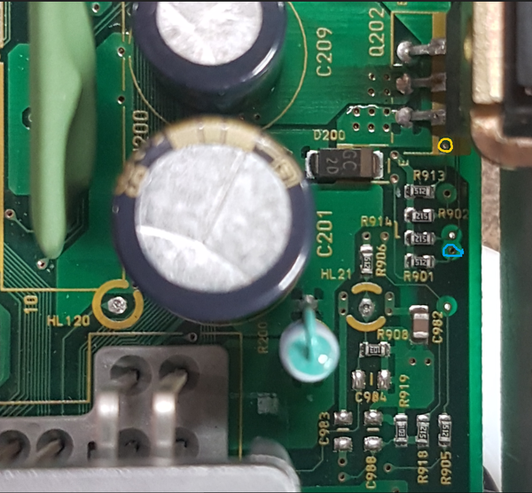  
Image 034.png [ 1.25 MiB | Viewed 213 times ]

### Post 18: Sasha_A80

**Posted:** Tue Mar 26, 2019 5:11 pm

**Subject:** Re: HOW TO: Unbrick and/or Hard Reflash Nissan ECU(Step-by-S

I suspect RX TX marking on PCB corresponds to UART and not MCU.  
And you may short red marked point to ground to disable TX to Kline path.  
Just short C985 capacitor.

Q904 does not look like a correct RX driver.  
I think Q900 is. And you are to short R903 resistor to block RX path to MCU from Kline.

Anyway you may send the ecu and applicable ROM image to me for recovery if in doubt.  
Upto 2 weeks each turn by a snail mail postage.

### Post 19: a33b

**Posted:** Wed Mar 27, 2019 4:23 pm

**Subject:** Re: HOW TO: Unbrick and/or Hard Reflash Nissan ECU(Step-by-S

Did some multimeter testing since those traces can be so tricky. Here's what I've found connected from MCU pin 165.

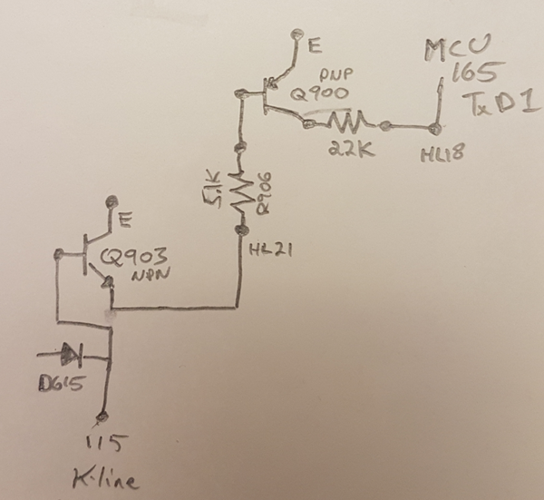  
Image 035.png [ 570.77 KiB | Viewed 204 times ]

### Post 20: fenugrec

**Posted:** Thu Mar 28, 2019 12:34 am

**Subject:** Re: HOW TO: Unbrick and/or Hard Reflash Nissan ECU(Step-by-S

yep, definitely need pencil & paper when tracing a multi-layer PCB ! you seem to have done well, but on Q903 you have the arrow drawn on the wrong leg (goes on E, which is probably ground, which makes the circuit make a bi tmore sense.

Two things you could try, remove the 22k resistor going to TxD (I don't even understand what they're doing there), or better short B and E on Q903 which effectively deactivates it.

### Post 21: P1on3R

**Posted:** Mon Aug 26, 2019 8:10 pm

**Subject:** Re: HOW TO: Unbrick and/or Hard Reflash Nissan ECU(Step-by-S

Hi to all)  
One man write to ECM of Nissan teana J32 2008Y with SH705822/28 firmware of Nissan Murano Z50 2007Y with SH705821 - ECM is bricked :roll:  
He thinks - WTF!? and try to write it in another 3 ECM :mrgreen:  
Now we have 4 bricked ECM of Nissan Teana J32 2008Y with SH705822/28.  
Then he send 4 boards to me to unbricking it :shock:  
He write it with K-Tag.  
I try to connect with FDT, Boot is ok, but then i have an error with "sending supported devices inquiry", what is this?  
[http://www.picshare.ru/view/10246032/](<http://www.picshare.ru/view/10246032/>)  
I unbrick Nissan Note E11 ECM with SH705520, and Nissan Teana J31 ECM with SH705513 - no problem with it.  
TPs pins are the same as on another Nissan ECM (photos later).  
FWE=1  
MD1=0

### Post 22: Shuher

**Posted:** Mon Aug 26, 2019 8:24 pm

**Subject:** Re: HOW TO: Unbrick and/or Hard Reflash Nissan ECU(Step-by-S

Did you try using "generic" kernel instead of selecting particular 64F7058xxx device in FDT?

I had such issue once for 0.18um CPUs - some of them were requiring exact selection of 64F7055xxxx while others were working only with "generic type C kernel CPU" or something like this.

Another possible reason - SCI1 which is used for reflash via FDT is also used for other communications inside ECU and components like EEPROM/WDT could affect the line communication. I got one ECU which uses SCI0 for KLINE and SCI1 for EEPROM communication.

Error on your screenshot looks like resulted by second reason.

### Post 23: Sasha_A80

**Posted:** Tue Aug 27, 2019 3:13 am

**Subject:** Re: HOW TO: Unbrick and/or Hard Reflash Nissan ECU(Step-by-S

Use GenericBootDevice.  
If nothing helps it is high time to visit my location.

### Post 24: P1on3R

**Posted:** Thu Aug 29, 2019 4:21 am

**Subject:** Re: HOW TO: Unbrick and/or Hard Reflash Nissan ECU(Step-by-S

> **Shuher wrote:**  
>  
> Did you try using "generic" kernel instead of selecting particular 64F7058xxx device in FDT?  
>  
> I had such issue once for 0.18um CPUs - some of them were requiring exact selection of 64F7055xxxx while others were working only with "generic type C kernel CPU" or something like this.  
>  
> Another possible reason - SCI1 which is used for reflash via FDT is also used for other communications inside ECU and components like EEPROM/WDT could affect the line communication. I got one ECU which uses SCI0 for KLINE and SCI1 for EEPROM communication.  
>  
> Error on your screenshot looks like resulted by second reason.

I try "generic" and 7058, result is one - fail.  
Eeprom 95320 is connected to SCI0. I desolder it, - nothing's change.  
If i try another CPU - then i have an error "bla bla bla 0.18um CPU".

> **Sasha_A80 wrote:**  
>  
> Use GenericBootDevice.

I uses it, but nothings change.

> **Sasha_A80 wrote:**  
>  
> If nothing helps it is high time to visit my location.

May be later)

Clock Frequency (External) = 10.0000MHz, Clock Mode = 0, CKM = 4, and CKP = 2  
Connecting to device 'SH/7058F' on 'COM7'  
Configuration:  
'BOOT Mode' connection - using emulated interface  
Opening port 'COM7' ...  
Loading Comms DLL  
Loaded Comms DLL  
Initiating BOOT SCI sequence  
Attempting 9600  
Received immediate response from device: 0xE6  
Detected generic boot device  
Sending inquiry for getting line size  
Buffer size has been set to default (128 bytes)  
Sending selection of device command  
Selection of Device - Device selected, code 0601  
Sending selection of clock mode  
Sending selection of clock mode  
Selection of Clock Mode - Clock selected, code 0  
Changing baud rate to 57600 bps  
Error No 15005: 'COM7' read time out  
Error No 15016: Changing baud rate to 57600 bps

### Post 25: Sasha_A80

**Posted:** Thu Aug 29, 2019 3:09 pm

**Subject:** Re: HOW TO: Unbrick and/or Hard Reflash Nissan ECU(Step-by-S

It looks like the watchdog circuitry is not working properly and the chip is reset while erasing the ROM before baud rate switching.  
Alternatively your COM7 interface may loose "erase done" response. It may take place for FTDI USB chip not set properly.

### Post 26: P1on3R

**Posted:** Fri Aug 30, 2019 5:57 am

**Subject:** Re: HOW TO: Unbrick and/or Hard Reflash Nissan ECU(Step-by-S

> **Sasha_A80 wrote:**  
>  
> It looks like the watchdog circuitry is not working properly and the chip is reset while erasing the ROM before baud rate switching.  
> Alternatively your COM7 interface may loose "erase done" response. It may take place for FTDI USB chip not set properly.

I connect WDT circuit to another working ECU - nothings change.  
FTDI ft232rl - original but very older chip.  
I think try to buy another FTDI chip to compare result))

### Post 27: fenugrec

**Posted:** Fri Aug 30, 2019 8:40 am

**Subject:** Re: HOW TO: Unbrick and/or Hard Reflash Nissan ECU(Step-by-S

You can also try the manual steps on  
[https://nissanecu.miraheze.org/wiki/Boo ... operations](<https://nissanecu.miraheze.org/wiki/Bootmode#Sequence_of_operations>)  
and repeat the 0x20 , "Supported device inquiry" a few times over a few seconds, that should confirm if the WDT works or not.

### Post 28: Sasha_A80

**Posted:** Fri Aug 30, 2019 5:52 pm

**Subject:** Re: HOW TO: Unbrick and/or Hard Reflash Nissan ECU(Step-by-S

WDT on Nissan MY08+ ecu relies upon WDT clocking AND SCI port communication with throttle control chip.  
You may analyze ecu bootloader code.

### Post 29: Shuher

**Posted:** Fri Aug 30, 2019 6:27 pm

**Subject:** Re: HOW TO: Unbrick and/or Hard Reflash Nissan ECU(Step-by-S

Is it so-called "Gen2" ECUs? Based on SH72531/SH72543/R5F72533 or it is still about SH7055/SH7058-based ECUs?

### Post 30: Sasha_A80

**Posted:** Fri Aug 30, 2019 7:10 pm

**Subject:** Re: HOW TO: Unbrick and/or Hard Reflash Nissan ECU(Step-by-S

The remark is about SH7058S based Hitachi\Nissan MY08+ ecu.  
I have no experience with the most recent ones.

## Page 3

### Post 31: a33b

**Posted:** Tue Nov 12, 2019 3:00 am

**Subject:** Re: HOW TO: Unbrick and/or Hard Reflash Nissan ECU(Step-by-S

Finally made some progress here after months of just not trying. Putting a larger ground from my RS232 GND direct to the battery made all the difference. I'd tried this before but with tiny gauge wire that apparently wasn't adequate. Now the process goes OK for a little while until I end up with a checksum error, or sometimes a read timeout. I think the furthest it's made it is 11%. Same results with a couple of RS232 devices.

```text
FCF Settings Applied: SH/7055F, (C:\Program Files (x86)\Renesas\FDT4.09\kernels\ProtB\7055\Renesas\1_0_00\)
Clock Frequency (External) = 10.0000MHz, Clock Mode = 0, CKM = 4, and CKP = 2
Connecting to device 'SH/7055F' on 'COM8'
Configuration:
'BOOT Mode' connection - using emulated interface
Opening port 'COM8' ...
Loading Comms DLL
Loaded Comms DLL
Initiating BOOT SCI sequence
Attempting 9600
Received immediate response from device: 0xAA
Using micro-Kernel : 'C:\Program Files (x86)\Renesas\FDT4.09\kernels\ProtB\7055\Renesas\1_0_00\uGen7055r.cde'
Downloading and verifying micro kernel...
Device is erasing...
Erase Timeout value set to 21 seconds
Erase Successful
micro-Kernel download successful
Sending inquiry for getting line size
Buffer size has been set to default (128 bytes)
Sending selection of device command
Selection of Device - Device selected, code 0405
Sending selection of clock mode
Sending selection of clock mode
Selection of Clock Mode - Clock selected, code 0
Changing baud rate to 38400 bps
Set baud rate value = 38400
Downloading main kernel 'C:\Program Files (x86)\Renesas\FDT4.09\kernels\ProtB\7055\Renesas\1_0_00\Genm7055.cde'
Main kernel download complete...
Connection complete
Processing file :"C:\NISTUN\nisprog_1_02\6Y303nn.bin"
Loading image file : 'C:\NISTUN\nisprog_1_02\6Y303nn.bin'
Operation on User Flash
Downloaded the operation module
Writing image to device... [0x00000000 - 0x000021FF]
Writing image to device... [0x00002200 - 0x0000227F]
Writing image to device... [0x00002280 - 0x0000237F]
Writing image to device... [0x00002380 - 0x00006B7F]
Error No 16170: Kernel Error Response: 0xd0 0x11 Checksum Error
Operation failed
```

### Post 32: fenugrec

**Posted:** Tue Nov 12, 2019 3:21 am

**Subject:** Re: HOW TO: Unbrick and/or Hard Reflash Nissan ECU(Step-by-S

> **a33b wrote:**  
>  
> a checksum error, or sometimes a read timeout.

Did you make absolutely 100% sure the nRES line stays high the entire time ?

Is it a mule ECU that has been reflashed hundreds of times already ?

### Post 33: Sasha_A80

**Posted:** Tue Nov 12, 2019 4:19 am

**Subject:** Re: HOW TO: Unbrick and/or Hard Reflash Nissan ECU(Step-by-S

Set baud rate 19200 or 9600 to overcome data transmission errors.  
Ecu hardware may be not applicable for 38400 57600 115200 raud rate of FDT list.

Check whether your USB uart dongle provides 5 V Tx output level.  
Many chips are sending just 3.3 V that may be not applicable for ECU schematics.

### Post 34: Sasha_A80

**Posted:** Tue Nov 12, 2019 4:25 am

**Subject:** Re: HOW TO: Unbrick and/or Hard Reflash Nissan ECU(Step-by-S

> **fenugrec wrote:**  
>  
> > **a33b wrote:**  
> >  
> > a checksum error, or sometimes a read timeout.  
>  
> Did you make absolutely 100% sure the nRES line stays high the entire time ?  
>  
> Is it a mule ECU that has been reflashed hundreds of times already ?

My SH7055F mule was reflashed many hundreds times without problems.  
Nevertheless any SH7055F ecu fails writing being preheated upto 60-70C.  
And becomes healthy being cooled.

Watchdog circuitry will not allow SH boot kernel to be downloaded saying nothing about a part ROM to be reflashed.  
Checksum errors are ecu schematics\signal levels related.

### Post 35: a33b

**Posted:** Tue Nov 12, 2019 8:18 am

**Subject:** Re: HOW TO: Unbrick and/or Hard Reflash Nissan ECU(Step-by-S

> **fenugrec wrote:**  
>  
> Did you make absolutely 100% sure the nRES line stays high the entire time ?

Yep, nRES is extremely reliable, 0.15V closed, 5.88V open and it stays there.

> **Sasha_A80 wrote:**  
>  
> Checksum errors are ecu schematics\signal levels related.

I successfully unbricked a 7058 ECU with this hardware setup. These stubborn 7055 ECUs are frustrating me. I'd forgotten I had shorted the locations for C981 and C985 on this in an earlier attempt. Tried an identical ECU without these locations shorted, doesn't seem to matter.

Tried lowering the baud rate, tried lowering latency, tried putting them back, tried a different RS232 converter, I'm currently having less success than I was earlier with identical settings. :?

I measure 6V on TX and 3V on RX

### Post 36: fenugrec

**Posted:** Tue Nov 12, 2019 8:28 am

**Subject:** Re: HOW TO: Unbrick and/or Hard Reflash Nissan ECU(Step-by-S

> **a33b wrote:**  
>  
> Yep, nRES is extremely reliable, 0.15V closed, 5.88V open  
>  
> I measure 6V on TX and 3V on RX

5.88V ? 6V? those seem pretty high, where's that extra volt coming from ? 3V on RX is questionable too, possibly not a problem but I would expect it to swith closer to 0 / 5V rails...

### Post 37: a33b

**Posted:** Tue Nov 12, 2019 9:28 am

**Subject:** Re: HOW TO: Unbrick and/or Hard Reflash Nissan ECU(Step-by-S

Yes, that 5.88V is higher than I observed when flashing the 7058 ECU, it was much closer to 5V (didn't write it down)

Both RX and TX float at 3V disconnected (other RS232 floats at 3.3V)

### Post 38: Sasha_A80

**Posted:** Tue Nov 12, 2019 3:11 pm

**Subject:** Re: HOW TO: Unbrick and/or Hard Reflash Nissan ECU(Step-by-S

> **a33b wrote:**  
>  
> Tried lowering the baud rate, tried lowering latency, tried putting them back, tried a different RS232 converter, I'm currently having less success than I was earlier with identical settings. :?

Driver setting for FTDI chip latency 1 ms is a must for FDT software.  
6V signal level does not look correct either. Check SH7055F power voltage.

### Post 39: a33b

**Posted:** Wed Nov 13, 2019 4:34 pm

**Subject:** Re: HOW TO: Unbrick and/or Hard Reflash Nissan ECU(Step-by-S

SUCCESS!! Thank you all for steering me along. I added 2 more ECU grounds to see if the 'extra' voltage would go away and I had 5.1V on nRES. First time FDT stalled after loading the kernel, but 2nd attempt went perfect, except at 9600 bps.

Moral of the story, pay attention to ALL of the instructions in the step-by-step. And in my case, use healthy gauge wire for those grounds. :oops:

I'm going to try unbricking my second ECU tomorrow, this one I had shorted the two locations mentioned above, it worked, but I suspect that it is not necessary. **I was wrong again...**

I unbricked ECU #2 today. I shorted C985, didn't go. Shorted C981 as well and then it worked. Not sure if C985 is necessary, but once I had it unbricked I didn't feel like doing another test.

### Post 40: P1on3R

**Posted:** Fri Nov 15, 2019 5:40 am

**Subject:** Re: HOW TO: Unbrick and/or Hard Reflash Nissan ECU(Step-by-S

For my question with SH705822/28 ECM, i calculate that CPU is in the Reset state.  
The oscilogram of pulse generator:  
[https://dropmefiles.com/e1D7F](<https://dropmefiles.com/e1D7F>)  
This pulse generator i connect to the ECM with SH705513 and SH705520 later and Renesas FDT works fine, CPU going to the Boot Mode.  
The oscilogram of nRes pin:  
[https://dropmefiles.com/OB1xj](<https://dropmefiles.com/OB1xj>)  
For experiment i put WDT pin from another worked ECM (with SH705822/28), but nothing's change.  
Until CPU is in the Reset state, may not to try connect with Renesas FDT - it makes no sense.

**Attachments:**

**File comment:** The oscilogram of pulse generator  
[IMG_1581.7z](<https://www.romraider.com/forum/download/file.php?id=34491>) [11.21 MiB]  
Downloaded 17 times

### Post 41: Sasha_A80

**Posted:** Fri Nov 15, 2019 7:21 am

**Subject:** Re: HOW TO: Unbrick and/or Hard Reflash Nissan ECU(Step-by-S

Once again:  
WDT circuity on Nissan MY08+ ecu relies upon WDT clocking

AND

SCI port communication with throttle control chip.  
Analyze ecu bootloader code.

### Post 42: P1on3R

**Posted:** Fri Nov 15, 2019 4:15 pm

**Subject:** Re: HOW TO: Unbrick and/or Hard Reflash Nissan ECU(Step-by-S

Thanks, will try to analyze :)

### Post 43: P1on3R

**Posted:** Sat Mar 14, 2020 6:11 am

**Subject:** Re: HOW TO: Unbrick and/or Hard Reflash Nissan ECU(Step-by-S

All 4 boards are unbricking now.  
Thank you **Sasha_A80** 8)  
Now all of them is 23710-JN93B :D  
Next quest is unbrick TCM-CVT ECU 31036-JD02A from Nissan Qashqai J10 with CPU M32R M32176F4V-103FP.

```text
Initiating BOOT SCI sequence
Attempting 9600
Received immediate response from device: 0xE6
Detected generic boot device
Requesting supported devices list...
List received - 1 selectable device(s)
    Device Code, Product Code: 1n01,R4F70580S

Selecting Device - 1n01
Device selected

List received - 1 selectable clock mode(s)
    Clock Mode: 0x00

Selecting Clock mode - 0
Clock mode selected

Requesting supported multiplication ratio list...
List received - 2 types of multiplication ratio(s)
 Multiplication Ratio type 2:
    Multiplication Ratio = 8

 Multiplication Ratio type 1:
    Multiplication Ratio = 2

Requesting supported operating frequencies list...
List received - 2 operating frequency range(s)
    Operating Frequency Range 0: 40.00 - 80.00 MHz
    Operating Frequency Range 1: 10.00 - 20.00 MHz

Requesting supported clock type list...
Requesting user ROM information...
List received - 1 user ROM area(s)
    User ROM Area 0: 0x00000000 - 0x000FFFFF

Requesting user-boot ROM information...
List received - 1 user-boot ROM area(s)
    User Boot ROM Area 0: 0x00000000 - 0x00002FFF

Requesting data mat existence information...
    No response to Data Mat command

Requesting erase block information...
List received - 16 erase block(s)
    Erase Block 00: 0x00000000 - 0x00000FFF
    Erase Block 01: 0x00001000 - 0x00001FFF
    Erase Block 02: 0x00002000 - 0x00002FFF
    Erase Block 03: 0x00003000 - 0x00003FFF
    Erase Block 04: 0x00004000 - 0x00004FFF
    Erase Block 05: 0x00005000 - 0x00005FFF
    Erase Block 06: 0x00006000 - 0x00006FFF
    Erase Block 07: 0x00007000 - 0x00007FFF
    Erase Block 08: 0x00008000 - 0x0001FFFF
    Erase Block 09: 0x00020000 - 0x0003FFFF
    Erase Block 10: 0x00040000 - 0x0005FFFF
    Erase Block 11: 0x00060000 - 0x0007FFFF
    Erase Block 12: 0x00080000 - 0x0009FFFF
    Erase Block 13: 0x000A0000 - 0x000BFFFF
    Erase Block 14: 0x000C0000 - 0x000DFFFF
    Erase Block 15: 0x000E0000 - 0x000FFFFF

Requesting line size information...
    Line size received - 128

Clock Frequency (External) = 10.0000MHz, CKM = 8, and CKP = 2
Changing baud rate to 38400 bps
Set baud rate value = 38400
FCF Settings Applied: R4F70580S, (C:\Users\P1on3R\AppData\Local\Temp\)

Attempting to finalise connection to Generic R4F70580S device...

Connection complete

Processing file :"C:\Users\P1on3R\Desktop\9ZVKJ2N32_1JN93B_SH705822N_Original.bin"
Loading image file : 'C:\Users\P1on3R\Desktop\9ZVKJ2N32_1JN93B_SH705822N_Original.bin'
Operation on User Flash
Loaded the Write operation module
Writing image to device... [0x00000000 - 0x00005DFF]
Writing image to device... [0x00005F80 - 0x00005FFF]
Writing image to device... [0x00006E80 - 0x00006F7F]
Writing image to device... [0x00008080 - 0x000080FF]
Writing image to device... [0x00008200 - 0x00009BFF]
Writing image to device... [0x00009C00 - 0x0000D27F]
Writing image to device... [0x0000D280 - 0x0000D9FF]
Writing image to device... [0x0000DA00 - 0x0000DDFF]
Writing image to device... [0x0000DE00 - 0x0000E7FF]
Writing image to device... [0x0000E800 - 0x00012BFF]
Writing image to device... [0x00012C00 - 0x00012D7F]
Writing image to device... [0x00012D80 - 0x0001317F]
Writing image to device... [0x00013180 - 0x00014CFF]
Writing image to device... [0x00014D00 - 0x00014DFF]
Writing image to device... [0x00014E00 - 0x00014EFF]
Writing image to device... [0x00014F00 - 0x000154FF]
Writing image to device... [0x00015500 - 0x000163FF]
Writing image to device... [0x00020000 - 0x000D8AFF]
Writing image to device... [0x000FFF80 - 0x000FFFFF]
Data programmed at the following positions:
 0x00000000 - 0x00005DFF      Length : 0x00005E00
 0x00005F80 - 0x00005FFF      Length : 0x00000080
 0x00006E80 - 0x00006F7F      Length : 0x00000100
 0x00008080 - 0x000080FF      Length : 0x00000080
 0x00008200 - 0x00009BFF      Length : 0x00001A00
 0x00009C00 - 0x0000D27F      Length : 0x00003680
 0x0000D280 - 0x0000D9FF      Length : 0x00000780
 0x0000DA00 - 0x0000DDFF      Length : 0x00000400
 0x0000DE00 - 0x0000E7FF      Length : 0x00000A00
 0x0000E800 - 0x00012BFF      Length : 0x00004400
 0x00012C00 - 0x00012D7F      Length : 0x00000180
 0x00012D80 - 0x0001317F      Length : 0x00000400
 0x00013180 - 0x00014CFF      Length : 0x00001B80
 0x00014D00 - 0x00014DFF      Length : 0x00000100
 0x00014E00 - 0x00014EFF      Length : 0x00000100
 0x00014F00 - 0x000154FF      Length : 0x00000600
 0x00015500 - 0x000163FF      Length : 0x00000F00
 0x00020000 - 0x000D8AFF      Length : 0x000B8B00
 0x000FFF80 - 0x000FFFFF      Length : 0x00000080
819.38 K programmed in 249 seconds
Image written to device
```

```text
Адаптер: Tactrix Inc. - OpenPort 2.0 J2534 ISO/CAN/VPW/PWM
DLL: 1.01.4250 Apr 24 2014 09:33:35
Firmware: 1.16.4769
Модуль: Nissan: EFI SH705822N, SH705828N (Hitachi SH7058/1MB)
Идентификация
Версия ПО:   1JN93B00000
VIN номер:
Основной номер:   9ZVKJ2N32
Каталожный номер:   23710-JN93B
Протокол:   Hitachi CAN
Тип ЭБУ: Nissan: EFI SH705822N, SH705828N (Hitachi SH7058/1MB)
Выполнено

Адаптер: Tactrix Inc. - OpenPort 2.0 J2534 ISO/CAN/VPW/PWM
DLL: 1.01.4250 Apr 24 2014 09:33:35
Firmware: 1.16.4769
Модуль: Nissan: EFI SH705822N, SH705828N (Hitachi SH7058/1MB)
Чтение ошибок
Ошибок: 18
Ошибка  1: U1000-C0 (Индикация)
Ошибка  2: P1564-C0 (Индикация)
Ошибка  3: P0118-C0 (Индикация)
Ошибка  4: P2122-C0 (Индикация)
Ошибка  5: P2127-C0 (Индикация)
Ошибка  6: P0223-C0 (Индикация)
Ошибка  7: P0123-C0 (Индикация)
Ошибка  8: P1212-80 (Индикация)
Ошибка  9: P1610-80 (Индикация)
Ошибка 10: P1612-80 (Индикация)
Ошибка 11: P0075-80 (Индикация)
Ошибка 12: P0081-80 (Индикация)
Ошибка 13: P1800-80 (Индикация)
Ошибка 14: P1801-80 (Индикация)
Ошибка 15: U1001-80 (Индикация)
Ошибка 16: P0113-80 (Индикация)
Ошибка 17: P0198-80 (Индикация)
Ошибка 18: P1551-80 (Индикация)
Выполнено
```

**Attachments:**

**File comment:** 4 Boards  
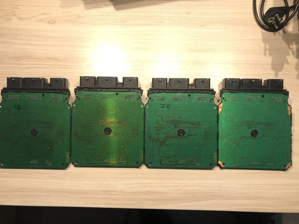  
IMG_3108.JPG [ 2.79 MiB | Viewed 688 times ]

**File comment:** 4 Boards  
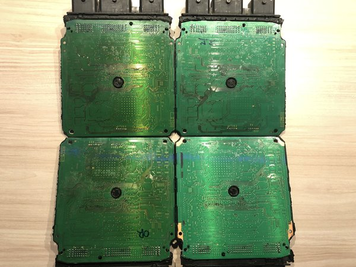  
IMG_3107.JPG [ 4.09 MiB | Viewed 688 times ]

**File comment:** 4 Boards  
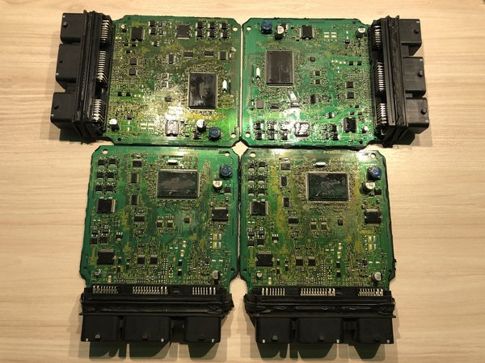  
IMG_3106.JPG [ 3.67 MiB | Viewed 688 times ]

**File comment:** 4 Boards  
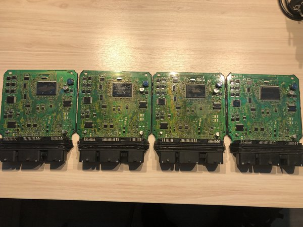  
IMG_3105.JPG [ 3.31 MiB | Viewed 688 times ]

**File comment:** PCMFlash Errors  
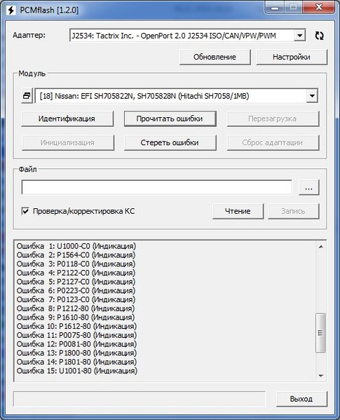  
2.jpg [ 97.92 KiB | Viewed 688 times ]

**File comment:** PCMFlash Idents  
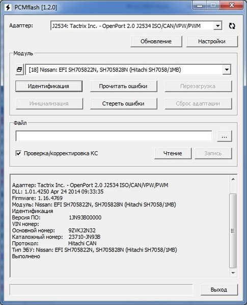  
1.jpg [ 87.15 KiB | Viewed 688 times ]

**File comment:** Writing OK

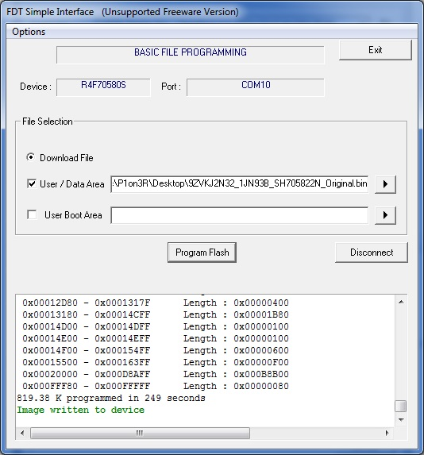

3.jpg [ 98.23 KiB | Viewed 688 times ]

**File comment:** Booting OK

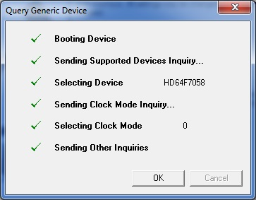

4.jpg [ 28.76 KiB | Viewed 688 times ]

### Post 44: a33b

**Posted:** Fri Jan 08, 2021 5:22 pm

**Subject:** Re: HOW TO: Unbrick and/or Hard Reflash Nissan ECU(Step-by-S

> **P1on3R wrote:**  
>  
> All 4 boards are unbricking now.  
> Thank you **Sasha_A80** 8)

What was the solution to get the boards into boot mode? Did you have to change settings?

### Post 45: Sasha_A80

**Posted:** Fri Jan 08, 2021 6:48 pm

**Subject:** Re: HOW TO: Unbrick and/or Hard Reflash Nissan ECU(Step-by-S

Once again:  
WDT circuity on Nissan MY08+ ecu relies upon WDT clocking

AND

WDT circuity on Nissan MY08+ ecu relies upon SCI port communication with throttle control chip.  
Analyze ecu bootloader code.

## Page 4

### Post 46: tomb

**Posted:** Tue Jul 12, 2022 4:01 pm

**Subject:** Re: HOW TO: Unbrick and/or Hard Reflash Nissan ECU(Step-by-S

Has anyone had any experience in unbricking the SH7059 / 370Z 1.5MB ECU's?

I can't seem to connect via Renesas Flash Toolkit..... I've tried for hours now and i'm getting frustrated!

I've been reading the 7059 hardware documentation and am confused with which pins need to go low and high.... Am I to attempt to go into Programmer Mode of Boot Mode?

Boot Mod requires the following pins;  
RES: 1  
FWE: 1  
MD0: 0/1  
MD1: 0  
MD2: 1

Programmer Mode requires:  
RES: 1  
FWE: 0/1  
MD0: 1  
MD1: 1  
MD2: 0

Any help would be appreciated!

### Post 47: P1on3R

**Posted:** Tue Sep 06, 2022 5:18 pm

**Subject:** Re: HOW TO: Unbrick and/or Hard Reflash Nissan ECU(Step-by-S

WDT signal on the board with SH705519N/SH705520N.

**Attachments:**

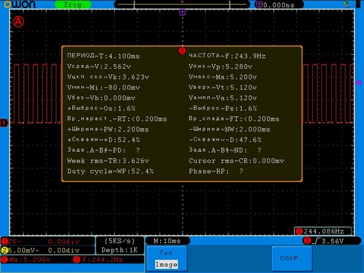  
2.jpg [ 154.19 KiB | Viewed 230 times ]

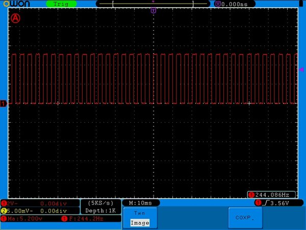  
1.jpg [ 137.2 KiB | Viewed 230 times ]

### Post 48: Alex-Angarsk

**Posted:** Thu Sep 08, 2022 1:04 pm

**Subject:** Re: HOW TO: Unbrick and/or Hard Reflash Nissan ECU(Step-by-S

> **P1on3R wrote:**  
>  
> WDT signal on the board with SH705519N/SH705520N.

SH7059 the same?

### Post 49: Alex-Angarsk

**Posted:** Thu Sep 08, 2022 1:38 pm

**Subject:** Re: HOW TO: Unbrick and/or Hard Reflash Nissan ECU(Step-by-S

> **tomb wrote:**  
>  
> Has anyone had any experience in unbricking the SH7059 / 370Z 1.5MB ECU's?  
>  
> I can't seem to connect via Renesas Flash Toolkit..... I've tried for hours now and i'm getting frustrated!  
>  
> I've been reading the 7059 hardware documentation and am confused with which pins need to go low and high.... Am I to attempt to go into Programmer Mode of Boot Mode?  
>  
> Boot Mod requires the following pins;  
> RES: 1  
> FWE: 1  
> MD0: 0/1  
> MD1: 0  
> MD2: 1  
>  
> Programmer Mode requires:  
> RES: 1  
> FWE: 0/1  
> MD0: 1  
> MD1: 1  
> MD2: 0  
>  
> Any help would be appreciated!

**Attachments:**

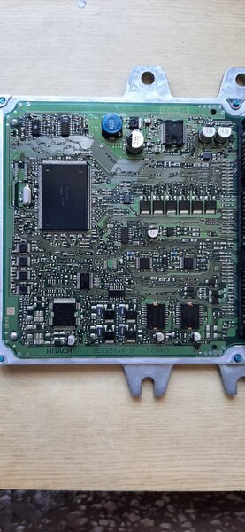  
Hitachi_SH7059.jpeg [ 139.94 KiB | Viewed 221 times ]

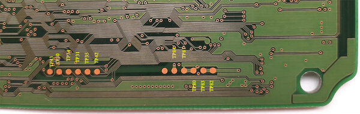  
VQ37VHR SH7059.jpg [ 155.33 KiB | Viewed 221 times ]

### Post 50: P1on3R

**Posted:** Thu Sep 08, 2022 4:23 pm

**Subject:** Re: HOW TO: Unbrick and/or Hard Reflash Nissan ECU(Step-by-S

> **Alex-Angarsk wrote:**  
>  
> > **P1on3R wrote:**  
> >  
> > WDT signal on the board with SH705519N/SH705520N.  
>  
> SH7059 the same?

SH705927N not checked/tested yet.  
Later))

### Post 51: Alex-Angarsk

**Posted:** Sun Sep 18, 2022 12:40 pm

**Subject:** Re: HOW TO: Unbrick and/or Hard Reflash Nissan ECU(Step-by-S

Renesas Flash Development Toolkit works with SH7059 ???

### Post 52: Alex-Angarsk

**Posted:** Sat Sep 24, 2022 2:26 am

**Subject:** Re: HOW TO: Unbrick and/or Hard Reflash Nissan ECU(Step-by-S

SH7059

**Attachments:**

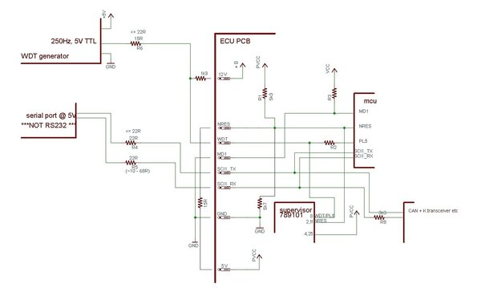  
SH7059 Bootmode.jpg [ 122.53 KiB | Viewed 199 times ]

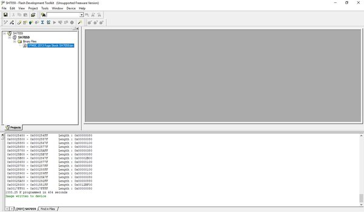  
SH7059 final.JPG [ 112.97 KiB | Viewed 199 times ]

### Post 53: Alex-Angarsk

**Posted:** Sat Sep 24, 2022 3:00 pm

**Subject:** Re: HOW TO: Unbrick and/or Hard Reflash Nissan ECU(Step-by-S

Universal UnBrick-Board for SH7055-59. Approximate size 40 х 60mm.  
Test points TP83, 84 connect only for SH7059.

**Attachments:**

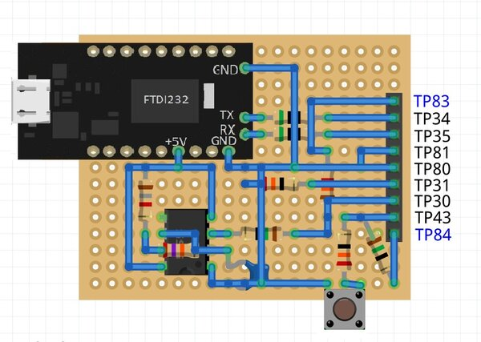  
Universal_UnBrick-Board.jpg [ 151.29 KiB | Viewed 192 times ]

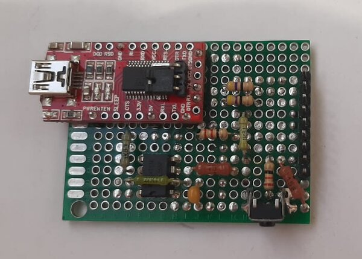  
Image 2022-09-24 at 11.49.01.jpg [ 55.58 KiB | Viewed 192 times ]

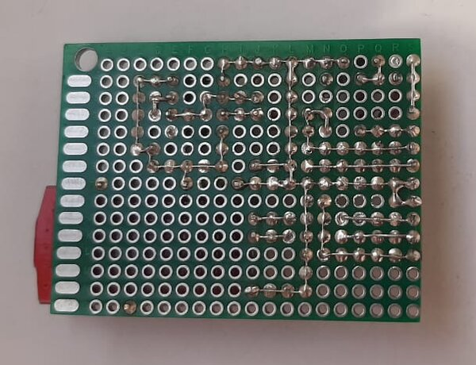  
Image 2022-09-24 at 11.49.02.jpg [ 56.91 KiB | Viewed 192 times ]

### Post 54: P1on3R

**Posted:** Sun Oct 02, 2022 10:02 pm

**Subject:** Re: HOW TO: Unbrick and/or Hard Reflash Nissan ECU(Step-by-S

WDT signal on the board with SH705927N.

**Attachments:**

  
20211211_140443.jpg [ 152.12 KiB | Viewed 159 times ]

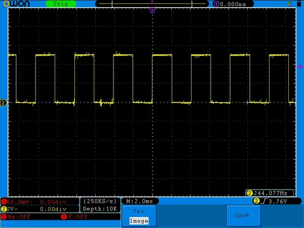  
20211211_140423.jpg [ 126.58 KiB | Viewed 159 times ]

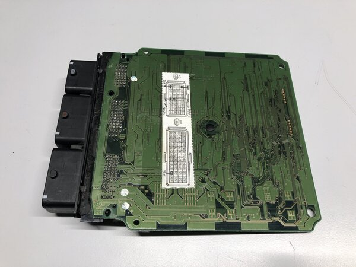  
4.jpg [ 559.23 KiB | Viewed 159 times ]

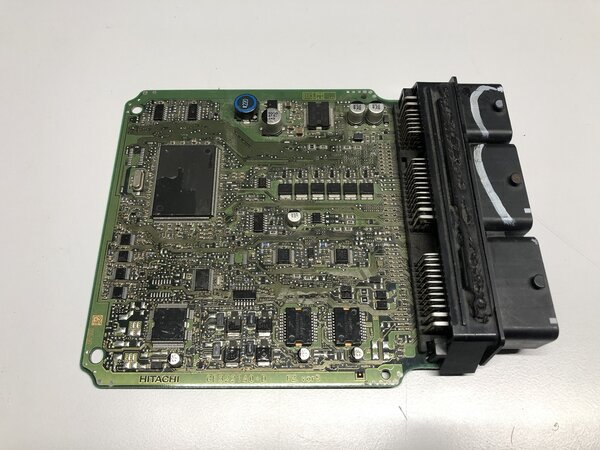  
3.jpg [ 649.2 KiB | Viewed 159 times ]

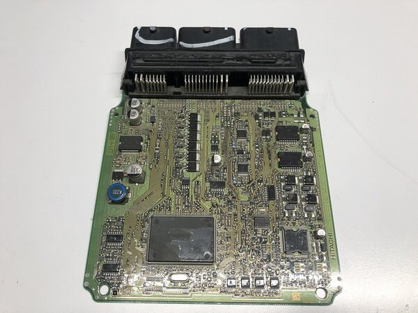  
2.jpg [ 677.66 KiB | Viewed 159 times ]

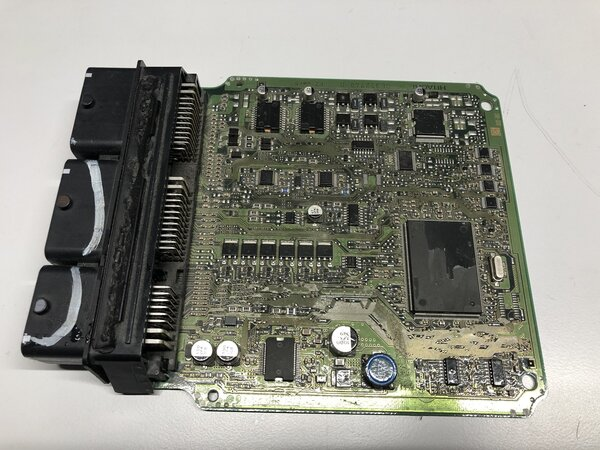  
1.jpg [ 761.15 KiB | Viewed 159 times ]

### Post 55: darkhalf

**Posted:** Sun Oct 23, 2022 9:32 am

**Subject:** Re: HOW TO: Unbrick and/or Hard Reflash Nissan ECU(Step-by-S

I've had some mixed results so far with a few ECUs here

CD001 (7055) - Will return AA for 55 command and then SCI RX echos SCI TX

Needed 5.6K pullup added to SCI RX for it to filter out cross talk/glitching from SCI TX

I've seen that SCI TX goes straight to the 9762 KLine transceiver chip on this ECU

CE815 (7058). Same setup. Works fine. ECU PCBs almost look identical apart from processor

**Attachments:**

**File comment:** CD001 TX/RX with pullup  
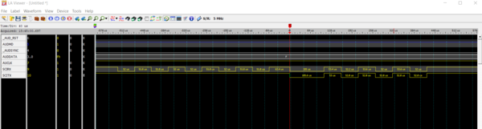  
CD001 SCI LA Viewer - 5-6 pullup.png [ 51.27 KiB | Viewed 141 times ]

**File comment:** CE815 : Correct response bytes  
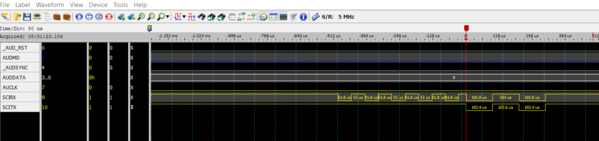  
CE815 SCI Init response.png [ 40.1 KiB | Viewed 141 times ]

**File comment:** CE815: Supported device  
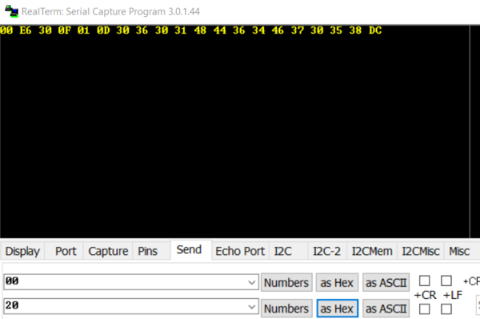  
CE815 Init Supported Device.png [ 41.04 KiB | Viewed 141 times ]

**File comment:** CD001 TX/RX with pullup. Note no extra bytes  
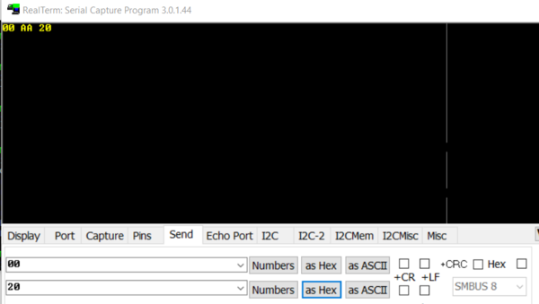  
CD001 SCI LA Viewer - 5-6 pullup2.png [ 42.18 KiB | Viewed 141 times ]

**File comment:** CD001 TX/RX with reflection. Noise on FT232 RX  
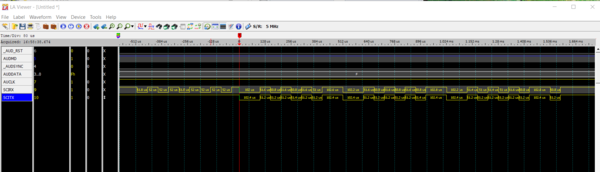  
CD001 SCI LA Viewer - No pullup.png [ 61.08 KiB | Viewed 141 times ]

### Post 56: darkhalf

**Posted:** Sun Oct 23, 2022 10:57 am

**Subject:** Re: HOW TO: Unbrick and/or Hard Reflash Nissan ECU(Step-by-S

> **Quote:**  
>  
> Test points TP83, 84 connect only for SH7059.

Thanks for this. This works fine (so pullup WRES to VCC via 15ohms, I used 20 ohms)

Also you used 1.5K pullup on WDG clock line. I've used 1K (which is same as Piasini pullup on their WDG diagrams) and that works the same. Just manged to unbrick my 370Z ECU :D

**Attachments:**

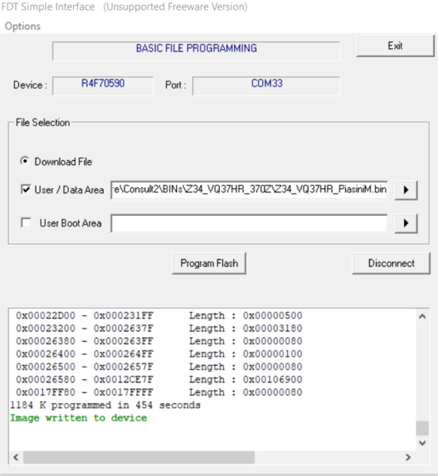  
FDT 370Z ECU recover.png [ 97.9 KiB | Viewed 138 times ]

### Post 57: nadkewl@gmail.com

**Posted:** Mon Feb 13, 2023 1:54 am

**Subject:** Re: HOW TO: Unbrick and/or Hard Reflash Nissan ECU(Step-by-S

Hi Guys,

I have a bit of an issue. I have a 350z APS TT with REVUP ECU, CF43A. ECU is licensed via UPREV. I wanted to apply an updated tune and then when the update finished programming reaching 100% and the ROmeditor said to switch off the car but it seems the ECU did not go out of programming mode and the fan kept running. So i tried to unplug the uprev and reconnect the cable but it did not change and also switched of the car with the same symptom. I have disconnected the battery etc etc. and nothing worked. I contacted UPREV and they said I need to ship the ecu to them. I did just that and await their reply.

So I though, ok, i also have a race 350z with a REVUP ECU with UPREV in it so let me try that one. So I programmed the NATS and keys etc and tried to flash it again as I dont race with my race 350z now and changing the ECU to a Haltec soon. Problem is, the same thing happened as per the first ECU!! Quite pissed off about it I searched the NET and I stumbled on this thread and built a 555 timing board. I can connect and flash the CF43A.BIN file to the ECU but when I plug it back in its just does the same, fans running and ECU still in programming mode.

Are there any settings I need to setup in Renesas Toolkit because I tried flashing a few times and it still does the same?

I will post the log of the flash. Maybe I am missing something? I need some help guys?

Cheers!

### Post 58: Alex-Angarsk

**Posted:** Sat Feb 18, 2023 3:52 pm

**Subject:** Re: HOW TO: Unbrick and/or Hard Reflash Nissan ECU(Step-by-S

You are flashing the original CF43A.BIN ? Show a screenshot of the end of the .bin firmware. Did you read the dump after the firmware and compared it with the original one?

### Post 59: nadkewl@gmail.com

**Posted:** Sat Feb 18, 2023 6:53 pm

**Subject:** Re: HOW TO: Unbrick and/or Hard Reflash Nissan ECU(Step-by-S

Hi Alex, yes, I am flashing the original CF43A.bin file, I hope. I am a noob on around this Toolkit software so please bare with me :)

I do not know the Renesas Toolkit software at all so I have been following any SH7055/58 tutorials but I am not winning here and need some guidance please?

So when I open a New project on the Toolkit and select the SH7058 or Generic Boot (HD64F7058) and then select the CF43.bin file it open(I can share this file with you then you can check if its the correct one?). I see there is a "Boot user flash" area with nothing in it. Is it suppose to be like this and if not where can i find this Boot file? Also when I do a Blank Check it says the "User boot Flash" is empty??

I have Anydesk if someone can please guide me in the correct direction will be so much appreciated!!!

Here is the flash log,

OS: Windows 10 (Windows 8) [Non-Admin]  
Processing file :"C:\Nissan\CF43A.bin"  
Loading image file : 'C:\Nissan\CF43A.bin'  
Operation on User Flash  
Loaded the Write operation module  
Writing image to device... [0x00000000 - 0x00001C7F]  
Writing image to device... [0x00002000 - 0x0000447F]  
Writing image to device... [0x00004480 - 0x000044FF]  
Writing image to device... [0x00004500 - 0x0000457F]  
Writing image to device... [0x00004580 - 0x00004A7F]  
Writing image to device... [0x00004A80 - 0x00004B7F]  
Writing image to device... [0x00004C00 - 0x0000617F]  
Writing image to device... [0x00006180 - 0x0000627F]  
Writing image to device... [0x00006300 - 0x0000B17F]  
Writing image to device... [0x0000B180 - 0x0000C27F]  
Writing image to device... [0x0000C280 - 0x0000CAFF]  
Writing image to device... [0x0000CB00 - 0x000A7B7F]  
Writing image to device... [0x000A9000 - 0x000A91FF]  
Writing image to device... [0x000A9200 - 0x000A92FF]  
Writing image to device... [0x000A9300 - 0x000A93FF]  
Writing image to device... [0x000AFF80 - 0x000B01FF]  
Writing image to device... [0x000B0200 - 0x000B0BFF]  
Writing image to device... [0x000B0C00 - 0x000B15FF]  
Writing image to device... [0x000B1600 - 0x000B1FFF]  
Writing image to device... [0x000B2000 - 0x000B29FF]  
Writing image to device... [0x000B2A00 - 0x000B31FF]  
Writing image to device... [0x000E0400 - 0x000E04FF]  
Writing image to device... [0x000E1000 - 0x000E11FF]  
Writing image to device... [0x000E1280 - 0x000E13FF]  
Writing image to device... [0x000E1400 - 0x000E14FF]  
Writing image to device... [0x000FFF80 - 0x000FFFFF]  
Data programmed at the following positions:  
0x00000000 - 0x00001C7F Length : 0x00001C80  
0x00002000 - 0x0000447F Length : 0x00002480  
0x00004480 - 0x000044FF Length : 0x00000080  
0x00004500 - 0x0000457F Length : 0x00000080  
0x00004580 - 0x00004A7F Length : 0x00000500  
0x00004A80 - 0x00004B7F Length : 0x00000100  
0x00004C00 - 0x0000617F Length : 0x00001580  
0x00006180 - 0x0000627F Length : 0x00000100  
0x00006300 - 0x0000B17F Length : 0x00004E80  
0x0000B180 - 0x0000C27F Length : 0x00001100  
0x0000C280 - 0x0000CAFF Length : 0x00000880  
0x0000CB00 - 0x000A7B7F Length : 0x0009B080  
0x000A9000 - 0x000A91FF Length : 0x00000200  
0x000A9200 - 0x000A92FF Length : 0x00000100  
0x000A9300 - 0x000A93FF Length : 0x00000100  
0x000AFF80 - 0x000B01FF Length : 0x00000280  
0x000B0200 - 0x000B0BFF Length : 0x00000A00  
0x000B0C00 - 0x000B15FF Length : 0x00000A00  
0x000B1600 - 0x000B1FFF Length : 0x00000A00  
0x000B2000 - 0x000B29FF Length : 0x00000A00  
0x000B2A00 - 0x000B31FF Length : 0x00000800  
0x000E0400 - 0x000E04FF Length : 0x00000100  
0x000E1000 - 0x000E11FF Length : 0x00000200  
0x000E1280 - 0x000E13FF Length : 0x00000180  
0x000E1400 - 0x000E14FF Length : 0x00000100  
0x000FFF80 - 0x000FFFFF Length : 0x00000080  
684.88 K programmed in 176 seconds  
Image written to device

**Attachments:**

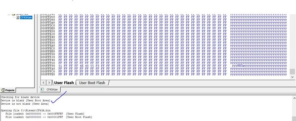  
Boot.JPG [ 216.63 KiB | Viewed 101 times ]

### Post 60: Alex-Angarsk

**Posted:** Sat Feb 18, 2023 8:51 pm

**Subject:** Re: HOW TO: Unbrick and/or Hard Reflash Nissan ECU(Step-by-S

Attach .bin and I'll tell you if it's correct or not. [https://www.drive2.ru/l/6520480/](<https://www.drive2.ru/l/6520480/>)

## Page 5

### Post 61: nadkewl@gmail.com

**Posted:** Sun Feb 19, 2023 12:36 am

**Subject:** Re: HOW TO: Unbrick and/or Hard Reflash Nissan ECU(Step-by-S

Got I working... I just needed to disconnect the 555 timing board I built and when I did that the ECU works 100% again!

Cheers!

### Post 62: Alex-Angarsk

**Posted:** Sun Feb 19, 2023 12:01 pm

**Subject:** Re: HOW TO: Unbrick and/or Hard Reflash Nissan ECU(Step-by-S

> **nadkewl@gmail.com wrote:**  
>  
> Here is the rom

.bin is correct.

### Post 63: mix0000

**Posted:** Mon May 26, 2025 11:19 am

**Subject:** Re: HOW TO: Unbrick and/or Hard Reflash Nissan ECU(Step-by-S

The power was turned off and bricked during the ECU write.  
I want to restore it, but I can't figure out the connection terminals.  
23710-AQ806  
nissan  
hitachi sh7055  
a56-001 L18  
I have the equipment to connect, so if I can just figure out the terminals, I should be fine.

**Attachments:**

[A56-001.7z](<https://www.romraider.com/forum/download/file.php?id=43021>) [1.05 MiB]  
Downloaded 12 times

### Post 64: fenugrec

**Posted:** Fri Sep 26, 2025 4:22 am

**Subject:** Re: HOW TO: Unbrick and/or Hard Reflash Nissan ECU(Step-by-S

[https://nissanecu.miraheze.org/wiki/Bootmode](<https://nissanecu.miraheze.org/wiki/Bootmode>)

Plus the datasheet for the 7055, and a multimeter, you can trace the required pins - they usually end up on testpoints on the PCB
